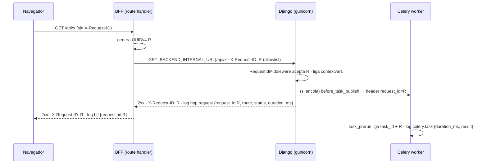

# Diseño — Módulo de Plataforma (fundaciones)

> Entrada: `spec.sdd.md` (*Clarified* 0.2.0 → *Designed* 0.3.0) + `clarifications.md` (Q-029..Q-060).
> ADR nuevo: `context/decisions/ADR-0005-contrato-openapi.md` (Propuesto).
> Aplicado en este diseño: **Q-055** y **Q-056** (default recomendado), **Q-057** (decidida por el usuario
> 2026-10-31: Claude puede mergear solo con certeza total, §3.7.4). Preguntas nuevas: **Q-058, Q-059, Q-060**
> (ninguna bloquea *Designed*). Este diseño **no** crea tablas ni reglas de negocio.

## 1. Resumen de la solución
Se construye el "chasis" del Hub sin negocio: carpetas por capa; `docker compose` de seis servicios (`db`,
`redis`, `backend`, `worker`, `beat`, `frontend`) que se levanta con **un comando**; settings Django validados por
`pydantic-settings` que no arrancan si falta algo; logger `structlog` JSON único con `request_id` navegador → BFF →
Django → Celery; `/healthz` y `/readyz`; errores `problem+json`; throttling base; contrato OpenAPI commiteado; y un
pipeline de GitHub Actions de nueve checks encadenados (fail-fast) más el check `zona-roja`. Cada regla de la
constitución que 00 hace cumplir (C-01, C-02, C-06, C-09, C-14..C-17) es un script o test que **falla el build**,
probado contra casos sintéticos que demuestran que detecta la violación. El frontend trae solo el esqueleto del
shell `(dashboard)` y la infraestructura común (tokens, tema, estados de carga, cliente tipado, BFF pass-through).

## 2. Cobertura de la spec
> Una fila sin destino = hueco. **Huecos: ninguno.** ⚠ = depende de una decisión del usuario que no cambia el
> diseño técnico: RF-PLT-04 (Q-048) y el paso "publicar" de RF-PLT-13 (Q-054).

### 2.1 Reglas (RN)
| RN | Dónde vive |
|---|---|
| RN-PLT-01 | `infra/docker-compose.yml` + comando único (§3.4, §10.2); prerrequisitos del host (§3.6, Q-060) |
| RN-PLT-02 | `backend/config/settings/env.py` (`PlatformEnv`, `load_env()`), `prod.py` (`DEBUG=False`, `SECRET_KEY` fuerte) (§3.2.2) |
| RN-PLT-03 | `.env.example` (raíz, solo plataforma) + `.gitignore` + test de paridad AC-05 |
| RN-PLT-04 | `spikes/.env.example` separado; Compose con `environment:` explícito, sin `env_file:` (D-04); test AC-06 |
| RN-PLT-05 | `apps/common/logging/` + `config/gunicorn.conf.py` + señal `setup_logging` de Celery; ruff `T20` (§3.2.3) |
| RN-PLT-06 | `apps/common/domain/redaction.py` + `middleware/access_log.py` (allowlist de campos, plantilla de ruta); `django.server`/`django.request` silenciados |
| RN-PLT-07 | `apps/common/domain/request_id.py`, `middleware/request_id.py`, `celery_signals.py`; BFF `lib/server/request-id.ts` |
| RN-PLT-08 | `scripts/check_file_size.py` en pre-commit y job `file-size` (excluye `context/legacy-source/`, Q-055) |
| RN-PLT-09 | `backend/tests/architecture/` (`ast_rules.py` + sintéticos) en job `architecture` (§3.2.6) |
| RN-PLT-10 | `apps/common/migration_lint/` + comandos `lint_migrations`, `check_migrations_roundtrip` + `makemigrations --check` en job `migrations` (§3.2.7) |
| RN-PLT-11 | `.github/workflows/ci.yml`: 9 pasos encadenados por `needs` (§3.5) |
| RN-PLT-12 | `.github/rulesets/main.json`, `workflows/zona-roja.yml`, `scripts/check_zona_roja.py`, `.github/zona-roja-paths.txt` (§3.7) |
| RN-PLT-13 | `.gitleaks.toml` en pre-commit y job `secrets`; secret scanning + push protection verificados por `scripts/verify_repo_protection.py` |
| RN-PLT-14 | `uv.lock` / `pnpm-lock.yaml` congelados; imágenes por tag + digest; `scripts/audit_deps.py` + `audit_exceptions.toml`; `.github/dependabot.yml` (§3.5, §8) |
| RN-PLT-15 | ADR-0005: `export_openapi`, `apps/common/api/schema.py`, `specs/_contracts/openapi.yaml`, `frontend/src/types/api.d.ts`; `api/exceptions.py` + `api/problems.py` (§3.2.4, §6) |
| RN-PLT-16 | BFF `app/api/[...path]/route.ts` + `lib/server/*` (`server-only`); Django sin CORS; sin `NEXT_PUBLIC_`; `frontend/scripts/check-client-bundle.ts` (§3.3.3) |
| RN-PLT-17 | `apps/common/health/{checks,views}.py`; rutas en `config/urls.py` (§3.2.5) |
| RN-PLT-18 | `permissions: contents: read` en workflows; `scripts/check_workflows.py`; procedimiento previo a publicar (§3.7.4) |
| RN-PLT-19 | `apps/common/api/throttling.py` (caché Redis, default `300/min`); `Retry-After` preservado (§3.2.4) |
| RN-PLT-20 | `backend/tests/architecture/test_AC_PLT_31_no_float_money.py` + `allowlists.py` (§3.2.6) |

### 2.2 Requisitos funcionales (RF) y no funcionales (RNF)
| RF / RNF | Dónde vive |
|---|---|
| RF-PLT-01 | Árbol §3.1; `.gitattributes`, `.editorconfig`, `infra/scripts/README.md`, `scripts/` |
| RF-PLT-02 | `infra/docker-compose.yml` (§3.4: healthchecks, `service_healthy`, volúmenes nombrados, una réplica de `beat`, `migrate` solo en `backend`); recrear BD §10.2 |
| RF-PLT-03 | `backend/config/settings/{env,base,dev,test,prod}.py` (§3.2.2) |
| RF-PLT-04 | ⚠ Q-048. `.env.example` + `spikes/.env.example` + tests AC-05/06 |
| RF-PLT-05 | `apps/common/logging/`, `middleware/`, `celery_signals.py` (§3.2.3) |
| RF-PLT-06 | `frontend/src/app/api/[...path]/route.ts`, `lib/server/backend-proxy.ts`, `request-id.ts` (§3.3.3) |
| RF-PLT-07 | `/healthz`, `/readyz` + `app/api/health/route.ts`; `scripts/smoke_stack.py` en job `build` |
| RF-PLT-08 | `scripts/check_file_size.py` + `scripts/tests/test_AC_PLT_13_check_file_size.py` |
| RF-PLT-09 | `backend/tests/architecture/` (§3.2.6) |
| RF-PLT-10 | `apps/common/migration_lint/`, comandos de gestión, job `migrations` (§3.2.7) |
| RF-PLT-11 | `ci.yml`, `zona-roja.yml`, `.github/actions/setup/action.yml`, `scripts/check_workflows.py` (§3.5) |
| RF-PLT-12 | `.pre-commit-config.yaml` + `scripts/precommit_frontend.py` (§3.6) |
| RF-PLT-13 | `.github/rulesets/main.json`, `.github/repo-settings.expected.json`, `scripts/verify_repo_protection.py`; ⚠ publicar: Q-054 (§3.7) |
| RF-PLT-14 | ADR-0005; `export_openapi [--check]`, `pnpm openapi:types`, job `typecheck`; `api/exceptions.py` |
| RF-PLT-15 | `frontend/src/lib/*`, `components/*`, `components/shell/*`, `app/(dashboard)/*` (§3.3) |
| RF-PLT-16 | Sección "Comandos de desarrollo" de `AGENTS.md` (contenido §10.2) + regla de merge de Q-057 |
| RF-PLT-17 | `api/throttling.py`, `REST_FRAMEWORK["DEFAULT_THROTTLE_*"]`, `CACHES` Redis |
| RF-PLT-18 | `test_AC_PLT_31_no_float_money.py` + `allowlists.py` |
| RF-PLT-19 | `apps/common/feature_flags.py` + `FEATURE_*` en `env.py` (§3.2.8) |
| RNF-PLT-01 | Dockerfiles multi-stage, usuario no root, `--no-dev`, `.dockerignore`; verificación en `build` (§3.4.2) |
| RNF-PLT-02 | `config/settings/prod.py` + `test_AC_PLT_04_check_deploy.py` |
| RNF-PLT-03 | `access_log.py` (`duration_ms`, `status`), `celery_signals.py` (`duration_ms`, `result`) |
| RNF-PLT-04 | pre-commit solo con hooks rápidos (§3.6) |
| RNF-PLT-05 | `.gitattributes` LF, `mixed-line-ending`, gunicorn `--reload-engine poll`, `WATCHPACK_POLLING`, `git ls-files -z` |
| RNF-PLT-06 | CI sin secretos; tests sin red (servicios locales del job); solo `deps-audit` sale a la red y no es un test |
| RNF-PLT-07 | Lockfiles congelados + digests + `packageManager` con hash (§8) |
| RNF-PLT-08 | `scripts/check_coverage.py` + `scripts/coverage_thresholds.toml` (job `coverage`) |
| RNF-PLT-09 | `[tool.mypy]` en `backend/pyproject.toml` (overrides estrictos) + `tsconfig.json` `strict` (§3.2.9) |

## 3. Componentes y capas

### 3.1 Árbol de carpetas inicial
> Solo lo que crea 00 (sin apps de negocio). Ningún archivo de código previsto pasa de ~250 líneas.
```
/  .editorconfig · .gitattributes · .gitignore (+ spikes/.env, coverage/, caches) · .gitleaks.toml
   .pre-commit-config.yaml · .env.example (solo plataforma) · ruff.toml (config única de ruff)
spikes/.env.example                 # SOLO variables de spikes; nadie del Hub las lee
scripts/                            # Python 3.12; stdlib salvo check_workflows (PyYAML del env del backend)
   check_file_size.py · check_workflows.py · check_zona_roja.py · check_coverage.py · coverage_thresholds.toml
   audit_deps.py · audit_exceptions.toml · verify_repo_protection.py · github_api.py (REST mínimo, paginado)
   glob_paths.py (globs con **) · precommit_frontend.py · smoke_stack.py · pytest.ini (-p no:django) · tests/
.github/  workflows/{ci.yml, zona-roja.yml} · actions/setup/action.yml · dependabot.yml
   zona-roja-paths.txt · rulesets/main.json · repo-settings.expected.json
infra/    README.md · docker-compose.yml (dev) · docker-compose.ci.yml (override paso 9) · scripts/README.md (bitácora)
specs/_contracts/openapi.yaml       # generado (ADR-0005)
backend/  Dockerfile · .dockerignore · pyproject.toml · uv.lock · manage.py
   config/  __init__.py (celery_app) · settings/{env,base,dev,test,prod}.py · urls.py (pública/prod)
            urls_dev.py (+ /api/dev/*) · celery.py · wsgi.py · gunicorn.conf.py
   apps/common/  apps.py (ready → señales) · tasks.py (diagnostic_ping) · feature_flags.py · celery_signals.py
      domain/{request_id,redaction}.py                       # puro, mypy strict
      logging/{__init__ (get_logger), setup, processors, context}.py
      middleware/{request_id,access_log}.py
      api/{problems,exceptions,throttling,schema,dev_views}.py
      health/{checks,views,beat_alive}.py
      migration_lint/rules.py
      management/commands/{export_openapi,lint_migrations,check_migrations_roundtrip}.py
   tests/  conftest.py · architecture/ (+synthetic/) · config/ · logging/ · api/ (urls_test.py) · health/
           migrations/ (+synthetic_apps/, settings_synthetic.py) · typing/ (+synthetic/) · contract/
frontend/ Dockerfile · .dockerignore · .nvmrc (24.22.2) · package.json · pnpm-lock.yaml · next.config.ts
   tsconfig.json · eslint.config.mjs · .prettierrc.json · tailwind.config.ts · postcss.config.mjs
   vitest.config.mts · vitest.setup.ts · scripts/check-client-bundle.ts
   src/app/  layout.tsx · providers.tsx · globals.css · page.tsx (→ /inicio)
             (dashboard)/{layout.tsx, inicio/{page,loading,error}.tsx, configuracion/{page,loading,error}.tsx}
             api/{health/route.ts, [...path]/route.ts}
   src/components/  PageSkeleton.tsx · EmptyState.tsx · ErrorNotice.tsx
             shell/{AppShell,TopBar,NavMenu,OrgBranchSelectorPlaceholder,UserMenuPlaceholder}.tsx
   src/modules/  home/components/HomeEmpty.tsx · settings/{settings-sections.ts, components/SettingsSectionList.tsx}
   src/hooks/ (.gitkeep) · src/types/api.d.ts (GENERADO)
   src/lib/  design-tokens.ts · theme.ts · query-client.ts · api-client.ts · problem.ts
             server/{env,request-id,backend-proxy,log}.ts      # import "server-only"
```

### 3.2 Backend

#### 3.2.1 Capas
00 no tiene casos de uso de negocio: todo es infraestructura en `apps/common`. **`domain/`** (puro, sin Django):
`request_id.py`, `redaction.py`; `api/problems.py` también es puro. **`api/`** fino: `exceptions.py` traduce
excepciones a `build_problem()`; `dev_views.py` solo llama a `diagnostic_ping.delay()`. **`services/`,
`selectors/`, `models.py` no existen en 00** (Q-044, Q-053), pero los tests de arquitectura ya vigilan `services/`.

#### 3.2.2 Settings (RN-PLT-02/03/04, RF-PLT-03/04, RNF-PLT-02)
`config/settings/env.py` es la **única** pieza que lee el entorno (AC-06 lo verifica):

| Variable | Validación | Notas por entorno |
|---|---|---|
| `DJANGO_SETTINGS_MODULE` | la lee Django | `config.settings.{dev,test,prod}` |
| `DJANGO_SECRET_KEY` | `SecretStr`; en prod ≥ 50 chars, ≥ 5 distintos, sin `django-insecure` | obligatoria siempre |
| `DJANGO_DEBUG` | bool estricto, default `False` | `true` solo en dev; en prod `true` → no arranca |
| `DJANGO_ALLOWED_HOSTS` | CSV (`NoDecode` + validador), sin vacíos | defaults en dev/test; obligatoria en prod |
| `DATABASE_URL` | `PostgresDsn` → `DATABASES` (`connect_timeout=2`) | obligatoria |
| `REDIS_URL` | `RedisDsn`; broker de Celery y caché (`KEY_PREFIX="hub"`) | obligatoria |
| `APP_VERSION` | str, default `unknown` | la imagen la fija con `ARG GIT_SHA` |
| `LOG_LEVEL` | `DEBUG/INFO/WARNING/ERROR`, default `INFO` | |
| `API_THROTTLE_ANON_RATE` | formato DRF, default `300/min` | |
| `TRUSTED_PROXY_COUNT` | int ≥ 0 → `NUM_PROXIES`, default 0 | se fija con el hosting (Q-020) |
| `FEATURE_<NOMBRE>` | bool estricto; un `FEATURE_*` no registrado → no arranca | §3.2.8 |

- `PlatformEnv(BaseSettings)` con `env_file=None` (**nunca** lee `.env`: lo inyecta Compose/hosting),
  `case_sensitive=True`, `extra="ignore"`. `prod.py` usa `ProdEnv` (sin defaults en lo obligatorio +
  `model_validator` de `DEBUG`).
- `load_env()` captura `ValidationError` y lanza `ImproperlyConfigured(...) from None` con un mensaje armado desde
  `errors(include_input=False, include_url=False)`: solo nombre de variable y tipo de error. Ningún valor llega al
  mensaje ni a la traza encadenada (AC-03 por construcción).
- `base.py`: `INSTALLED_APPS = ["rest_framework", "drf_spectacular", "apps.common"]`, **sin ningún
  `django.contrib.*`** (D-03). `REST_FRAMEWORK`: auth `[]`, permisos `[AllowAny]` (provisorio hasta 01),
  `UNAUTHENTICATED_USER=None`, solo `JSONRenderer`/`JSONParser`, `EXCEPTION_HANDLER`, throttle, `AutoSchema` de
  spectacular. `USE_TZ=True`, `TIME_ZONE="America/Argentina/Buenos_Aires"`, `LANGUAGE_CODE="es-ar"`. `MIDDLEWARE`:
  `RequestId` → `Security` → `AccessLog` → `Common` → `Csrf` → `XFrameOptions`.
- `dev.py`/`test.py`: `ROOT_URLCONF="config.urls_dev"`; `test.py` usa `LocMemCache` salvo tests `integration`.
- `prod.py`: `ROOT_URLCONF="config.urls"`; `SECURE_SSL_REDIRECT` con `SECURE_REDIRECT_EXEMPT=[r"^healthz$",
  r"^readyz$"]` (healthchecks internos por HTTP); `SECURE_PROXY_SSL_HEADER`; HSTS 1 año + subdominios; cookies
  `Secure`; `X_FRAME_OPTIONS="DENY"`. `SECURE_HSTS_PRELOAD=False` con `security.W021` silenciado **explícitamente
  y comentado** hasta tener dominio (Q-020): es el único silenciamiento permitido (otro requiere ADR).
- **`.env.example`** (raíz): solo plataforma, por grupos (Django, BD, Redis, Compose `POSTGRES_*`, frontend servidor
  `BACKEND_INTERNAL_URL`, observabilidad, flags comentados); valores ficticios de baja entropía para que gitleaks no
  los marque. **`spikes/.env.example`**: claves de spikes con `<ver .env: NOMBRE>`; el real `spikes/.env` está
  ignorado. Compose interpola del `.env` raíz pero declara cada variable en `environment:`: aunque queden
  variables de spikes en el `.env` raíz, **no entran a ningún contenedor** (D-04). ⚠ Mover las claves de spikes del
  `.env` actual a `spikes/.env` es acción del usuario (Q-048).
- Tests (`backend/tests/config/`): **AC-03** subproceso con `config.settings.prod` y cada obligatoria
  ausente/inválida → stderr nombra la variable y no contiene ningún valor centinela; **AC-04** subproceso
  `check --deploy --fail-level WARNING` → 0; con `DJANGO_DEBUG=true` → no arranca; **AC-05** paridad en los dos
  sentidos entre `PlatformEnv.model_fields` + `COMPOSE_ONLY_VARS` + `FRONTEND_SERVER_VARS` y `.env.example`;
  **AC-06** AST sobre `config/` y `apps/`: ninguna lectura de entorno fuera de `env.py`, ningún campo con patrón
  `^(MP|MERCADOPAGO|CLOVER|PAYWAY|DECIDIR|PRISMA)_` ni igual a una clave de `spikes/.env.example`.

#### 3.2.3 Logging y correlación (RN-PLT-05/06/07, RF-PLT-05, RNF-PLT-03)
- **Una sola configuración** (`logging/setup.py`) para Django (`LOGGING`), gunicorn (`logconfig_dict`) y Celery
  (señal `setup_logging`, `worker_hijack_root_logger=False`). Procesadores: `merge_contextvars` → `add_log_level`
  (`level`) → nombre del logger como `component` → `TimeStamper(fmt="iso", utc=True, key="timestamp")` → redacción
  → `format_exc_info` → `EventRenamer("message")` → `JSONRenderer`; los loggers stdlib pasan por
  `ProcessorFormatter`. Un evento por línea, solo `StreamHandler(stdout)`. `organization_id` solo si está ligado
  (`context.bind_organization()`, lo usa 02).
- **Redacción** (`domain/redaction.py`, recursiva): claves `authorization`, `cookie`, `set-cookie`, `x-api-key` y
  toda clave que contenga `token`, `secret`, `password`, `passwd`, `api_key`, `apikey`, `credential`, `signature`
  → `"[REDACTED]"`. Nunca se loguean `request.META`, body, query string ni path crudo.
- **`RequestIdMiddleware`** (primero): acepta `X-Request-ID` solo si `len == 36` y
  `re.fullmatch(r"[0-9a-f]{8}-[0-9a-f]{4}-4[0-9a-f]{3}-[89ab][0-9a-f]{3}-[0-9a-f]{12}", v.lower())` (`fullmatch`: un
  `\n` final no pasa); si no, `uuid4()`. Liga contextvars y devuelve el header en **toda** respuesta.
- **`AccessLogMiddleware`**: evento `http.request` con `method`, `route` (`resolver_match.route`, la plantilla;
  `"<unmatched>"` si no resolvió), `status`, `duration_ms`. Nivel `DEBUG` para `/healthz`/`/readyz` (no tapan logs),
  `INFO` < 500, `ERROR` ≥ 500. `django.server` y `django.request` silenciados (loguean el path crudo).
- **Servidor**: gunicorn en dev y prod (dev: `--reload --reload-engine poll`, D-05), `accesslog=None`.
- **Celery** (`celery_signals.py`): `before_task_publish` agrega `request_id` a los headers; `task_prerun` lo lee
  de `task.request` (atributo o `headers`), lo valida con el mismo parser y liga `task_id`, `request_id`,
  `task_name`; `task_postrun`/`task_failure` loguean `celery.task` con `duration_ms` y `result` (estado), sin
  args/kwargs/retorno. Worker y beat con `-q` (sin banner de texto), `broker_connection_retry_on_startup=True`,
  `broker_connection_max_retries=None`: reintenta con backoff logueando cada intento; si no se recupera, el
  healthcheck lo marca `unhealthy`.

#### 3.2.4 Errores, throttling y esquema (RN-PLT-15/19, RF-PLT-14/17)
- **`problem+json`** siempre (aunque `Accept` no lo pida): `type` (`urn:hub:problem:<code>`), `title`, `status`,
  `code`, `detail` (nunca en 500), `request_id`, `errors[]` (solo `validation_error`). Excepción no DRF → `500
  internal_error`; la traza **solo** al log. Se preservan headers de la excepción (`Retry-After`,
  `WWW-Authenticate`). `handler404`/`handler500` de `config.urls` devuelven el mismo sobre bajo `/api/`.
- **Throttle**: `HubAnonRateThrottle(AnonRateThrottle)` con `get_rate()` leyendo
  `settings.API_THROTTLE_ANON_RATE` en runtime (DRF fija la tasa al importar). Caché `RedisCache` de Django.
  **Fail-open** si Redis falla (log `WARNING throttle.cache_unavailable`, D-06). Health sin throttle (vistas Django
  planas). ⚠ Detrás del BFF todo el navegador comparte la IP del contenedor `frontend`: irrelevante en 00; **01**
  define la clave (IP real con `TRUSTED_PROXY_COUNT` o usuario).
- **Esquema** (`api/schema.py`): `TITLE`, `VERSION=API_VERSION="0.1.0"`, `SERVE_INCLUDE_SCHEMA=False`,
  `COMPONENT_SPLIT_REQUEST=True`, componente `Problem` en `APPEND_COMPONENTS` y hook que lo agrega como respuesta
  `4XX`/`5XX`. En 00 `paths: {}`.

#### 3.2.5 Health (RN-PLT-17)
`/healthz`: sin dependencias, `{"status":"ok","version":APP_VERSION[:7]}`. `/readyz`: `SELECT 1`
(`connect_timeout=2`) + `Redis.ping()` (`socket_timeout=1`); 200 `{"status":"ready"}` o 503
`{"status":"unavailable"}`; el detalle va al log `WARNING health.not_ready`, nunca al cuerpo. Ambos `Cache-Control:
no-store`, sin auth ni throttle.

#### 3.2.6 Arquitectura y C-02 (RN-PLT-09/20)
`tests/architecture/ast_rules.py` (puro: `root: Path` → `list[Violation(path, line, rule, msg)]`):
- **C-09**: en `apps/**` (incluidos tests de apps) y `config/**`, resuelve `Import`, `ImportFrom` (también
  relativos) e `importlib.import_module("<literal>")`; violación si importa `apps.integrations.providers.<x>` desde
  fuera de `apps/integrations/providers/<x>/` (incluye un proveedor importando a otro). `ADAPTER_IMPORT_ALLOWLIST`
  vacía (la usará 03 para el registro).
- **C-01**: en `apps/*/services/**`, todo `.objects`, `._default_manager`, `._base_manager` es violación;
  `ALLOWED_TENANT_MANAGERS` vacío (lo completa 02).
- **C-02**: `FloatField` en `apps/**/models.py` y `apps/**/models/**`; `float(...)` en
  `apps/**/{domain,services,selectors,api}/**`; nada bajo `/providers/`. `FLOAT_ALLOWLIST`.
- `allowlists.py`: `AllowEntry(path, symbol, reason)`; falla si `reason` está vacío o si una entrada no coincide con
  ninguna violación (sin entradas muertas).
- Cada regla: el código real da 0 violaciones y los sintéticos de `synthetic/` (`charges/services/bad_provider_import.py`,
  `integrations/providers/mercadopago/ok_internal_import.py`, `providers/clover/bad_cross_provider.py`,
  `charges/services/bad_objects.py`, `charges/domain/bad_float.py`, `charges/models.py` con `FloatField`,
  `providers/mercadopago/ok_float.py`, una entrada allowlisteada) dan exactamente lo esperado. `synthetic/` se
  analiza por AST, nunca se importa; está en `norecursedirs` y en `exclude` de mypy.

#### 3.2.7 Migraciones (RN-PLT-10)
- `makemigrations --check --dry-run`.
- `lint_migrations` (sobre migraciones de módulos `apps.*` vía `MigrationLoader`): nombre `^\d{4}_auto_` → error
  (`0001_initial` se acepta); operación con `reversible is False` (`RunPython` sin `reverse_code`, `RunSQL` sin
  `reverse_sql`, recorriendo `SeparateDatabaseAndState`); `RunPython` junto a cualquier otra operación → error. El
  reverso `RunPython.noop` se acepta.
- `check_migrations_roundtrip`: `migrate` → `migrate <app> zero` por app propia en orden inverso de dependencias →
  `migrate`. BD descartable = contenedor de servicio nuevo del job.
- Sintéticos (`tests/migrations/synthetic_apps/`): `good_reversible`, `bad_irreversible`, `bad_mixed`,
  `bad_autoname`, `missing_migration`; los comandos corren **en subproceso** con
  `tests.migrations.settings_synthetic` (BD `hub_synthetic` creada y borrada por el test), porque el registro de
  apps no cambia en caliente. Cobertura de subprocesos: `[tool.coverage.run] patch = ["subprocess"]`.
- En 00 las apps reales no tienen migraciones: el job corre igual para estar activo desde el primer commit.

#### 3.2.8 Feature flags (RF-PLT-19)
`feature_flags.py`: `REGISTRY: dict[str, str]` (vacío en 00) e `is_enabled(name)` (nombre no registrado →
`KeyError`). `env.py` lee `FEATURE_<NOMBRE>` (default `False`); un `FEATURE_*` no registrado impide arrancar
(un typo no deja algo "creído apagado"). Flags por organización: 02.

#### 3.2.9 Type-check (RNF-PLT-09)
`[tool.mypy]`: plugins de django-stubs y drf-stubs, `check_untyped_defs`, `warn_unused_ignores`, `exclude` de
`synthetic/`; `django_settings_module="config.settings.test"` (el job define variables ficticias). **mypy no admite
`strict` por módulo**: el override de `apps.common.*` y `apps.*.domain.*` enumera los flags equivalentes
(`disallow_untyped_defs`, `disallow_incomplete_defs`, `disallow_untyped_calls`, `disallow_untyped_decorators`,
`disallow_any_generics`, `disallow_subclassing_any`, `warn_return_any`, `no_implicit_reexport`, `strict_equality`,
`extra_checks`). mypy corre sobre `backend/` y `scripts/`. AC-21: `mypy.api.run` sobre sintéticos
`apps/common/untyped.py` y `apps/demo/domain/untyped.py` (fallan) y `apps/demo/services/untyped.py` (pasa).

### 3.3 Frontend

#### 3.3.1 Base visual (`07 §1–§2`)
`lib/design-tokens.ts` (colores, radio, tipografía, espaciado; **paleta provisoria neutra**, no hay marca) →
`lib/theme.ts` (`createTheme`) y `tailwind.config.ts` (`theme.extend`, `prefix: "tw-"`, `corePlugins.preflight:
false`; Tailwind 3.4, D-07). `app/providers.tsx`: `AppRouterCacheProvider` de `@mui/material-nextjs` (subpath del
adaptador para la mayor de Next instalada; el paquete exporta `./*`, confirmar al implementar) + `ThemeProvider` +
`CssBaseline` + `QueryClientProvider`. `PageSkeleton` (`variant: table|form|detail`), `EmptyState`, `ErrorNotice`
(`Alert` + "Reintentar" → `onRetry`).

#### 3.3.2 Shell `(dashboard)` (AC-PLT-28, spec §14)
`AppShell` = `TopBar` (título; `OrgBranchSelectorPlaceholder`: selects "Empresa"/"Sucursal" deshabilitados,
"Disponible con SPEC-02"; `UserMenuPlaceholder` deshabilitado, SPEC-01) + `NavMenu` (`Drawer` permanente en `md+`,
temporal en móvil; Inicio `/inicio`, Configuración `/configuracion`, activo por `usePathname()`). Inicio →
`HomeEmpty` (`EmptyState`, texto neutro). Configuración → `SettingsSectionList` con las 9 secciones de `07 §5.3`
(`settings-sections.ts`), cada una deshabilitada con un `Chip` del módulo (01, 02, 04, 05, 08, 11, 12/14).
`loading.tsx` = `PageSkeleton`; `error.tsx` = `ErrorNotice` con `onRetry={reset}`. Páginas finas: la lógica está
en `modules/` (cuenta para cobertura). Sin protección de rutas ni datos.

#### 3.3.3 BFF y cliente (RN-PLT-07/16, AC-PLT-10/29)
- `app/api/[...path]/route.ts` (`runtime="nodejs"`, `dynamic="force-dynamic"`) → `lib/server/backend-proxy.ts`:
  (1) `X-Request-ID` validado con la misma regla, si no `crypto.randomUUID()`; (2) destino
  `new URL("/api/" + segmentos, BACKEND_INTERNAL_URL)`, rechaza `..`, `\`, `%2f`, `%5c` (`400 bff.bad_path`) y
  exige el mismo origen; conserva query string; (3) headers de request en allowlist: `accept`, `accept-language`,
  `content-type`, `x-request-id` (06 sumará `idempotency-key`); **nunca** `cookie` (01 la convierte acá en
  `Authorization`, ADR-0004); (4) body en stream, timeout 30 s; (5) respuesta tal cual con headers en allowlist
  (`content-type`, `retry-after`, `x-request-id`, `content-disposition`, `cache-control`), sin `set-cookie`, siempre
  con `X-Request-ID`; (6) backend caído → `502 bff.upstream_unavailable`, timeout → `504 bff.upstream_timeout`.
  `log.ts`: una línea JSON por request (`timestamp`, `level`, `component:"bff"`, `request_id`, `method`, `status`,
  `duration_ms`; sin path).
- `app/api/health/route.ts` → `{"status":"ok"}` sin llamar al backend.
- `lib/server/env.ts`: `BACKEND_INTERNAL_URL` leída en runtime, validada. **Ninguna** variable `NEXT_PUBLIC_` en 00.
  `lib/server/*` con `import "server-only"`.
- `lib/api-client.ts`: `openapi-fetch` `createClient<paths>({ baseUrl: "" })` (mismo origen) + middleware que
  convierte `problem+json` en `ApiError` (`problem.ts`). `lib/query-client.ts`: `retry: 1` queries / `0` mutations,
  `staleTime: 30_000`, `refetchOnWindowFocus: false`.
- `next.config.ts`: `output: "standalone"`, `poweredByHeader: false`, `reactStrictMode`, headers `nosniff`,
  `Referrer-Policy: same-origin`, `X-Frame-Options: DENY`, `Permissions-Policy` mínima (CSP: 01).
  `NEXT_TELEMETRY_DISABLED=1`.
- **AC-29**: el stage `builder` construye con valores centinela para las variables solo-servidor y
  `scripts/check-client-bundle.ts` falla si algún centinela o nombre de variable no `NEXT_PUBLIC_` aparece en
  `.next/static/**`.

### 3.4 Infraestructura

#### 3.4.1 Servicios (`infra/docker-compose.yml`, `name: centro-pagos`)
| Servicio | Imagen / build | Comando | Healthcheck (int/timeout/retries/start) | `depends_on` (`service_healthy`) | Puerto (`127.0.0.1`) |
|---|---|---|---|---|---|
| `db` | `postgres:17.11-trixie@sha256:…` | default | `pg_isready -U $$POSTGRES_USER -d $$POSTGRES_DB` (5s/3s/10/10s) | — | 5432 |
| `redis` | `redis:7.4.12-bookworm@sha256:…` | `redis-server --save "" --appendonly no` | `redis-cli ping \| grep -q PONG` (5s/3s/10/5s) | — | — |
| `backend` | `../backend`, target `dev` | `migrate --noinput && gunicorn -c config/gunicorn.conf.py config.wsgi` | `python -c` urllib → `/readyz` == 200 (10s/3s/5/30s) | `db`, `redis` | 8000 |
| `worker` | imagen de `backend` | `celery -A config -q worker -l INFO --concurrency 2` (**sin migrate**) | `celery -A config inspect ping -d celery@$$HOSTNAME --timeout 5` (30s/10s/3/30s) | `db`, `redis`, `backend` | — |
| `beat` | imagen de `backend`, `replicas: 1` | `celery -A config -q beat -l INFO --schedule /tmp/beat/schedule` (**sin migrate**) | `python -m apps.common.health.beat_alive` (mtime < 300 s, `beat_max_loop_interval=60`) (60s/5s/3/90s) | `redis`, `backend` | — |
| `frontend` | `../frontend`, target `dev` | `pnpm install --frozen-lockfile && pnpm dev --hostname 0.0.0.0` | `node -e` fetch `/api/health` == 200 (10s/5s/10/60s) | `backend` | 3000 |

- Volúmenes nombrados: `pgdata`, `frontend_node_modules`, `pnpm_store`; `beat` usa `tmpfs: /tmp/beat`; Redis sin
  persistencia. Bind mounts de dev bajo `/repo/…` (`../backend:/repo/backend`, `../frontend:/repo/frontend`,
  `../specs/_contracts:/repo/specs/_contracts`, `../.env.example` y `../spikes/.env.example` `:ro` en `backend`)
  para que las rutas relativas sean iguales en contenedor, host y CI. Venv del backend en `/opt/venv`
  (`UV_PROJECT_ENVIRONMENT`) para que el bind mount no lo tape.
- `environment:` por servicio con `${VAR:?falta VAR en .env}` (fail-fast). `frontend`:
  `BACKEND_INTERNAL_URL=http://backend:8000`, `WATCHPACK_POLLING=true`, `NEXT_TELEMETRY_DISABLED=1`.
- `migrate` corre **solo** en `backend`; `worker` y `beat` esperan a `backend` sano (sin carrera).

#### 3.4.2 Imágenes
- **backend**: `ghcr.io/astral-sh/uv:0.13.6` → `builder` (`python:3.12.16-slim-trixie@sha256`,
  `UV_COMPILE_BYTECODE=1`, `UV_LINK_MODE=copy`, `UV_PYTHON_DOWNLOADS=never`, primero `pyproject.toml`+`uv.lock` y
  `uv sync --frozen --no-dev --no-install-project`) → `dev` (+ grupo dev) → `runtime` (copia `/opt/venv`, `apps/`,
  `config/`, `manage.py`, **sin** `tests/`; usuario `app` uid 10001; `ARG GIT_SHA` → `APP_VERSION`; label
  `org.opencontainers.image.revision`). `psycopg[binary]`: no se compila nada.
- **frontend**: `node:24.22.2-trixie-slim@sha256` + `corepack enable` → `deps` (`pnpm install --frozen-lockfile`) →
  `dev` → `builder` (`pnpm build` con centinelas + bundle check) → `runtime` (`.next/standalone`, `.next/static`,
  `public`; `USER node`; `node server.js`).
- `.dockerignore` en ambos: `**/.env*` (sin excepciones), `.git`, `node_modules`, `.next`, `.venv`, `__pycache__`,
  `coverage`, caches.
- **Override de CI** (`docker-compose.ci.yml`): imágenes `hub-backend:${GIT_SHA}`/`hub-frontend:${GIT_SHA}` (target
  `runtime`), sin bind mounts, `config.settings.prod` con valores ficticios inline (no secretos).

### 3.5 Pipeline de GitHub Actions (RN-PLT-11/13/14/18)
**`ci.yml`**: `on: pull_request (main)`, `push (main, tags v*)`; **nunca** `pull_request_target` ni
`workflow_run`. `permissions: {contents: read}` top-level; ningún job pide más. `concurrency` por ref con
`cancel-in-progress` en PR. Todas las `uses:` por **SHA completo** (Dependabot las actualiza). `env` común no
secreto: `DJANGO_SETTINGS_MODULE=config.settings.test`, `DJANGO_SECRET_KEY=ci-only-not-a-secret…`,
`DATABASE_URL`/`REDIS_URL` a `localhost`, `TZ=UTC`. Acción compuesta `.github/actions/setup` (inputs `python`,
`node`): `setup-uv` (caché por `uv.lock`) + `uv python install 3.12.16` + `uv sync --frozen`; `pnpm/action-setup` +
`setup-node` (`.nvmrc`, caché pnpm) + `pnpm install --frozen-lockfile`.

| Paso | Job = check requerido | `needs` | Qué corre | Falla si | AC |
|---|---|---|---|---|---|
| 1 | `lint` | — | `ruff check` · `ruff format --check` · `eslint --max-warnings 0` · `prettier --check` · `check_workflows.py` | cualquier hallazgo | 12, 20, 33 |
| 2 | `file-size` | `lint` | `check_file_size.py` sobre lo trackeado | archivo > 400 líneas fuera de exclusiones | 13 |
| 3 | `secrets` | `file-size` | `fetch-depth: 0`; `gitleaks git` (imagen v8.30.1 por digest) sobre `base..head` (PR) o `before..after` (push), `--redact`; test AC-19 | hallazgo | 19 |
| 3 | `deps-audit` | `file-size` | `audit_deps.py`: pip-audit sobre `uv export --frozen --all-groups` + `pnpm audit --json`, severidad vía OSV, excepciones con vencimiento | alta/crítica sin excepción vigente; excepción vencida; severidad desconocida (= alta) | 26 |
| 4 | `typecheck` | `secrets`, `deps-audit` | `mypy . ../scripts` · `export_openapi --check` · `pnpm openapi:types && git diff --exit-code -- frontend/src/types` · `tsc --noEmit` | error de tipos; contrato/tipos con diff (lo imprime) | 21, 23 |
| 5 | `architecture` | `typecheck` | `pytest tests/architecture` | violación C-01/02/09 o allowlist inválida | 14, 15, 31 |
| 6 | `tests` | `architecture` | servicios Postgres 17.11 y Redis 7.4.12; `pytest --cov` (backend, con `integration`) · `pytest -c scripts/pytest.ini scripts/tests --cov=scripts` · `vitest --coverage`; sube reportes (`upload-artifact`, 7 días) | test rojo | todos los de test automático |
| 7 | `coverage` | `tests` | `check_coverage.py` con `coverage_thresholds.toml` | backend < 85 % líneas o ramas (`apps/`+`config/`); `scripts/` < 85 %; frontend < 70 % líneas en `lib/ hooks/ modules/`; umbrales por ruta extra (p. ej. `apps/integrations/core` ≥ 90 % al existir) | 22 |
| 8 | `migrations` | `coverage` | `makemigrations --check --dry-run` · `lint_migrations` · `check_migrations_roundtrip` | faltante, irreversible, mezclada, `auto_` | 16–18 |
| 9 | `build` | `migrations` | `build-push-action` ×2 (`push: false`, `load: true`, target `runtime`, `GIT_SHA`, tags `:${sha}` y `:vX.Y.Z` en tags, caché `type=gha`); `id -u` ≠ 0; `smoke_stack.py` | build roto; bundle con centinelas; root; smoke rojo | 01, 02, 10, 25, 29 |

- **Fail-fast**: cadena estricta por `needs`. Ningún job requerido tiene `if:` **a nivel de job** (un check
  requerido *skipped* por `if:` cuenta como aprobado en GitHub); `if:` a nivel de step se permite.
- **`smoke_stack.py`**: `up -d --wait --wait-timeout 180` con el override de CI; `/readyz` 200; `/healthz` 200 con
  `version` = SHA corto; `/api/health` del BFF 200; `GET :3000/api/__smoke__` sin `X-Request-ID` → 404
  `problem+json` y el `X-Request-ID` devuelto aparece en `docker compose logs backend` (AC-10 E2E); `stop redis` →
  `/readyz` 503 sin hosts/versiones/trazas y `/healthz` 200 (AC-02 E2E); `down -v` siempre. Cada fallo nombra el
  servicio o check.
- **`check_workflows.py`** (AC-33; ojo: PyYAML parsea la clave `on` como `True`): falla con `pull_request_target`
  o `workflow_run`; sin `permissions` top-level o con algún scope que no sea `read`/`none`; permiso de escritura
  de job fuera de `JOB_PERMISSION_ALLOWLIST` (vacía en 00); `secrets.*` distinto de `GITHUB_TOKEN`; `uses:` remoto
  sin SHA de 40 hex; `if:` a nivel de job requerido. Nombra archivo y regla.
- **Dependabot**: semanal; `uv` (`/backend`), `npm` (`/frontend`, entiende pnpm), `docker` (ambos Dockerfiles),
  `github-actions`. Parches agrupados; mayores por separado. pre-commit: `pre-commit autoupdate` mensual a mano.

### 3.6 Pre-commit (RF-PLT-12, RNF-PLT-04)
**Prerrequisitos del host** (interpretación de "herramientas de pre-commit" de RN-PLT-01, **Q-060**): Docker
Desktop (engine Linux) con Compose v2, Git, Python 3.12 + `pre-commit`, Node 24 + pnpm (`corepack enable`) con
`pnpm --dir frontend install` una vez, solo para eslint/prettier. `uv` en el host es opcional. Los `node_modules`
del host y del contenedor están separados (volumen), así que los binarios nativos no se pisan.

`.pre-commit-config.yaml` (fixers y linters excluyen `^context/legacy-source/`; gitleaks no — Q-055):
1. `pre-commit-hooks` v6.0.0: `mixed-line-ending --fix=lf` (AC-27), `end-of-file-fixer`, `trailing-whitespace`
   (sin `*.md`), `check-yaml/toml/json`, `check-merge-conflict`, `check-case-conflict`,
   `check-added-large-files --maxkb=500`, `detect-private-key`, `no-commit-to-branch --branch main`.
2. `ruff-pre-commit` v0.17.3: `ruff-check --fix`, `ruff-format`.
3. Local `check-file-size` (`language: python`, stdlib, `types_or: [python, ts, tsx, jsx]`).
4. Local `eslint` y `prettier` (`language: system`, `python scripts/precommit_frontend.py …`, `files: ^frontend/`;
   quita el prefijo, excluye `src/types/`, llama a `pnpm --dir frontend exec`).
5. `gitleaks` v8.30.1 (staged, `--redact`).

Sin tests, mypy ni migraciones. Si un hook reformatea, se vuelve a stagear (documentado).
**`ruff.toml`**: `py312`, `line-length 100`, `extend-exclude = ["context/legacy-source", "**/migrations",
"frontend"]` (comentado, Q-055), `force-exclude = true` (vale aunque pre-commit pase archivos explícitos),
`select = [E, F, W, I, B, UP, S, T20, DJ, PT, SIM, RUF, N, C4, DTZ, LOG, G]`; `per-file-ignores`: tests → `S101`,
`scripts/**` → `T20` (son CLIs). **`.gitattributes`**: `* text=auto eol=lf` + binarios. **`.gitleaks.toml`**:
`useDefault = true`; allowlist `regexes = ['''<ver \.env: [A-Z][A-Z0-9_]*>''']` con `regexTarget = "secret"` (una
línea con placeholder **y** un token real sigue fallando); sin allowlist por ruta.

### 3.7 Gobierno del repo público (RN-PLT-12/13/18, RF-PLT-13)

#### 3.7.1 Ruleset y ajustes
- `.github/rulesets/main.json`: `target: branch`, `enforcement: active`, `include: ["~DEFAULT_BRANCH"]`,
  **`bypass_actors: []`**; reglas `deletion`, `non_fast_forward`, `required_linear_history`, `pull_request`
  (`required_approving_review_count: 0`, `dismiss_stale_reviews_on_push`, `allowed_merge_methods: ["squash"]`),
  `required_status_checks` (`strict` = rama al día; los 11 checks de §6.3, con `integration_id` de GitHub Actions
  para que no se puedan "firmar" con un status externo).
- `.github/repo-settings.expected.json`: solo squash, `delete_branch_on_merge`, secret scanning y push protection
  activos, permisos por defecto de Actions `read`, `can_approve_pull_request_reviews=false`, aprobación de
  workflows de forks para `first_time_contributors`, label `zona-roja` existente.
- Los aplica **el dueño a mano** (`gh api --method POST repos/{o}/{r}/rulesets --input .github/rulesets/main.json`
  + UI). Los checks tienen que haber corrido una vez antes de marcarlos requeridos.

#### 3.7.2 Rutas de zona roja (`.github/zona-roja-paths.txt`, globs con `**`)
- Contratos: `specs/_contracts/**`, `backend/apps/common/api/{exceptions,problems,schema}.py`.
- Migraciones y su chequeo: `backend/**/migrations/**`, `backend/apps/common/migration_lint/**`, los comandos
  `lint_migrations.py` y `check_migrations_roundtrip.py`, `backend/tests/migrations/**`.
- Arquitectura: `backend/tests/architecture/**`.
- Módulos rojos futuros (listados ya para no olvidarlos): `backend/apps/{identity,tenancy,integrations,charges,webhooks,reconciliation}/**`.
  01 agrega `frontend/src/app/api/**` y `frontend/src/lib/server/**`.
- **Provisorio, Q-058 (el propio gate):** `.github/**`, `scripts/**`, `.pre-commit-config.yaml`, `.gitleaks.toml`,
  `ruff.toml`, `backend/pyproject.toml`, `frontend/{tsconfig.json,eslint.config.mjs,vitest.config.mts}` — sin esto
  un PR puede neutralizar un check modificándolo en el mismo PR.

#### 3.7.3 Check `zona-roja` (`zona-roja.yml` + `check_zona_roja.py`)
- `on: pull_request` (`opened, synchronize, reopened, labeled, unlabeled, ready_for_review`), **sin `paths:`** (un
  check requerido filtrado queda pendiente para siempre). `permissions: contents/pull-requests/issues: read`.
- **No ejecuta código del PR**: checkout de `pull_request.base.sha` y corre script y lista **de la rama base**
  (D-09); los datos del PR (archivos con rutas viejas y nuevas, labels, comentarios, permisos) salen de la API.
- Lógica: sin rutas rojas y sin label → pasa; rutas rojas sin label → falla; con label → busca comentarios con
  `<!-- reviewer-verdict -->`, `Veredicto del reviewer: APROBADO|RECHAZADO` y `SHA: <40 hex>`; descarta autores sin
  permiso `write/maintain/admin` (`/collaborators/{u}/permission`) y los que no citan `head.sha`; el último (por
  `updated_at`) tiene que ser `APROBADO`. Error de API → falla ("no verificado"). Resumen en `$GITHUB_STEP_SUMMARY`.
- Flujo: el reviewer publica el veredicto con la cuenta del dueño y se re-ejecuta el check (`gh run rerun` o
  quitar/poner el label). Sin `issue_comment` (D-08). Push nuevo → el veredicto deja de citar `head.sha` → rojo.

#### 3.7.4 Verificación, publicación y merge
- `scripts/verify_repo_protection.py`: lo corre **el dueño** con un token de admin propio en `GH_TOKEN` (nunca
  commiteado; el `GITHUB_TOKEN` de Actions no ve `bypass_actors` ni `security_and_analysis`, D-11). Compara
  `/rulesets`, `/repos/{o}/{r}`, `/actions/permissions/workflow`, `/actions/permissions/fork-pr-contributor-approval`
  y `/labels/zona-roja` contra los JSON esperados; imprime cada diferencia; exit 0 / 1 (difiere) / 2 (API falló).
  Complemento manual de AC-24: PR de sacrificio con un check rojo figura como no mergeable.
- **Antes de pasar a público** (checklist en `infra/README.md`, bloqueado por **Q-054**): rotar tokens de MP y App
  Secret de Clover → `gitleaks git --log-opts="--all"` con 0 hallazgos → aplicar la opción de Q-054 → cambiar
  visibilidad → aplicar ruleset y ajustes → `verify_repo_protection.py` en verde.
- **Merge a `main` (Q-057, decidida por el usuario 2026-10-31):** Claude abre los PR y **puede mergear solo si está
  100 % seguro de que no rompe producción**: (1) los 11 checks requeridos en verde **en el último commit** del PR;
  (2) veredicto del `reviewer` sin bloqueantes (obligatorio en zona roja, citando ese SHA); (3) DoD de la tarea
  completo; (4) squash. Para mergear exactamente lo verificado usa `gh pr merge --squash --match-head-commit
  <sha>`. **Ante cualquier duda** (check flaky, re-run manual, scope drift, Q abierta, cambio de ruleset/ajustes,
  advertencias nuevas) el PR queda para que mergee el usuario. La regla va a `AGENTS.md` en la tarea de RF-PLT-16.
  Técnicamente el ruleset no distingue (0 aprobaciones, mismo token): es regla de proceso respaldada por los checks.

## 4. Flujos principales
**F1 — Request del navegador (AC-07/09/10/11)**

**F2 — Errores**: `X-Request-ID` inválido (no UUID, `\n`, 10 KB) → se reemplaza; excepción no controlada → `500
problem+json internal_error` + traza solo en log con el mismo `request_id`; throttle → `429 throttled` +
`Retry-After`; backend caído/lento → BFF `502`/`504`.
**F3 — Arranque**: `db`, `redis` sanos → `backend` migra y arranca → `/readyz` 200 → `worker`, `beat`, `frontend`
arrancan → `up --wait` vuelve 0. Redis cae: `/readyz` 503, `/healthz` 200, `backend` y `worker` `unhealthy`, el
worker reintenta logueando; al volver Redis todo vuelve a `healthy` sin intervención.
**F4 — PR a `main`**: `ci.yml` (9 pasos) + `zona-roja.yml` → si es zona roja: label + veredicto citando el SHA +
re-run → todo verde → merge squash por el usuario o por Claude según §3.7.4.

## 5. Datos
No aplica: sin tablas (Q-044, Q-053) y sin `django.contrib.*` (D-03); solo existe `django_migrations`. Las apps
sintéticas crean tablas únicamente en la BD descartable `hub_synthetic` de sus tests. Toda BD es descartable hasta 01.

## 6. Contratos

### 6.1 Endpoints
| Método | Ruta | Permisos | Response | Errores |
|---|---|---|---|---|
| GET | `/healthz` (backend) | anónimo | `200 {"status":"ok","version":"<sha7>"}`, `no-store` | — |
| GET | `/readyz` (backend) | anónimo | `200 {"status":"ready"}` | `503 {"status":"unavailable"}` sin detalle |
| GET | `/api/health` (BFF) | anónimo | `200 {"status":"ok"}` | — |
| * | `/api/{path…}` (BFF) | provisorio anónimo (01 agrega sesión) | pass-through + `X-Request-ID` | `400 bff.bad_path`, `502 bff.upstream_unavailable`, `504 bff.upstream_timeout` |
| POST | `/api/dev/diagnostic-task/` (solo dev/test) | anónimo en dev | `202 {"task_id","request_id"}` | `429` |
| GET | `/api/dev/schema/`, `/api/dev/docs/` (solo dev/test) | anónimo en dev | OpenAPI YAML / Swagger UI | — |
> En `prod` (`config.urls`) las rutas `/api/dev/*` no existen → 404 (`test_Q056_dev_routes_absent_in_prod`).
> `X-Request-ID` en toda response; sin headers `Access-Control-Allow-*` (`test_RN_PLT_16_backend_sends_no_cors_headers`).

### 6.2 Sobre de error (`application/problem+json`, RFC 9457)
`{"type":"urn:hub:problem:validation_error","title":"Datos inválidos","status":400,"code":"validation_error","detail":"…","request_id":"9b1d…","errors":[{"field":"…","code":"required","message":"…"}]}`

| `code` → HTTP | |
|---|---|
| `validation_error` 400 (con `errors[]`) · `parse_error` 400 · `not_authenticated`/`authentication_failed` 401 (desde 01) · `permission_denied` 403 · `not_found` 404 · `method_not_allowed` 405 · `not_acceptable` 406 · `unsupported_media_type` 415 · `throttled` 429 (+`Retry-After`) · `internal_error` 500 (sin `detail`) · `bff.bad_path` 400 · `bff.upstream_unavailable` 502 · `bff.upstream_timeout` 504 | Convención: `snake_case`, prefijo de módulo para errores de negocio (`charges.duplicate_reference`); cambiar o borrar un `code` publicado es incompatible (ADR-0005) |

### 6.3 Contratos operativos (fuera del OpenAPI)
Nombres de jobs = checks requeridos: `lint`, `file-size`, `secrets`, `deps-audit`, `typecheck`, `architecture`,
`tests`, `coverage`, `migrations`, `build`, `zona-roja` (renombrar uno exige actualizar el ruleset en el mismo PR;
`verify_repo_protection.py` lo detecta). Formato del veredicto (§3.7.3). Campos del log JSON (§3.2.3).

## 7. Seguridad y privacidad
- **Roles**: no hay login; todo endpoint de 00 es anónimo y sin datos; `AllowAny` es provisorio (01 pone
  denegación por defecto); diagnóstico/esquema/Swagger no existen en `prod`.
- **Aislamiento**: sin datos de negocio; C-01 vigilado por el test de arquitectura desde el primer commit; el
  logger ya soporta `organization_id`.
- **Secretos**: ninguno en repo, CI ni imágenes; errores de settings sin valores; redacción en logs; gitleaks en
  pre-commit y CI + secret scanning/push protection; variables de spikes fuera de los contenedores (D-04).
- **Repo público / supply chain**: sin `pull_request_target`/`workflow_run`; token de solo lectura; acciones por
  SHA; `zona-roja` no ejecuta código del PR; lockfiles congelados; imágenes por digest; `packageManager` con hash;
  auditoría bloqueante; Dependabot; aprobación del dueño para el primer aporte externo.
- **Entrada**: `X-Request-ID` con `fullmatch` y longitud; paths del BFF sin `..` ni separadores codificados y mismo
  origen; headers en allowlist en ambos sentidos.
- **Superficie**: sin admin, browsable API, Swagger en prod, CORS ni cookies del backend; HSTS y redirect HTTPS en
  prod (healthchecks exentos); `X-Frame-Options: DENY`. **PII**: ninguna.

## 8. Tecnologías y dependencias
> Verificadas el **2026-10-31** (PyPI, npm, Docker Hub, GitHub Releases). Versión exacta (`==` en `pyproject.toml`,
> sin `^`/`~` en `package.json`); transitivas en los lockfiles. Se respeta Q-029; **Q-059** pregunta por las que ya
> quedaron atrás. Digests `@sha256` se resuelven en la tarea de Dockerfiles.

| Ámbito | Versiones fijadas |
|---|---|
| Runtimes / imágenes | Python **3.12.16** (`python:3.12.16-slim-trixie`) · PostgreSQL **17.11** (`postgres:17.11-trixie`) · Redis **7.4.12** (`redis:7.4.12-bookworm`; no hay `trixie` para 7.4) · Node **24.22.2** (`node:24.22.2-trixie-slim`; 24 hoy en *maintenance* LTS, la activa es 26) · uv **0.13.6** · pnpm **12.16.1** (corepack, con hash) · gitleaks **v8.30.1** · pre-commit **4.7.0** (host) |
| Backend runtime | `django` **5.2.18** · `djangorestframework` **3.16.1** · `celery` **5.5.3** (→ `kombu` 5.5.4) · `redis` **5.2.1** (techo de `kombu` 5.5: `redis<=5.2.1`) · `psycopg[binary]` **3.3.6** · `pydantic-settings` **2.16.2** · `structlog` **26.1.0** · `drf-spectacular` **0.30.0** · `gunicorn` **26.2.0** |
| Backend dev | `ruff` **0.17.3** · `mypy` **1.19.1** (`django-stubs` 5.2.9 exige `<1.20`) · `django-stubs` **5.2.9** (fijada para que uv no suba a 6.x, que apunta a Django 6) · `djangorestframework-stubs` **3.16.9** · `celery-types` **0.26.0** · `pytest` **9.2.0** · `pytest-django` **4.14.0** · `pytest-cov` **7.1.0** (coverage ≥ 7.10.6, `patch=subprocess`) · `pip-audit` **2.10.1** · `pyyaml` **6.0.3** |
| Frontend deps | `next` **16.4.3** (mayor estable compatible con MUI v7: `@mui/material-nextjs` 7.3.10 acepta `^16`) · `react`/`react-dom` **19.3.1** · `@mui/material` **7.3.11** · `@mui/icons-material` **7.3.11** · `@mui/material-nextjs` **7.3.10** · `@emotion/react` **11.14.0** · `@emotion/styled` **11.14.1** · `@emotion/cache` **11.14.0** · `@tanstack/react-query` **5.105.0** · `openapi-fetch` **0.17.0** · `server-only` **0.0.1** |
| Frontend dev | `typescript` **5.9.3** (`openapi-typescript` exige `^5`) · `openapi-typescript` **7.13.0** · `@types/react`/`@types/react-dom` **19.3.0** · `@types/node` **24.19.2** (confirmar última 24.x) · `eslint` **9.39.5** (`maintenance`; ESLint 10.14.0 existe pero los plugins de `eslint-config-next` pueden no soportarlo) · `eslint-config-next` **16.4.3** · `prettier` **3.9.10** · `tailwindcss` **3.4.19** (`v3-lts`, D-07) · `postcss` **8.5.32** · `autoprefixer` **10.6.2** · `vitest`/`@vitest/coverage-v8` **5.0.5** · `vite` **8.3.5** · `@vitejs/plugin-react` **6.1.2** · `jsdom` **30.1.3** (exige Node ≥ 24.15; el local 24.14 no alcanza, los tests corren en contenedor/CI) · `@testing-library/react` **16.3.3** · `@testing-library/dom` **10.4.2** · `@testing-library/jest-dom` **7.0.1** · `@testing-library/user-event` **14.6.8** |
| Actions (por SHA) | `actions/checkout` v7.0.1 · `astral-sh/setup-uv` v10.3.3 · `actions/setup-python` (última v6.x al implementar) · `pnpm/action-setup` v6.1.0 · `actions/setup-node` v7.1.0 · `actions/upload-artifact` v7.0.2 · `actions/download-artifact` v8.0.2 · `docker/setup-buildx-action` v4.4.1 · `docker/build-push-action` v7.4.0 |
| **No** se agregan | `django-environ`/`dj-database-url` (pydantic-settings), `django-cors-headers` (CORS cerrado), `django-redis` (alcanza `RedisCache`), `django-structlog` (middleware propio, más control de redacción), `whitenoise` (sin estáticos), `drf-spectacular-sidecar` (Swagger solo dev, CDN), `zod`/`react-hook-form` (sin formularios), `watchfiles` (worker se reinicia a mano) |

## 9. Estrategia de pruebas
| Nivel | Qué cubre | AC |
|---|---|---|
| Unitarias (puras) | `request_id`, `redaction`, `problems`, reglas AST y de migración, scripts (`check_*`, `audit_deps` con OSV mockeado, `verify_repo_protection` y `check_zona_roja` con fixtures de la API, `glob_paths`); frontend `request-id`, `backend-proxy` (fetch mockeado), `problem`, `check-client-bundle` | 09, 10, 13–15, 18, 22, 24, 26, 31–33 |
| Integración (BD/Redis del job) | `/readyz` con Redis caído y real; throttle con Redis; Celery con `start_worker`; migraciones y settings en subproceso | 02–04, 11, 16–18, 30 |
| API | `problem+json`, 429 + `Retry-After`, logs JSON con `capfd` (campos, redacción, plantilla), rutas dev ausentes en prod, sin CORS | 07–09, 30, 34 |
| Contrato | `export_openapi --check`; `openapi:types` + `git diff`; `Problem` presente | 23 |
| Estáticos / config | paridad `.env.example`, lecturas de entorno, T20 sobre `print` sintético, mypy sobre sintéticos, `.gitattributes` + hook LF, Dockerfiles con `--frozen`, forma de la cadena `needs` | 05, 06, 12, 20, 21, 25, 27 |
| Componentes | `AppShell`, `HomeEmpty`, `ErrorNotice`, `SettingsSectionList`, `PageSkeleton` | 28 |
| Aislamiento | no aplica (sin datos); C-01 por arquitectura | 15 |
| Smoke (paso 9) | `smoke_stack.py` con imágenes del SHA | 01, 02, 10, 25, 29 |
| Manual | AC-01 completo en Windows 11 + Docker Desktop desde clon limpio (con hot-reload); AC-24 con el repo real; AC-19/27 en pre-commit local; AC-32 en un PR real | 01, 19, 24, 27, 32 |

**Matriz AC → test** (prefijo `test_AC_PLT_NN_`; el task-planner los asigna):
| AC | Archivo |
|---|---|
| 02 · 03–06 | `backend/tests/health/…02_readyz.py` · `backend/tests/config/…03_missing_required_var.py`, `…04_check_deploy.py`, `…05_env_example_parity.py`, `…06_no_provider_env.py` |
| 07–09 · 11 | `backend/tests/logging/…07_access_log_json.py`, `…08_redaction.py`, `…09_request_id.py` (+ `frontend/src/lib/server/request-id.test.ts`) · `…11_celery_task_log.py` |
| 10 | `frontend/src/lib/server/backend-proxy.test.ts` + smoke |
| 12 · 13 · 19 · 20 | `scripts/tests/…12_ruff_print.py` · `…13_check_file_size.py` (repo temporal, ruta con `ó`) · `…19_gitleaks.py` (token falso generado en runtime) · `…20_pipeline_chain.py` |
| 14 · 15 · 31 | `backend/tests/architecture/…14_adapter_boundary.py`, `…15_no_raw_objects_in_services.py`, `…31_no_float_money.py` |
| 16–18 | `backend/tests/migrations/…16_missing_migration.py`, `…17_reversibility.py`, `…18_names_and_mixing.py` |
| 21 | `backend/tests/typing/…21_mypy_strict.py` + `scripts/tests/…21_tsconfig_strict.py` |
| 22 · 24–27 · 32 · 33 | `scripts/tests/…22_check_coverage.py`, `…24_verify_repo_protection.py`, `…25_dockerfiles.py`, `…26_audit_deps.py`, `…27_line_endings.py`, `…32_zona_roja.py`, `…33_check_workflows.py` |
| 23 | `backend/tests/contract/…23_openapi_up_to_date.py` + `git diff` de tipos en `typecheck` |
| 28 · 29 | `frontend/src/components/shell/AppShell.test.tsx`, `modules/home/components/HomeEmpty.test.tsx`, `components/ErrorNotice.test.tsx` · `frontend/scripts/check-client-bundle.test.ts` |
| 30 · 34 | `backend/tests/api/…30_throttle_429.py`, `…34_problem_json.py` |
| 01 | manual + smoke |

Reglas: reloj fijo donde importe la hora (vencimientos de auditoría); ningún test con red externa; secretos de
prueba generados en runtime; sintéticos fuera de la recolección de pytest y de mypy.

## 10. Migración y despliegue
### 10.1 Migraciones, flags, rollback
Sin migraciones propias; al llegar 01 (usuario custom + `auth`/`contenttypes`) hay que recrear la BD (`down -v`),
documentado (Q-053). Flags: mecanismo listo, sin flags. Paso 10 fuera de alcance (Q-020/Q-049): el paso 9 deja
imágenes con el SHA (y `vX.Y.Z` en tags) para que el rollback sea redeployar el tag anterior. Gobierno: checks
corridos una vez → ruleset (después de publicar, Q-054).

### 10.2 "Comandos de desarrollo" para `AGENTS.md` (desde la raíz; PowerShell o bash; `DC` = `docker compose -f infra/docker-compose.yml`)
| Para | Comando |
|---|---|
| Primera vez | `copy .env.example .env` · `pre-commit install` · `corepack enable` · `pnpm --dir frontend install` |
| Levantar todo | `docker compose -f infra/docker-compose.yml --env-file .env up -d --build --wait` |
| Logs / bajar | `DC logs -f backend worker` · `DC down` |
| Recrear la BD | `DC down -v` y volver a levantar (borra todos los volúmenes; BD descartable hasta 01) |
| Tests | `DC exec backend pytest` · `DC exec frontend pnpm test` |
| Lint rápido / tipos | `pre-commit run --all-files` · `DC exec backend mypy . ../scripts` · `pnpm --dir frontend typecheck` |
| Regenerar contrato | `DC exec backend python manage.py export_openapi` → `pnpm --dir frontend openapi:types` |
| Migraciones | `DC exec backend sh -c "python manage.py makemigrations --check --dry-run && python manage.py lint_migrations && python manage.py check_migrations_roundtrip"` |
| Reiniciar worker/beat | `DC restart worker beat` |
| Verificar protección (dueño) | `python scripts/verify_repo_protection.py` con `GH_TOKEN` de admin |

## 11. Riesgos técnicos y decisiones
### 11.1 Decisiones
| ID | Decisión | Por qué / alternativa descartada |
|---|---|---|
| D-01 | Contrato OpenAPI code-first commiteado + tipos generados + diff en CI | **ADR-0005** |
| D-02 | Cadena estricta de 9 pasos (`deps-audit` comparte el 3 con `secrets`) | RN-PLT-11 literal; más lento que paralelizar, compensado con cachés |
| D-03 | 00 no instala ningún `django.contrib.*` | Q-053 sin tablas `auth_user` que 01 tendría que tirar; DRF anda con `UNAUTHENTICATED_USER=None` |
| D-04 | `spikes/.env.example` separado + `environment:` explícito en Compose | las variables de spikes no llegan a ningún contenedor; la paridad no necesita marcadores frágiles |
| D-05 | gunicorn también en dev (`--reload-engine poll`) | logs del servidor en JSON (runserver imprime texto y paths crudos); reload por polling en Windows |
| D-06 | Throttle fail-open si Redis falla | disponibilidad; `/readyz` ya lo señala; 01/07/11 pueden elegir fail-closed |
| D-07 | Tailwind 3.4.19 (`v3-lts`) | `07 §1` usa API de v3 (`tw-`, `preflight: false`, `tailwind.config.ts`); v4 exige editar `07` (Q-059) |
| D-08 | `zona-roja` sin `issue_comment`, re-run manual tras el veredicto | `issue_comment` corre en la base y no actualiza el check del SHA del PR; evita un workflow disparable por cualquiera |
| D-09 | `zona-roja` corre script y lista de la rama base | el PR no puede modificar el check que lo evalúa |
| D-10 | `pip-audit` envuelto por `audit_deps.py` | `pip-audit` no da severidad ni vencimientos; OSV + severidad desconocida = alta |
| D-11 | `verify_repo_protection.py` lo corre el dueño | `GITHUB_TOKEN` no ve bypass ni seguridad; un token admin en CI sería un secreto en un repo público |
| D-12 | `ruff.toml` único en la raíz con `force-exclude` | cubre `backend/` y `scripts/` y excluye el legacy aunque pre-commit pase archivos explícitos |
| D-13 | Q-055 (default): `context/legacy-source/` fuera de ruff, `check_file_size` y fixers; sigue en gitleaks | evidencia de solo lectura; Q-055 pedía aplicar la recomendación si no había respuesta |
| D-14 | Q-056 (default): `/api/dev/*` solo en `config.urls_dev` | en `prod` no existen; lo verifica un test |
| D-15 | Q-057 (decidida): Claude mergea solo con certeza total; si no, mergea el usuario | §3.7.4; `--match-head-commit` asegura mergear el SHA verificado |
> Si el usuario quiere ADR propio para D-03, D-07 o D-09, el orquestador asigna el número (no se crean acá para no
> chocar con los ADR que se escriben en paralelo).

### 11.2 Riesgos
| Riesgo | Mitigación |
|---|---|
| Versiones de Q-029 superadas (MUI v9, Celery 5.6, DRF 3.18) y `kombu` 5.5 obliga a `redis-py` 5.2.1 (dic-2024) | **Q-059**; se fija Q-029 hasta que el usuario decida; cambiarlo antes del primer scaffold cuesta pocas líneas |
| Pipeline secuencial ~8–12 min por PR | cachés uv/pnpm/Docker; pre-commit atrapa lo barato; `cancel-in-progress` |
| Hot-reload en Windows; Turbopack (dev por defecto en Next 16) puede ignorar `WATCHPACK_POLLING` | probar en la tarea de Compose; plan B `next dev --webpack`; documentar en `infra/README.md` |
| Healthcheck de `beat` por mtime es indirecto | umbral 300 s con loop de 60 s; si da falsos positivos, se baja a "proceso vivo" y se documenta |
| Throttle por IP detrás del BFF | sin efecto en 00; 01 define la clave |
| Un PR puede neutralizar checks (`pull_request` corre su código) | D-09 + rutas del gate como zona roja (**Q-058**, provisorio) |
| Merge por el agente con 0 aprobaciones | criterios cerrados de §3.7.4 + `--match-head-commit`; ante duda, mergea el usuario |
| `W021` silenciado | único permitido, comentado, hasta tener dominio (Q-020) |
| Node local 24.14 < 24.15 (`jsdom` 30) | tests en contenedor/CI; recomendado actualizar el Node local a 24.22.x |
| `@mui/material-nextjs` 7.3.10 y su subpath para Next 16 (`exports: "./*"`) | verificar en la primera tarea de frontend; si falta, usar el de la mayor anterior (el peer ya acepta `^16`) |

## Handoff
```
Hecho: design.md (RN/RF/RNF con destino, 0 huecos), ADR-0005 (Propuesto), versiones verificadas al 2026-10-31,
Q-055/Q-056 aplicadas por defecto, Q-057 decidida por el usuario y reflejada (§3.7.4, D-15), Q-058..Q-060 nuevas.
Pendiente / dudas: Q-048 (usuario: .env.example), Q-054 (usuario: antes de publicar), Q-058 (rutas del gate como
zona roja), Q-059 (versiones de Q-029), Q-060 (prerrequisitos del host).
Siguiente rol sugerido: usuario (gate Approved) → task-planner.
```
