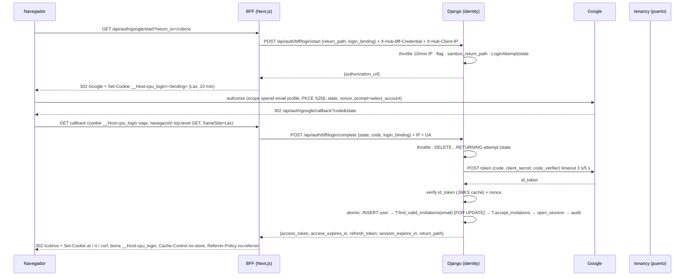

# Diseño — Módulo de Identidad y Acceso (`01-identity-access`)

> Parte de `spec.sdd.md` 1.0.1 (Approved). Decisión central en `context/decisions/ADR-0004-sesion-y-tokens-en-navegador.md`
> (Propuesto), que resuelve los 15 puntos de la spec §15. Zona roja (auth): toda tarea derivada pasa por `reviewer`.
> **No cambia reglas de negocio.** Q-119…Q-125 están decididas por el usuario (2026-11-06, ver §11).
> Donde el código real de SPEC-00 obliga a nombrar distinto, manda `tasks.md` ("Ajustes al diseño").

## 1. Resumen de la solución
- **Django termina el OIDC, el BFF termina el navegador.** Google redirige al Route Handler de Next.js
  (`/api/auth/google/callback`); el BFF reenvía `code` + `state` + un *binding* del navegador a un endpoint de Django
  solo-BFF, que canjea el código (client secret + PKCE S256), valida el ID token y el `nonce`, aplica RN-IDA-05/06/21 y
  abre la sesión. Django devuelve los tokens **solo al BFF**, que los guarda en cookies `__Host-` `httpOnly`.
- **Sesión en servidor + JWT corto.** `auth_sessions` es la verdad; el JWT de acceso (ES256, 15 min, `sub`+`sid`) se
  valida sin red y, en **cada** request, una lectura por PK de la sesión y el usuario (sin caché) corta el acceso en la
  request siguiente a una revocación.
- **Refresh opaco, rotado, con ventana de gracia de 30 s** en Django para pestañas concurrentes (sin candado
  compartido entre instancias del BFF); reuso fuera de la ventana revoca la sesión.
- **CSRF en el BFF** (Django nunca autentica por cookie): `Origin` + `Sec-Fetch-Site` + *double-submit* con cookie
  `__Host-`. Rate limit en Django con la IP del cliente que informa el BFF autenticado.
- Puertos hacia SPEC-02 (invitaciones en plural, selector de memberships) y SPEC-10 (auditoría), con stubs hasta que
  existan; sin imports de `identity` → `tenancy`.

## 2. Cobertura de la spec
> Una fila sin destino = hueco de diseño. **No quedan huecos**; dos dependencias externas se marcan como tales.

| RN / RF / RNF | Dónde vive en el diseño |
|---|---|
| RN-IDA-01 | `oidc/google_gateway.py` (único proveedor real) · sin modelo de contraseña (`set_unusable_password`) · `checks.py` + `apps.py` (proveedor falso prohibido en staging/prod, Q-122) · `dev_oidc/` solo local/test |
| RN-IDA-02 | `oidc/id_token.py` (firma JWKS, `iss`, `aud`, `exp` leeway 60 s, `nonce` por hash) · `services/login_complete.py` paso 2 (`state` + binding) · `models/login_attempt.py` |
| RN-IDA-03 | `domain/login_rules.py::evaluate_identity` → `email_not_verified` (acepta `True` o `"true"`) |
| RN-IDA-04 | `models/user.py` (`google_sub` único, `USERNAME_FIELD`) · `services/user_provisioning.py` busca por `sub` |
| RN-IDA-05 | `services/user_provisioning.py` (casos a/b) · `ports/invitations.py` · `domain/emails.py::normalize_email` (Q-107) |
| RN-IDA-06 | `services/user_provisioning.py` — una `transaction.atomic()`: insert usuario → `find_valid_invitations` (con bloqueo) → `accept_invitations` → sesión |
| RN-IDA-07 | `services/user_status.py::deactivate_user` (revoca todas) · `selectors/auth_sessions.py::get_request_auth_context` (usuario activo) · `services/refresh.py` |
| RN-IDA-08 | `tokens/access_token.py::verify_access_token` (allowlist `["ES256"]`, `typ=at+jwt`, `kid` conocido, `iss`/`aud`, leeway 60 s) · `api/authentication.py` |
| RN-IDA-09 | `tokens/access_token.py::issue_access_token` (claims fijos) · test de claims · header `X-Organization-Id` lo valida SPEC-02 |
| RN-IDA-10 | `services/refresh.py` (rotación, `SELECT … FOR UPDATE`, gracia 30 s, reuso → revocar) · `models/refresh_token.py` (solo hash, un vivo por sesión) · `frontend/src/lib/bff/refresh.ts` (coalescencia por instancia) |
| RN-IDA-11 | `domain/session_policy.py` (15 min / 7 d / 30 d) · constraints de `auth_sessions` · `services/refresh.py` |
| RN-IDA-12 | `frontend/src/lib/bff/cookies.ts` (`__Host-`, `HttpOnly`, `Secure`, `SameSite=Lax`) · endpoints Django `auth/bff/*` con credencial BFF · denylist del proxy catch-all |
| RN-IDA-13 | `frontend/src/lib/bff/csrf.ts` · `domain/return_path.py::sanitize_return_path` (Django) + re-chequeo en `lib/bff/return-path.ts` |
| RN-IDA-14 | `services/logout.py` (acepta refresh o JWT con firma válida aunque vencido; idempotente) · `app/api/auth/logout/route.ts` |
| RN-IDA-15 | `api/throttles.py` (DRF: `login_start_ip`, `login_complete_ip` 10/min; `refresh_session` 30/min) · `api/client_ip.py` · `frontend/src/lib/bff/client-ip.ts` |
| RN-IDA-16 | settings `pydantic-settings` con secretos separados · `checks.py` (secretos distintos entre sí) · procesador de redacción de logs |
| RN-IDA-17 | `ports/audit.py` + `domain/audit_events.py` (catálogo) · emisión en cada servicio (§7.4) |
| RN-IDA-18 | `api/views_me.py::MeView` (sin parámetros de usuario) · `ports/memberships.py` |
| RN-IDA-19 | `api/authentication.py` solo acepta Bearer JWT del Hub; vistas de 01 declaran `authentication_classes` explícitas (sin API key) |
| RN-IDA-20 | `selectors/auth_sessions.py::get_request_auth_context` (1 query por PK, sin caché) llamado por `HubJWTAuthentication` |
| RN-IDA-21 | `services/user_provisioning.py::_sync_existing_user` (email libre → actualiza + audita; colisión → no cambia + audita) · rama `identity_conflict` + alerta |
| RN-IDA-22 | `MeView` devuelve `memberships: []` · login no consulta memberships · UI `NoOrganizationState` |
| RN-IDA-23 | `management/commands/deactivate_user.py`, `reactivate_user.py` (identity) · bootstrap en `apps/tenancy` (**SPEC-02**, Q-123) · sin URLs · admin fuera de `INSTALLED_APPS` en prod |
| RN-IDA-24 | `selectors/auth_sessions.py::list_active_sessions` · `services/sessions.py::revoke_session / revoke_other_sessions` · `domain/client_hint.py` (navegador/SO, sin IP) |
| RN-IDA-25 | `tasks.py::purge_auth_data` (Celery beat horario) · borrado de `login_attempts` al consumir · usuarios sin borrado (FK `PROTECT`) |
| RF-IDA-01 | `services/login_start.py` + `api/views_bff.py::LoginStartView` + `app/api/auth/google/start/route.ts` |
| RF-IDA-02 | `services/login_complete.py` + `services/user_provisioning.py` + `app/api/auth/google/callback/route.ts` |
| RF-IDA-03 | `api/authentication.py::HubJWTAuthentication` + `selectors/auth_sessions.py` |
| RF-IDA-04 | `services/refresh.py` + `api/views_bff.py::RefreshView` + `lib/bff/refresh.ts` |
| RF-IDA-05 | `services/logout.py` + `LogoutView` + `app/api/auth/logout/route.ts` |
| RF-IDA-06 | `api/views_me.py::MeView` + `ports/memberships.py` (stub vacío hasta SPEC-02) |
| RF-IDA-07 | `api/views_sessions.py` + `services/sessions.py` + pantalla "Seguridad" |
| RF-IDA-08 | identity: `deactivate_user`/`reactivate_user`; **bootstrap: comando en `apps/tenancy` (dependencia SPEC-02)** |
| RF-IDA-09 | `ports/audit.py` (stub a log `audit` hasta SPEC-10) |
| RF-IDA-10 | `tasks.py::purge_auth_data` + `services/purge.py` |
| RNF-IDA-01 | `tokens/access_token.py` (verificación local, claves en memoria) · `oidc/id_token.py` (`PyJWKClient`, caché 1 h, refresco ante `kid` desconocido con *cooldown*) |
| RNF-IDA-02 | presupuesto §7.3: JWT ≤ 2 ms, chequeo de sesión ≤ 5 ms p95, total auth ≤ 20 ms p95 |
| RNF-IDA-03 | `common` logging (structlog) + claves de redacción de identity (§7.5) · BFF sin logs de cookies ni de query del callback |
| RNF-IDA-04 | eventos de log `auth.*` con `outcome`/`reason` + `alert=true` en `identity_conflict` y `refresh_reuse_detected` · gauge de sesiones activas desde la purga |
| RNF-IDA-05 | columnas mínimas en `users` y `auth_sessions` (sin IP, sin UA crudo) |
| RNF-IDA-06 | migraciones reversibles por modelo · flag `FEATURE_IDENTITY_GOOGLE_LOGIN` · chequeo de arranque (Q-122) |
| RNF-IDA-07 | `DateTimeField` UTC (`USE_TZ=True`) · claims epoch UTC · UI `Intl.DateTimeFormat('es-AR', {timeZone:'America/Argentina/Buenos_Aires'})` |

## 3. Componentes y capas

### 3.1 Backend — `backend/apps/identity/`
Capas según `AGENTS.md`. Ningún archivo > 400 líneas; los más cargados (`login_complete.py`, `user_provisioning.py`,
`refresh.py`) están separados a propósito.

```
apps/identity/
├── apps.py                     # IdentityConfig.ready(): falla el arranque si el proveedor falso está activo en staging/prod (Q-122)
├── checks.py                   # system checks: secretos distintos, admin fuera en prod, issuer = Google en staging/prod
├── settings.py                 # IdentitySettings (pydantic-settings): ver §8.3
├── models/
│   ├── user.py                 # User (AUTH_USER_MODEL) + UserManager (sin create_superuser)
│   ├── auth_session.py         # AuthSession
│   ├── refresh_token.py        # RefreshToken
│   └── login_attempt.py        # LoginAttempt
├── domain/                     # puro, sin Django ni red
│   ├── errors.py               # códigos de error (enum) y excepciones de dominio
│   ├── emails.py               # normalize_email (trim + lower, Q-107)
│   ├── profile.py              # clamp_display_name (150), clean_avatar_url (https, ≤ 500, si no → vacío)
│   ├── return_path.py          # sanitize_return_path
│   ├── session_policy.py       # duraciones, cálculo de vencimientos, is_expired, decide_refresh (rotar / gracia / reuso)
│   ├── login_rules.py          # evaluate_identity(claims) y tabla de decisión del callback (§4.2)
│   ├── secrets_format.py       # formato/parse/hash de refresh token, state, nonce, binding, PKCE (stdlib)
│   ├── client_hint.py          # User-Agent → (browser, os) resumidos
│   └── audit_events.py         # catálogo de eventos de auditoría (nombres, motivos)
├── ports/
│   ├── invitations.py          # InvitationPort (Protocol) + DTO + InvitationsNoLongerValid
│   ├── memberships.py          # MembershipSelectorPort (Protocol) + DTO
│   ├── audit.py                # AuditPort (Protocol) + AuditEvent
│   ├── stubs.py                # NullInvitationPort, EmptyMembershipSelector, LogAuditPort
│   └── registry.py             # resuelve implementaciones por dotted path desde settings (import_string)
├── oidc/
│   ├── google_gateway.py       # build_authorization_url, exchange_code (httpx), mapeo de errores a unavailable/rejected
│   └── id_token.py             # verify_id_token (PyJWT + PyJWKClient)
├── tokens/
│   ├── keys.py                 # carga de clave de firma activa + claves de verificación por kid
│   └── access_token.py         # issue_access_token / verify_access_token
├── selectors/
│   ├── users.py                # get_by_sub, get_by_email (con/sin lock)
│   └── auth_sessions.py        # get_request_auth_context, list_active_sessions, get_own_session
├── services/
│   ├── login_start.py          # crea LoginAttempt y URL de autorización
│   ├── login_complete.py       # orquesta el callback (orden §12 de la spec)
│   ├── user_provisioning.py    # casos (a)/(b), RN-IDA-21, carrera de callbacks
│   ├── session_lifecycle.py    # open_session, transiciones (revoke, expire) con UPDATE condicional
│   ├── refresh.py              # refresh_session
│   ├── logout.py               # logout (refresh o JWT vencido)
│   ├── sessions.py             # revoke_own_session, revoke_other_sessions
│   ├── user_status.py          # deactivate_user, reactivate_user
│   └── purge.py                # materializar expired + purgar 90 días + intentos vencidos
├── api/
│   ├── authentication.py       # HubJWTAuthentication (DRF)
│   ├── bff_auth.py             # IsBffCaller (credencial BFF, comparación en tiempo constante)
│   ├── client_ip.py            # client_ip_for(request): X-Hub-Client-IP solo si el llamador es el BFF
│   ├── throttles.py            # LoginStartIpThrottle, LoginCompleteIpThrottle, RefreshSessionThrottle
│   ├── serializers.py
│   ├── views_bff.py            # LoginStartView, LoginCompleteView, RefreshView, LogoutView
│   ├── views_me.py             # MeView
│   ├── views_sessions.py       # SessionListView, SessionRevokeView, RevokeOtherSessionsView
│   └── urls.py
├── dev_oidc/                   # proveedor OIDC falso (Q-122), solo se monta con IDENTITY_OIDC_PROVIDER=fake
│   ├── views.py                # /dev-oidc/authorize (form), /dev-oidc/token, /dev-oidc/jwks
│   └── urls.py
├── management/commands/
│   ├── deactivate_user.py
│   └── reactivate_user.py
├── tasks.py                    # purge_auth_data (Celery)
├── migrations/                 # 0001_users, 0002_sessions_refresh_tokens, 0003_login_attempts
└── tests/                      # test_<caso>.py por AC
```

Reglas de dependencia (test de arquitectura, se suma a los de SPEC-00):
- `apps.identity` **no importa** `apps.tenancy` ni `apps.audit`: los resuelve `ports/registry.py` por settings.
  `apps.tenancy` sí importa `apps.identity.ports` para implementar los Protocols.
- `domain/` no importa `django`, `httpx`, `jwt`.
- Las entidades de identity son **globales** (sin `organization_id`, spec §9): se registran en la lista de modelos
  globales que el test C-01 de SPEC-00 exime (coordinar con SPEC-00, ver §11).
- Ninguna vista de identity usa `SessionAuthentication` de DRF; `DEFAULT_AUTHENTICATION_CLASSES` no la incluye.

### 3.2 Frontend — `frontend/src/` (Next.js App Router, Route Handlers en runtime Node.js)
```
src/
├── proxy.ts                               # (Next 16; `middleware.ts` en versiones previas) sin cookie __Host-cpu_rt en rutas (dashboard) → /login?return_to=
├── app/
│   ├── (auth)/login/page.tsx              # "Ingresar" (Server Component: lee error/return_to)
│   ├── (dashboard)/configuracion/perfil/page.tsx
│   ├── (dashboard)/configuracion/seguridad/page.tsx
│   └── api/
│       ├── auth/google/start/route.ts     # GET  → Django login/start → 302 Google
│       ├── auth/google/callback/route.ts  # GET  → Django login/complete → cookies → 302 ruta interna
│       ├── auth/logout/route.ts           # POST → Django logout → borra cookies → 204
│       ├── session/active-organization/route.ts  # PUT → cookie de preferencia (Q-119)
│       └── [...path]/route.ts             # proxy catch-all: CSRF, Bearer, refresh transparente, denylist
├── lib/
│   ├── api-client.ts                      # (compartido, SPEC-00) + X-CSRF-Token, X-Organization-Id, 401 → /login
│   └── bff/                               # `import 'server-only'`; nunca llega al bundle del navegador
│       ├── config.ts                      # env: HUB_API_INTERNAL_URL, HUB_BFF_CREDENTIAL, HUB_APP_ORIGIN, HUB_TRUSTED_PROXY_HOPS
│       ├── cookies.ts                     # nombres, atributos, set/clear
│       ├── csrf.ts                        # Origin/Sec-Fetch-Site + double-submit
│       ├── client-ip.ts                   # IP real desde X-Forwarded-For con N saltos de confianza
│       ├── django.ts                      # fetch a Django con credencial BFF, X-Request-ID, timeouts
│       ├── refresh.ts                     # refresh con coalescencia por instancia (Map<hash, Promise>)
│       ├── return-path.ts                 # re-sanitiza antes de redirigir
│       └── problem.ts                     # respuestas problem+json propias del BFF (csrf_failed, upstream_unavailable)
└── modules/identity/
    ├── components/  LoginCard, LoginErrorAlert, ProfileCard, SessionsTable, RevokeSessionDialog,
    │                RevokeOthersDialog, NoOrganizationState, UserMenu
    ├── hooks/       useMe, useSessions, useRevokeSession, useRevokeOtherSessions, useLogout
    └── lib/         login-errors.ts (código → texto de §14), format-dates.ts
```

### 3.3 Asíncrono
- `identity.tasks.purge_auth_data` — Celery beat **cada hora** (`crontab(minute=17)`), idempotente, en lotes de 1000:
  (1) materializa `expired` en sesiones `active` con `idle_expires_at <= now` (`ended_at = idle_expires_at`);
  (2) borra `login_attempts` con `expires_at < now`; (3) borra sesiones con `ended_at < now − 90 d` (refresh tokens en
  cascada); (4) log `auth.sessions_active` (gauge). Entrada de beat registrada por la app (`identity/beat.py`) y
  agregada por `config/celery.py` de SPEC-00.

### 3.4 Pantallas (spec §14; esquemas de carga de `07 §2`)
| Pantalla / pieza | Ruta / componente | Datos | Estados |
|---|---|---|---|
| **Ingresar** | `(auth)/login/page.tsx` + `LoginCard` + `LoginErrorAlert` (pantalla propia simple: Tailwind para layout, `Button`/`Alert` MUI) | `searchParams.error`, `searchParams.return_to` | Botón único "Ingresar con Google" = `<a href="/api/auth/google/start?return_to=…">` (navegación completa, no `fetch`); al click `LoadingButton` "Redirigiendo a Google…". Errores por `login-errors.ts`: `login_cancelled` "Cancelaste el ingreso con Google"; `email_not_verified` "Tu email de Google no está verificado"; `not_invited` "Pedile a un administrador de tu empresa que te invite"; `user_inactive` "Tu acceso está desactivado. Contactá al soporte"; `identity_conflict` "No pudimos verificar tu cuenta; contactá al soporte"; `rate_limited` "Esperá unos minutos y volvé a intentar"; `google_unavailable` `Alert` + "Reintentar"; `session_expired` "Tu sesión venció, ingresá de nuevo"; `google_auth_failed`/`internal_error`/desconocido "No pudimos completar el ingreso. Probá de nuevo" |
| **Sin empresas** | `NoOrganizationState` (lo usa el layout `(dashboard)` cuando `useMe().memberships` está vacío) | `GET /api/me` | `EmptyState` "No pertenecés a ninguna empresa" + "Cerrar sesión" |
| **Mi perfil** | `(dashboard)/configuracion/perfil/page.tsx` + `ProfileCard` | `useMe` | `PageSkeleton variant="detail"` → avatar (o iniciales), nombre, email en solo lectura + nota "Los datos vienen de tu cuenta de Google"; error con "Reintentar". Sin idioma |
| **Seguridad** | `(dashboard)/configuracion/seguridad/page.tsx` + `SessionsTable` + `RevokeSessionDialog` + `RevokeOthersDialog` | `useSessions`, `useRevokeSession`, `useRevokeOtherSessions`, `useLogout` | Skeleton de tabla (5 filas) → filas: navegador · SO, "Iniciada", "Último uso" (`es-AR`, `America/Argentina/Buenos_Aires`), `Chip` "Esta sesión". Por fila "Cerrar sesión" (`Dialog` de confirmación, `LoadingButton`); en la actual "Cerrar esta sesión" usa el **logout del BFF** (borra cookies y va a `/login`). "Cerrar las demás" deshabilitado si no hay otras. Sin contraseña |
| **Menú de usuario** | `UserMenu` (en la barra del shell) | `useMe` | "Cerrar sesión" → `POST /api/auth/logout` → `window.location.assign('/login')` |
| **Sesión vencida** | `lib/api-client.ts` | — | Ante `401` del BFF: `window.location.assign('/login?error=session_expired&return_to=<ruta interna actual>')` |

### 3.5 Externos
- Google: `https://accounts.google.com/o/oauth2/v2/auth`, `https://oauth2.googleapis.com/token`,
  `https://www.googleapis.com/oauth2/v3/certs`, `iss ∈ {"https://accounts.google.com", "accounts.google.com"}`,
  `RS256` (discovery verificado 2026-10-31). Se configuran por settings (para el proveedor falso), pero en
  staging/producción `checks.py` exige estos valores exactos.

## 4. Flujos principales

### 4.1 Login — camino feliz (caso b, primer ingreso por invitación)


### 4.2 Tabla de decisión del callback (orden de la spec §12, determinístico)
| # | Paso | Falla → código | ¿Llama a Google? | ¿Audita? |
|---|---|---|---|---|
| 1 | Throttle `login_complete_ip` | `rate_limited` 429 | No | No (log + métrica) |
| 2 | Consumir intento: `state` existe, binding coincide, no vencido; se borra en el acto | `google_auth_failed` | No | Sí |
| 3 | `error=access_denied` de Google | `login_cancelled` (estado UI "cancelado") | No | No (no es un rechazo del Hub; RN-IDA-17 no lo lista) |
| 3b | Otro `error` o falta `code` | `google_auth_failed` | No | Sí |
| 4 | Canje del código | timeout / red / 5xx / 429 → `google_unavailable` · 400 `invalid_grant` → `google_auth_failed` | Sí | unavailable: No · failed: Sí |
| 5 | ID token: firma (JWKS), `alg=RS256`, `iss`, `aud`, `exp`/`iat` leeway 60 s, `sub`, `nonce`# | `google_auth_failed` (JWKS inaccesible sin caché → `google_unavailable`) | JWKS si no hay caché | ídem |
| 6 | `email_verified` ∈ {`True`, `"true"`} | `email_not_verified` | — | Sí |
| 7a | `sub` existe: inactivo → `user_inactive`; activo → RN-IDA-21 + sesión | `user_inactive` | — | Sí |
| 7b | `sub` nuevo: email de otro usuario → `identity_conflict` (+ alerta); si no, invitaciones vigentes (caso b) o `not_invited` | `identity_conflict` / `not_invited` | — | Sí |

### 4.3 Carrera de dos callbacks del mismo invitado (AC-IDA-02)
`user_provisioning` inserta el usuario **antes** de bloquear invitaciones. El segundo `INSERT` espera el índice único
de `google_sub` hasta que el primero commitea y recibe `IntegrityError` → rollback del savepoint → **un reintento** del
aprovisionamiento completo → encuentra el usuario por `sub` → caso (a) (Q-121: no acepta invitaciones) → abre su sesión.
Nunca `500`. Si el `IntegrityError` es por email con otro `sub`, el reintento cae en `identity_conflict`.

### 4.4 Request autenticada (RN-IDA-20)
```
Navegador → BFF [...path]: CSRF (si muta) → ¿falta __Host-cpu_at y hay rt? refresh (coalescido)
  → Django con Authorization: Bearer <at> (+ X-Organization-Id que mandó la pestaña, validado como UUID)
Django HubJWTAuthentication: verify JWT (local) → get_request_auth_context(sid, sub) [1 SELECT por PK, JOIN users]
  → status='active' ∧ idle_expires_at > now ∧ absolute_expires_at > now ∧ user.is_active  ⇒ request.user / request.auth
  → si no ⇒ 401 session_revoked
Django 401 token_expired | token_invalid → BFF refresca una vez y reintenta una vez (el 401 de autenticación ocurre
  antes de la vista, así que reintentar una mutación no la duplica; con session_revoked NO se reintenta)
Refresh falla (session_revoked / token_invalid) → BFF borra cookies → 401 session_revoked → api-client → /login?return_to=
```

### 4.5 Refresh y concurrencia (RN-IDA-10, AC-IDA-14/15/16/28)
```
refresh_session(raw_rt, now):
  parse "rt1.<sid>.<secret>" (malformado → token_invalid)            # el throttle 30/min usa <sid> sin tocar la BD
  atomic:
    rt = RefreshToken por sha256(raw) SELECT … FOR UPDATE            (no existe → token_invalid)
    s  = AuthSession(rt.session) SELECT … FOR UPDATE
    s.status != active                       → session_revoked
    idle/absolute vencido                    → marcar expired (ended_at = idle_expires_at) → session_revoked
    !user.is_active                          → session_revoked
    rt.used_at is None                       → ROTAR: rt.used_at=now; nuevo rt'; rt.replaced_by=rt';
                                               s.last_used_at=now; s.idle_expires_at=min(now+7d, absolute)
                                               → {access, refresh: rt', session_expires_in}
    now − rt.used_at ≤ 30 s ∧ rt.replaced_by es el token vivo de s
                                             → GRACIA: solo access nuevo, refresh=null (no audita)
    en otro caso                             → REUSO: revoke(s, refresh_reuse) + audit refresh_reuse_detected
                                               + session_revoked; commit; → session_revoked (alerta)
```
El BFF, si recibe `refresh=null`, actualiza solo la cookie de acceso: la cookie `__Host-cpu_rt` del navegador ya quedó
con `rt'` por la respuesta de la pestaña que rotó (las cookies son del navegador, no de la pestaña). Además, cada
instancia del BFF comparte en memoria la promesa de refresh por hash del token, así que las pestañas que caen en la
misma instancia hacen un solo refresh.

### 4.6 Logout (RN-IDA-14, AC-IDA-17/35)
`POST /api/auth/logout` (BFF; Origin + CSRF si hay sesión) → Django `auth/bff/logout {refresh_token?, access_token?}`:
busca la sesión por hash del refresh (vigente **o** usado) o por `sid` de un JWT con firma válida aunque vencido →
`revoke(s, logout)` + audit `logout` si estaba `active` → `204` siempre. El BFF borra `at`, `rt`, `csrf` y la cookie de
organización.

### 4.7 Caminos de error ilustrativos
- **`state` repetido** (callback reabierto desde el historial): paso 2 no encuentra el intento → `google_auth_failed`,
  sin canje, sin sesión → `302 /login?error=google_auth_failed`.
- **Google caído**: paso 4 timeout → `google_unavailable` → "Ingresar" con botón Reintentar (vuelve a `start`).
- **Desactivación con JWT vigente**: comando → sesiones `revoked` en la misma transacción → la request siguiente
  falla en `get_request_auth_context` → `401 session_revoked`.

## 5. Datos
Todas las marcas en UTC (`timestamptz`). Migraciones reversibles (solo `CreateModel`/`AddConstraint`/`AddIndex`).

| Tabla | Columnas | Constraints / índices | Notas |
|---|---|---|---|
| `users` | `id uuid PK` · `google_sub varchar(255)` · `email varchar(254)` · `display_name varchar(150)` default `''` · `avatar_url varchar(500)` default `''` · `password varchar(128)` (inutilizable, heredado de `AbstractBaseUser`) · `is_active bool` · `last_login_at timestamptz null` · `created_at` · `deactivated_at null` | `UNIQUE(google_sub)` · `UNIQUE(email)` · `CHECK email = lower(btrim(email))` · `CHECK is_active = (deactivated_at IS NULL)` | `AUTH_USER_MODEL = "identity.User"`, `USERNAME_FIELD = "google_sub"`, `last_login = None` (se reemplaza por `last_login_at`). Sin `PermissionsMixin`. Nombre > 150 → recorte; avatar no-https o > 500 → `''` |
| `auth_sessions` | `id uuid PK` · `user_id FK users PROTECT` · `status varchar(16)` (`active`/`revoked`/`expired`) · `created_at` · `last_used_at` · `idle_expires_at` · `absolute_expires_at` · `ended_at null` · `revoke_reason varchar(32) null` · `client_browser varchar(32)` · `client_os varchar(32)` | `CHECK absolute_expires_at = created_at + interval '30 days'` · `CHECK idle_expires_at <= absolute_expires_at` · `CHECK (status='active') = (ended_at IS NULL)` · `CHECK (status='revoked') = (revoke_reason IS NOT NULL)` · `INDEX (user_id) WHERE status='active'` · `INDEX (idle_expires_at) WHERE status='active'` · `INDEX (ended_at) WHERE ended_at IS NOT NULL` | `revoke_reason ∈ {logout, user_revoked, revoked_others, user_deactivated, refresh_reuse, superseded}`. Transiciones solo por `UPDATE … WHERE status='active'` (terminal nunca vuelve). `last_used_at` = último login/refresh (granularidad ≤ 15 min) |
| `refresh_tokens` | `id bigint PK` · `session_id FK auth_sessions CASCADE` · `token_hash char(64)` (SHA-256 hex) · `issued_at` · `used_at null` · `replaced_by_id FK self null` (OneToOne) | `UNIQUE(token_hash)` · `UNIQUE(session_id) WHERE used_at IS NULL` (un solo vivo por sesión) · `CHECK replaced_by_id IS NULL OR used_at IS NOT NULL` · `INDEX(session_id)` | Token `rt1.<sid base64url>.<32 bytes base64url>` (256 bits): SHA-256 sin pimienta alcanza por la entropía |
| `login_attempts` | `id uuid PK` · `state_hash char(64)` · `nonce_hash char(64)` · `binding_hash char(64)` · `code_verifier varchar(128)` · `return_path varchar(512)` · `created_at` · `expires_at` | `UNIQUE(state_hash)` · `INDEX(expires_at)` · `CHECK expires_at = created_at + interval '10 minutes'` | Se **borra** al consumirse (`DELETE … RETURNING`) y la purga borra los vencidos. El `code_verifier` es el único valor en claro (vida ≤ 10 min) |

No se agrega columna de organización activa en ninguna tabla: la preferencia vive en la cookie del BFF (§7.2).

## 6. Contratos de API
Errores en `application/problem+json` (RFC 9457) con `code` y `request_id` (SPEC-00). Barra final según la
convención de SPEC-00. Los endpoints `auth/bff/*` van al OpenAPI con tag `bff-internal` y esquema de seguridad
`BffCredential`; el cliente tipado del navegador **no** los usa.

### 6.1 Django — solo BFF (requieren `X-Hub-Bff-Credential`; sin ella → `404 not_found`)
| Método | Ruta | Request | Response | Errores |
|---|---|---|---|---|
| POST | `/api/auth/bff/login/start` | headers `X-Hub-Client-IP`; body `{return_path?: string, login_binding: string(43)}` | `200 {authorization_url}` | `429 rate_limited` (+`Retry-After`) · `503 login_disabled` (flag apagado) |
| POST | `/api/auth/bff/login/complete` | headers `X-Hub-Client-IP`, `X-Hub-Client-UA`; body `{state, login_binding, code?, error?}` | `200 {access_token, access_expires_in: 900, refresh_token, session_id, session_expires_in, return_path}` | `429 rate_limited` · `400 google_auth_failed` · `400 login_cancelled` · `503 google_unavailable` · `403 email_not_verified` · `403 not_invited` · `403 user_inactive` · `409 identity_conflict` · `503 login_disabled` |
| POST | `/api/auth/bff/refresh` | body `{refresh_token}` | `200 {access_token, access_expires_in, refresh_token: string\|null, session_expires_in}` (`null` = ventana de gracia) | `401 session_revoked` · `401 token_invalid` · `429 rate_limited` |
| POST | `/api/auth/bff/logout` | body `{refresh_token?, access_token?, reason?: "logout"\|"superseded"}` | `204` siempre | — |

### 6.2 Django — autenticados por Bearer (llegan vía el proxy del BFF)
| Método | Ruta | Permisos | Request | Response | Errores |
|---|---|---|---|---|---|
| GET | `/api/me` | persona autenticada (cualquier rol o sin membership) | — | `200 {id, email, display_name, avatar_url\|null, memberships: [{organization_id, organization_name, role}]}` (forma de membership: la fija SPEC-02; stub `[]`) | `401 unauthenticated` · `401 token_expired` · `401 token_invalid` · `401 session_revoked` |
| GET | `/api/auth/sessions` | ídem; solo propias | — | `200 [{id, browser, os, created_at, last_used_at, is_current}]` solo `active`, orden `last_used_at desc`, paginación de SPEC-00 | `401 …` |
| POST | `/api/auth/sessions/{id}/revoke` | ídem; ajena = inexistente | — | `204` | `404 not_found` · `401 …` |
| POST | `/api/auth/sessions/revoke-others` | ídem | — | `204` (revoca todas las `active` del usuario salvo `request.auth.sid`) | `401 …` |

`401` lleva `WWW-Authenticate: Bearer realm="hub"`. No existe ningún endpoint para crear organizaciones/owners ni para
desactivar/reactivar usuarios (AC-IDA-32).

### 6.3 BFF — rutas que ve el navegador (mismo origen que la app)
| Método | Ruta | Comportamiento | Respuesta |
|---|---|---|---|
| GET | `/api/auth/google/start?return_to=` | Reusa el binding de `__Host-cpu_login` si existe (doble clic/pestañas), si no genera 32 bytes | `302` a Google · error → `302 /login?error=<code>` |
| GET | `/api/auth/google/callback?code&state[&error]` | Llama a `login/complete`; si había `__Host-cpu_rt` previo distinto, `logout(reason=superseded)` *best effort* | `302 <return_path>` + cookies · error → `302 /login?error=<code>` |
| POST | `/api/auth/logout` | Origin + CSRF (si hay cookie de sesión) | `204` + borra cookies |
| PUT | `/api/session/active-organization` | Origin + CSRF; body `{organization_id: uuid\|null}`; solo valida formato (la autorización es de SPEC-02) | `204` + cookie `__Host-cpu_org` |
| * | `/api/[...path]` | Proxy (§4.4). `404` para `auth/bff/**`, `auth/google/**`, rutas con `..` o `%2e`. Headers de entrada en **allowlist** (`content-type`, `accept`, `x-organization-id`, `idempotency-key`, `x-request-id`); nunca reenvía `cookie`, `authorization` ni `x-hub-*` del navegador. Headers de salida en allowlist; descarta `set-cookie` de Django | lo que responda Django; `401 session_revoked` si el refresh falla; `403 csrf_failed`; `502 upstream_unavailable` |

Códigos admitidos en `/login?error=` (allowlist; cualquier otro → genérico): `login_cancelled`, `google_auth_failed`,
`google_unavailable`, `email_not_verified`, `not_invited`, `user_inactive`, `identity_conflict`, `rate_limited`,
`login_disabled`, `session_expired`, `internal_error`. Nunca se agregan detalles ni tokens a la URL.

### 6.4 Interfaces internas (puertos)
```python
# apps/identity/ports/invitations.py — definido por SPEC-01, implementado por SPEC-02 (Q-108, Q-120: plural)
@dataclass(frozen=True)
class InvitationRef:
    invitation_id: UUID
    organization_id: UUID

class InvitationsNoLongerValid(Exception): ...

class InvitationPort(Protocol):
    def find_valid_invitations(self, email_normalized: str, *, now: datetime) -> list[InvitationRef]:
        """Se llama DENTRO de la transacción del caller. Devuelve las invitaciones pendientes y vigentes para ese
        email exacto y las bloquea (SELECT … FOR UPDATE) hasta el fin de la transacción. No commitea."""
    def accept_invitations(self, invitations: Sequence[InvitationRef], user_id: UUID, *, now: datetime) -> None:
        """Misma transacción. Acepta todas (crea memberships) o lanza InvitationsNoLongerValid / cualquier error;
        el caller hace rollback de todo (RN-IDA-06). No commitea ni emite auditoría de identity."""

# apps/identity/ports/memberships.py — implementado por SPEC-02 (Q-114)
class MembershipSelectorPort(Protocol):
    def list_active_memberships(self, user_id: UUID) -> list[MembershipSummary]: ...
    # MembershipSummary(organization_id, organization_name, role) — forma final la fija SPEC-02

# apps/identity/ports/audit.py — implementado por SPEC-10
class AuditPort(Protocol):
    def record(self, event: AuditEvent) -> None:
        """Si hay transacción abierta, escribe dentro de ella (atomicidad con el cambio de estado)."""
# AuditEvent(action, result, reason|None, actor_type: user|anonymous|platform_operator|system,
#            actor_id|None, organization_id|None, occurred_at UTC, metadata: dict sin secretos)
```
Stubs (settings por defecto hasta que existan 02/10): `NullInvitationPort` (`find` → `[]`, todo login nuevo →
`not_invited`), `EmptyMembershipSelector` (`[]`), `LogAuditPort` (log estructurado en el logger `audit`, canal aparte).
SPEC-02 los reemplaza por settings (`IDENTITY_INVITATION_PORT`, `IDENTITY_MEMBERSHIP_SELECTOR`), sin tocar identity.

### 6.5 Comandos de gestión (sin HTTP)
| Comando | App | Argumentos | Efecto | Auditoría |
|---|---|---|---|---|
| `deactivate_user` | identity | `--email \| --user-id`, `--operator <nombre>` (obligatorio), `--reason` | atomic: `is_active=false`, `deactivated_at=now`, revoca todas las sesiones `active` (`user_deactivated`). Repetido sobre inactivo → no-op informado | `user_deactivated` + `session_revoked` × N; actor `platform_operator` (`--operator` + usuario del SO) |
| `reactivate_user` | identity | ídem | `is_active=true`, `deactivated_at=null`; **no** toca sesiones | `user_reactivated` |
| `tenancy_create_org` (forma final en `specs/02-tenancy-rbac/design.md §4.5`) | **tenancy (SPEC-02)** | `--key`, `--name`, `--owner-email`, `--operator` | crea organización + invitación owner (Q-123: sirve para **toda** organización nueva; repetirlo para esa empresa/email no crea nada e informa). Si el email ya tiene usuario, igual emite la invitación y la persona la acepta adentro del Hub (Q-124) | `organization.created` + `invitation.created` (org = la nueva). Contrato exigido por RF-IDA-08/AC-IDA-32; lo implementa SPEC-02 |

## 7. Seguridad y privacidad

### 7.1 Cookies (todas `Secure`, `Path=/`, prefijo `__Host-` ⇒ sin `Domain`)
| Cookie | Contenido | `HttpOnly` | `SameSite` | `Max-Age` | Se borra |
|---|---|---|---|---|---|
| `__Host-cpu_at` | JWT de acceso (~450 B) | Sí | Lax | `access_expires_in − 60` (840 s) → el BFF refresca antes de que Django lo rechace | logout / refresh fallido |
| `__Host-cpu_rt` | refresh opaco (~90 B) | Sí | Lax | `session_expires_in` = `idle_expires_at − now` (≤ 7 d, renovado en cada refresh, nunca > vida absoluta de 30 d) | ídem |
| `__Host-cpu_csrf` | 32 bytes aleatorios base64url | **No** (lo lee el `api-client`) | Lax | igual que `rt` | ídem; se rota en cada login |
| `__Host-cpu_login` | binding del intento (32 bytes) | Sí | **Lax** (debe viajar en la navegación GET top-level que vuelve de Google) | 600 s | al completar el login |
| `__Host-cpu_org` | UUID de la última empresa elegida (preferencia, no autorización) | Sí | Lax | 30 d | logout |

`Lax` y no `Strict`: con `Strict` el aterrizaje después del redirect de Google y los enlaces de los emails de
invitación llegarían sin sesión. El CSRF no depende de `SameSite` (§7.2).

### 7.2 CSRF, organización activa y aislamiento
- **CSRF (RN-IDA-13)** en el BFF para todo método no seguro (`POST/PUT/PATCH/DELETE`): (1) `Origin` debe ser
  exactamente `HUB_APP_ORIGIN`; si falta, `Sec-Fetch-Site` debe ser `same-origin`; si faltan los dos → rechazo;
  (2) `X-CSRF-Token` debe igualar a `__Host-cpu_csrf` (comparación en tiempo constante). Falla → `403 csrf_failed` sin
  llamar a Django. El proxy no habilita CORS. Django no necesita CSRF: nunca autentica por cookie. No se usan Server
  Actions para mutaciones (quedarían fuera de este esquema).
- **Organización activa (Q-112, Q-119 b):** cada pestaña guarda su empresa en el estado del shell y la
  manda en `X-Organization-Id` en cada request; el BFF la reenvía (validando formato UUID) y **nunca** la inyecta desde
  la cookie. `__Host-cpu_org` guarda la última elegida solo como valor inicial para pestañas nuevas o recargas: el
  layout `(dashboard)` (Server Component) la lee y se la pasa al shell. SPEC-02 valida la membership en cada request.
- **Aislamiento:** entidades globales sin `organization_id`; toda consulta de sesiones filtra por `request.user.id`
  (`get_own_session(user_id, session_id)` → `404` si no es propia, AC-IDA-25). `/api/me` no acepta id.

### 7.3 Chequeo por request y presupuesto (RNF-IDA-02)
- Verificación JWT ES256 local: ≤ 2 ms. Chequeo de sesión: 1 `SELECT` por PK con `JOIN users` (≤ 5 ms p95 con BD en la
  misma red). Total de autenticación ≤ 20 ms p95. **Sin escrituras por request** (`last_used_at` se mueve en el
  refresh). **Prohibido** cachear el estado de sesión/usuario (`cache`, `lru_cache`, memo por proceso); si en el futuro
  hay réplicas de lectura, este selector lee del primario. Test de regresión: revocar y en la request siguiente `401`.

### 7.4 Auditoría (RN-IDA-17, Q-117)
| Evento (`action`) | Cuándo | Org | Actor |
|---|---|---|---|
| `identity.login_succeeded` | sesión abierta | nula | user |
| `identity.login_rejected` (`reason` ∈ google_auth_failed, email_not_verified, not_invited, user_inactive, identity_conflict) | pasos 2–7 de §4.2 | nula | user si se conoce (`user_inactive`), si no anonymous |
| `identity.user_created_by_invitation` | caso (b), **uno por invitación aceptada** | la de la invitación | user |
| `identity.logout` | logout de sesión activa | nula | user |
| `identity.session_revoked` (`reason` ∈ user_revoked, revoked_others, user_deactivated, refresh_reuse, superseded) | revocaciones distintas de logout | nula | user / platform_operator / system |
| `identity.refresh_reuse_detected` | §4.5 reuso | nula | system (+ `alert`) |
| `identity.user_deactivated` / `identity.user_reactivated` | comandos | nula | platform_operator |
| `identity.email_changed` / `identity.email_change_collision` | RN-IDA-21 | nula | user |
| `organization.created` + `invitation.created` (SPEC-02, RNF-TEN-04) | comando de SPEC-02 | la nueva | platform_operator |

Éxitos: dentro de la transacción del cambio. Rechazos: después del rollback, en escritura propia. `429`,
`google_unavailable` y `login_cancelled` → solo logs y métricas. Contenido de los rechazos: solo el motivo, **sin**
email ni `sub` de la persona rechazada (Q-125, RNF-IDA-05).

### 7.5 Secretos y logs (RN-IDA-16, RNF-IDA-03, AC-IDA-23)
- Secretos separados: `IDENTITY_GOOGLE_CLIENT_SECRET`, `IDENTITY_JWT_SIGNING_KEY`, `IDENTITY_BFF_CREDENTIALS` (Django)
  / `HUB_BFF_CREDENTIAL` (Next). `checks.py` falla si dos coinciden o si alguno coincide con `DJANGO_SECRET_KEY`.
- Redacción en el procesador de structlog (claves): `access_token`, `refresh_token`, `id_token`, `code`,
  `code_verifier`, `state`, `nonce`, `login_binding`, `authorization`, `cookie`, `set-cookie`, `client_secret`,
  `x-hub-bff-credential`, `x-csrf-token`. Los serializers no hacen eco del input en errores.
- BFF: no loguea headers ni cookies; el access log del proxy de borde/Next no registra la *query string* de
  `/api/auth/google/callback` (contiene `code` y `state`) — requisito de despliegue anotado para SPEC-00/infra.
- Respuestas de auth del BFF: `Cache-Control: no-store`; callback con `Referrer-Policy: no-referrer`.

### 7.6 IP del cliente y rate limit (RN-IDA-15, AC-IDA-20/37)
- BFF: IP = entrada de `X-Forwarded-For` a `HUB_TRUSTED_PROXY_HOPS` saltos desde la derecha (configuración del proxy
  de borde); nunca confía en headers del navegador.
- Django: `client_ip_for(request)` usa `X-Hub-Client-IP` **solo** si `IsBffCaller` validó la credencial; si no,
  `REMOTE_ADDR`. Claves de throttle: `sha256(ip)[:16]` por scope (`login_start_ip`, `login_complete_ip`, 10/min cada
  uno) y `sid` del refresh token (`refresh_session`, 30/min). Throttles de DRF sobre el caché Redis de SPEC-00; DRF ya
  devuelve `Retry-After`. El throttle corre antes de la vista ⇒ antes de cualquier llamada a Google.
- El proxy catch-all **no** manda la credencial BFF: las rutas generales ven la IP del BFF; los throttles generales de
  SPEC-00 sobre esas rutas deberían ser por usuario (nota para SPEC-00).

### 7.7 Datos personales
De Google: `sub`, email, nombre (≤ 150), avatar (https ≤ 500). Del dispositivo: navegador y SO resumidos (32 c/u);
no se guarda IP ni User-Agent crudo. Purga a 90 días. Sin borrado de usuarios (Q-118).

## 8. Tecnologías y dependencias
### 8.1 Dependencias nuevas (zona roja → ADR-0004, C-13; versiones verificadas en PyPI/npm el 2026-10-31)
| Paquete | Versión fijada | Para qué | Nota |
|---|---|---|---|
| `PyJWT[crypto]` | `2.15.1` | Emitir/verificar el JWT del Hub (ES256) y verificar el ID token de Google (RS256, `PyJWKClient` con caché de JWKS y refresco ante `kid` desconocido con *cooldown*) | `leeway` aplica a `exp`, `nbf` e `iat` futuro |
| `cryptography` | `50.0.2` | Backend de ES256/RS256 de PyJWT | Puede venir ya fijada por SPEC-00; se usa la misma versión del lock |
| `httpx` | `0.28.1` | Canje del código con el token endpoint de Google (timeouts explícitos) | Si SPEC-00/03 ya fija un cliente HTTP, se usa ese y se descarta esta fila |
| Frontend | — | **Ninguna nueva**: `crypto` de Node, `next/server` y `cookies()` alcanzan | Next.js 16 ⇒ `proxy.ts` (renombre de `middleware.ts`) |

Descartadas: Authlib (su integración Django guarda el `state` en la sesión de Django, que no usamos; su cliente bajo
nivel suma superficie sin ahorrar código relevante), `google-auth` (resuelve solo el ID token y suma `requests`),
`ua-parser` (para "navegador/SO resumido" alcanza una función pura de ~60 líneas), Redis desde Next.js (no hace falta
candado compartido gracias a la ventana de gracia).

### 8.2 Parámetros fijados
`ACCESS_TTL=900 s` · `SESSION_IDLE=7 d` · `SESSION_ABSOLUTE=30 d` · `CLOCK_SKEW=60 s` · `REFRESH_GRACE=30 s` ·
`LOGIN_ATTEMPT_TTL=600 s` · JWKS `lifespan=3600 s`, `timeout=5 s` · token endpoint `connect 3 s / read 5 s`, sin
reintentos (el código es de un solo uso) · JWT: header `{alg: ES256, kid, typ: "at+jwt"}`, claims
`{iss, aud, sub (user UUID), sid (session UUID), iat, nbf, exp = iat + 900}` y nada más.

### 8.3 Configuración (pydantic-settings; nombres de variables de entorno)
Django: `IDENTITY_OIDC_PROVIDER` (`google`|`fake`), `IDENTITY_GOOGLE_CLIENT_ID`, `IDENTITY_GOOGLE_CLIENT_SECRET`,
`IDENTITY_GOOGLE_REDIRECT_URI` (= `https://<app>/api/auth/google/callback`, uno por entorno), `IDENTITY_JWT_ISSUER`,
`IDENTITY_JWT_AUDIENCE`, `IDENTITY_JWT_SIGNING_KID`, `IDENTITY_JWT_SIGNING_KEY` (PEM P-256),
`IDENTITY_JWT_VERIFICATION_KEYS` (JSON `{kid: PEM público}`), `IDENTITY_BFF_CREDENTIALS` (lista: vigente, anterior),
`IDENTITY_INVITATION_PORT`, `IDENTITY_MEMBERSHIP_SELECTOR`, `IDENTITY_AUDIT_PORT` (dotted paths),
`FEATURE_IDENTITY_GOOGLE_LOGIN` (flag de `apps/common`). Next (solo servidor): `HUB_API_INTERNAL_URL`,
`HUB_BFF_CREDENTIAL`, `HUB_APP_ORIGIN`, `HUB_TRUSTED_PROXY_HOPS`. Placeholders en `.env.example` (SPEC-00).

## 9. Estrategia de pruebas
Cada test lleva el ID: `test_AC_IDA_NN_<caso>`. Google nunca se llama en CI: `GoogleGateway` se sustituye por un fake
que firma ID tokens con una clave RSA de test y expone su JWKS en memoria.

| Nivel | Qué cubre | AC |
|---|---|---|
| Unitarias (dominio) | `normalize_email`, `sanitize_return_path`, `session_policy` (vencimientos, `decide_refresh`), `login_rules`, formato de refresh token, `client_hint`, recortes de perfil | 16 (cálculo), 19 (return path), 28/15 (decisión gracia/reuso), 31, 34 (con verify) |
| Tokens (sin BD) | Emisión y verificación del JWT: vencido > 60 s, 14 min, firma alterada, otra clave, `alg=none`, HS256, `iss`/`aud` ajenos, token de Google, `nbf`/`iat` ±30/120 s, claims exactos | 10, 11, 12, 13, 34 |
| OIDC (fake de Google) | ID token inválido por firma/`aud`/`iss`/vencido; `nonce` distinto; timeout/5xx/429 en token y JWKS; `kid` desconocido refresca una vez | 7, 8, 36 |
| Servicio/integración (PostgreSQL real) | Casos a/b, invitación vencida/revocada, aceptación que falla (rollback total), `email_verified=false`, `user_inactive`, cambio y colisión de email, `identity_conflict`, sin memberships, **dos callbacks concurrentes** (dos conexiones/hilos), refresh rotación/gracia/reuso/vencimientos, **dos refresh concurrentes** (`FOR UPDATE`), logout con JWT vencido, desactivación/reactivación, purga 89/91 días | 1–6, 9, 14–17, 27–31, 35, 38 |
| API (DRF) | `/api/me`, sesiones propias/ajenas (`404`), "cerrar las demás", `401` codes, API key rechazada, credencial BFF ausente → `404`, throttles 11.º → `429` + `Retry-After` sin llamar al fake de Google, 10 IPs distintas vía BFF sin `429`, `X-Hub-Client-IP` ignorado sin credencial, revocar → request siguiente `401`, esquema OpenAPI sin endpoints de alta/desactivación | 20, 21, 22, 25, 26, 32, 33, 37 |
| Auditoría y logs | Catálogo completo de eventos (org nula/de la invitación, uno por invitación), `429` sin evento; captura de logs y cuerpos de error de login/refresh/logout/rechazo sin tokens, `code`, cookies, `state`/`nonce`, client secret ni clave | 23, 24 |
| Arquitectura | `identity` no importa `tenancy`/`audit`; `domain/` sin Django; sin `SessionAuthentication`; `admin` fuera en settings de producción; arranque falla con proveedor falso en staging/prod | 32, RNF-IDA-06 |
| BFF (vitest, sin red) | Cookies con `HttpOnly`/`Secure`/`SameSite`/`__Host-`; ningún cuerpo hacia el navegador contiene tokens; CSRF (sin Origin, Origin ajeno, token distinto); `return_to` hostil; denylist `auth/bff`; coalescencia de refresh; `refresh=null` no pisa `rt`; IP por saltos | 18, 19, 28 (BFF), 37 (BFF) |
| Aislamiento entre organizaciones | No aplica a entidades de identity (globales); el aislamiento de `/api/me` lo garantiza el selector de SPEC-02 (test en SPEC-02) | 21 (parte SPEC-02) |
| E2E humo | Con proveedor OIDC falso: ingresar → `/api/me` → "Seguridad" → cerrar las demás → logout | 1, 17, 33 (punta a punta) |
| Manual (paso 6) | Google real en staging con client ID propio: login, cancelación, invitación, dos pestañas tras 15 min, logout | 1, 2, 28 |

## 10. Migración y despliegue
- **Orden:** `AUTH_USER_MODEL = "identity.User"` debe existir **antes** de la primera migración de cualquier app que
  referencie usuarios (T-IDA-01 va primero en H1; no hay BD persistente todavía). Migraciones `0001_users`,
  `0002_sessions_refresh_tokens`, `0003_login_attempts`, todas reversibles y probadas en ambos sentidos en CI.
- **Feature flag** `FEATURE_IDENTITY_GOOGLE_LOGIN` (apagado por defecto en producción): apaga `login/start` y
  `login/complete` (`503 login_disabled`); las sesiones existentes, refresh y logout siguen funcionando.
- **Entornos:** client ID/secret de Google y redirect URI por entorno; staging usa Google real. El proveedor falso
  (`IDENTITY_OIDC_PROVIDER=fake`) solo con `APP_ENV ∈ {local, test}`: `IdentityConfig.ready()` lanza
  `ImproperlyConfigured` y el proceso no arranca si no; además, en staging/prod se exige el issuer y los endpoints
  exactos de Google y las URLs de `dev_oidc` no se montan.
- **Rotación de la clave JWT:** (1) agregar la pública nueva a `IDENTITY_JWT_VERIFICATION_KEYS` y desplegar; (2) cambiar
  `SIGNING_KID/KEY` y desplegar; (3) tras ≥ 16 min quitar la vieja. Compromiso de clave: se quita de inmediato; los JWT
  firmados con ella pasan a `401 token_invalid` y el BFF, que ante `token_expired` **o** `token_invalid` en una request
  proxied refresca una vez (§4.4), obtiene un JWT nuevo con el refresh opaco (que no es JWT y sigue sirviendo): la
  gente no pierde la sesión.
- **Rotación de la credencial BFF:** Django acepta la lista (vigente, anterior); se cambia el BFF y luego se quita la
  anterior.
- **Rollback:** redeploy del tag anterior; las tablas nuevas no rompen versiones previas (expand/contract).

## 11. Riesgos técnicos y decisiones
| Riesgo / decisión | Mitigación / ADR |
|---|---|
| Ventana de gracia de 30 s: quien robe un refresh y lo use dentro de esos 30 s obtiene un JWT de acceso (no un refresh) | Acotado a 15 min y cortable por revocación (RN-IDA-20); fuera de la ventana revoca todo. ADR-0004 §3 |
| Respuesta del refresh que rotó perdida por red y la de gracia sí llega: el navegador queda con un `rt` usado → el próximo refresh es reuso → re-login | Residual y raro; la coalescencia por instancia lo reduce; se mide con la métrica de reusos |
| Django público (webhooks/ERP) expone `auth/bff/*` | Credencial BFF obligatoria (`404` sin ella) + denylist en el proxy; recomendado además restringirlos por red en el borde (Q-020) |
| Throttles de DRF no atómicos: ráfagas concurrentes pueden pasar 1–2 de más | Aceptado para el MVP; se vigila con la métrica de `429` |
| Varias cajas detrás de una IP comparten el cupo 10/min | Consecuencia de Q-111; métrica de `429` |
| Cambio de `AUTH_USER_MODEL` tardío rompe migraciones | T-IDA-01 primero; coordinación con SPEC-00 |
| Test C-01 de SPEC-00 podría marcar `Model.objects` en servicios de identity | Lista de modelos globales exentos (coordinar con SPEC-00) |
| Forma de `MembershipSummary` | La fija SPEC-02 (`T-TEN-12`); identity solo pasa la lista. Header `X-Organization-Id` cerrado en `specs/02-tenancy-rbac/design.md` |
| Bootstrap vive en SPEC-02 | RF-IDA-08/AC-IDA-32 quedan trazados a `T-TEN-18` |
| Q-124 (decidida 2026-11-06): el owner de una organización nueva que **ya tiene usuario** acepta adentro del Hub (Q-121) | El flujo entra en H1: `T-TEN-16` y `T-TEN-30` de SPEC-02 (`AC-TEN-39`, `AC-TEN-40`). No toca el login |
| Q-125 (decidida 2026-11-06): los eventos de login rechazado no guardan email ni `sub` | Solo el motivo; test en `T-IDA-21` |
| Decisiones no obvias | ADR-0004 (los 15 puntos de la spec §15) |

## 12. Corte preliminar en tareas (insumo para `task-planner`; ≤ ~300 líneas de diff cada una)
> **Reemplazado por `tasks.md`** (2026-11-06): los IDs de abajo son los preliminares, no los finales; `T-IDA-01` es lo
> único que conserva el mismo contenido.

| # | Tarea (propuesta) | AC principales | Depende de |
|---|---|---|---|
| T-IDA-01 | `User` + manager + `AUTH_USER_MODEL` + `domain/emails.py`, `profile.py` + migración 0001 | 31 (normalización), base de 1–2 | SPEC-00 esqueleto |
| T-IDA-02 | `AuthSession`, `RefreshToken`, `LoginAttempt` + migraciones 0002/0003 + `domain/session_policy.py`, `secrets_format.py` | 16 (cálculo), 14 (solo hash) | 01 |
| T-IDA-03 | `tokens/keys.py`, `tokens/access_token.py` (ES256, kid, leeway) | 10, 11, 12, 13, 34 | 01 |
| T-IDA-04 | `ports/*` + stubs + `registry.py` + test de arquitectura (identity ⟂ tenancy/audit) + catálogo `audit_events.py` | base de 21, 24 | 01 |
| T-IDA-05 | `HubJWTAuthentication` + `selectors/auth_sessions.py` + `/api/me` (stub de memberships) + códigos 401 | 21, 22, 26 (parte), 30 (API) | 02, 03, 04 |
| T-IDA-06 | `oidc/google_gateway.py` + `oidc/id_token.py` + fake de Google para tests | 7, 36 | 03 |
| T-IDA-07 | Credencial BFF (`IsBffCaller`), `client_ip.py`, throttles, flag, `login_start` (servicio + vista) | 20 (start), 37, 19 (server) | 02, 06 |
| T-IDA-08 | `domain/login_rules.py` + `services/user_provisioning.py` (casos a/b, RN-IDA-21, carrera) | 2, 4, 5, 29, 30, 31 | 02, 04 |
| T-IDA-09 | `services/login_complete.py` + `LoginCompleteView` + auditoría de login | 1, 3, 6, 8, 9 (callback), 20 (callback), 24 (login) | 06, 07, 08 |
| T-IDA-10 | `services/refresh.py` + `RefreshView` + throttle por sesión | 9 (refresh), 14, 15, 16, 20 (refresh), 28 | 05, 07 |
| T-IDA-11 | `logout` + `sessions` (servicios + vistas) | 17, 25, 26, 33, 35 | 05, 10 |
| T-IDA-12 | `deactivate_user`/`reactivate_user` + `user_status.py` + test de esquema sin endpoints + admin fuera en prod | 27, 32 (parte 01) | 11 |
| T-IDA-13 | `purge_auth_data` + beat | 38 | 02 |
| T-IDA-14 | `checks.py` + `IdentityConfig.ready()` + `dev_oidc/` (Q-122) | RNF-IDA-06 | 06 |
| T-IDA-15 | Redacción de logs + eventos de métricas + tests de captura de logs y del catálogo de auditoría | 23, 24 | 09–12 |
| T-IDA-16 | BFF `lib/bff/*` (cookies, csrf, client-ip, django, refresh, return-path, problem) + unit | 18, 19, 28 (BFF), 37 (BFF) | 07, 10 (contratos) |
| T-IDA-17 | Route Handlers `auth/google/start`, `auth/google/callback`, `auth/logout`, `session/active-organization` | 18, 19, 17 (BFF) | 16 |
| T-IDA-18 | Proxy `api/[...path]` + `proxy.ts` + ajustes de `lib/api-client.ts` | 26 (UX), 28 (punta a punta) | 16 |
| T-IDA-19 | Pantalla "Ingresar" + `login-errors.ts` | §14 | 17 |
| T-IDA-20 | "Mi perfil", "Seguridad", `UserMenu`, `NoOrganizationState` | 30 (UI), 33 (UI) | 18 |
| T-IDA-21 | E2E humo con proveedor falso | 1, 17, 33 | 14, 19, 20 |
| (SPEC-02) | `tenancy_create_org` + implementación de `InvitationPort` y `MembershipSelectorPort` | 32 (bootstrap), 2/5 con puerto real | 04 |

Orden sugerido: 01 → 02 → 03 → 04 → 05 → 06 → 07 → 08 → 09 → 10 → 11 → 12 → 13 → 14 → 15; el frontend (16 → 21)
puede arrancar cuando los contratos de 07/09/10 estén mergeados.

## 13. Cambio a aplicar en `context/07-frontend-ui-guidelines.md §3.2` (lo aplica `T-IDA-27`)
Reemplazar el primer punto de §3.2 por:

> - **Qué hace (ADR-0004):** (1) **termina el navegador** del login con Google: inicia el intento, recibe el callback,
>   lo reenvía a Django y guarda los tokens que Django le entrega **solo a él** en cookies `__Host-` `httpOnly`
>   (`SameSite=Lax`, `Secure`); (2) en cada request a `/api/*` traduce la cookie a `Authorization: Bearer` hacia
>   Django, hace el **refresh transparente** (rota y borra cookies) y reintenta una vez ante `token_expired`;
>   (3) aplica **CSRF** a toda mutación (`Origin`/`Sec-Fetch-Site` + `X-CSRF-Token` = cookie `__Host-cpu_csrf`);
>   (4) **reenvía** el header `X-Organization-Id` que manda cada pestaña (nunca lo inventa) y guarda la última empresa
>   elegida en la cookie `__Host-cpu_org` solo como valor inicial para pestañas nuevas; (5) informa a Django la IP
>   real del cliente en los endpoints de login (credencial BFF). Rutas: `app/api/auth/*`, `app/api/session/*` y el
>   proxy `app/api/[...path]`; código servidor en `lib/bff/` (`server-only`).
> - **Qué no hace:** no reimplementa reglas de negocio, no transforma cuerpos de respuesta, no valida memberships ni
>   roles, no expone tokens al JavaScript, no habilita CORS, no usa Server Actions para mutaciones.

Y en el árbol de §3: `api/  # Route Handlers = BFF (ver 3.2 y ADR-0004)`. Mismo ajuste en `frontend/README.md`
("solo adjunta la cookie de sesión" → "BFF de sesión, ver `07 §3.2`"). En §5.3, fila "Mi perfil": quitar "idioma"
(Q-115).
