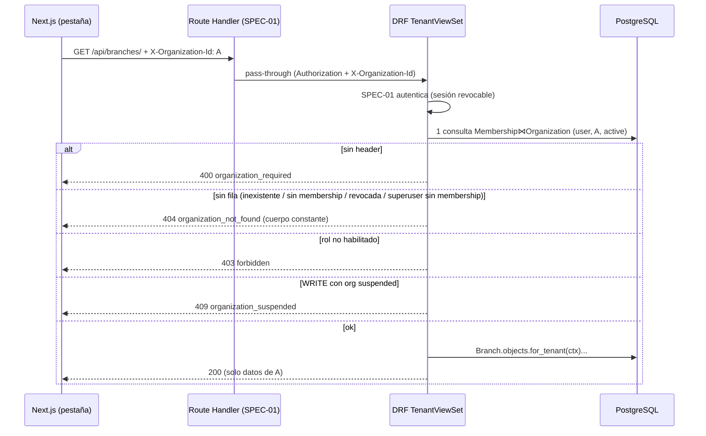

# Diseño — Módulo de Organizaciones, Sucursales y Roles (tenancy + RBAC)

> Parte de `spec.sdd.md` 1.0.2 (*Approved*) y de `clarifications.md` (Q-201…Q-228). No cambia reglas de negocio:
> donde la spec delega un detalle técnico ("lo decide `design.md`") se decide acá. Decisiones no obvias: **ADR-0001**
> (multi-tenancy) y **ADR-0002** (modelos propios), ambos *Aceptados*. Donde el código real de SPEC-00 obliga a nombrar
> distinto, manda `tasks.md` ("Ajustes al diseño").
>
> Supuestos de otras specs (ramas aparte, ya decididos): SPEC-00 — Python 3.12, Django 5.2 LTS, DRF 3.16,
> PostgreSQL 17, Celery 5.5, structlog, errores `application/problem+json` con `code` y `request_id`, test de
> arquitectura contra `Model.objects` crudo en `services/`, feature flags en `apps/common`, `/api/` sin versión en la
> URL, OpenAPI con drf-spectacular. SPEC-01 — `AUTH_USER_MODEL` en `apps/identity`, sesión revocable chequeada por
> request, el JWT no lleva rol/organización/membership, puerto de invitación `find_valid_invitations` /
> `accept_invitations` (aceptación atómica de todas las vigentes en el primer login), `GET /api/me` usa un selector de
> memberships de este módulo, la sesión del BFF guarda la última organización solo como default.
>
> **Ajustes posteriores a la aprobación del 2026-11-06**, redactados por `task-planner` y sin `architect`. El dueño dio
> su OK en el PR #61 a: flujo de Q-124 (`GET /api/invitations/mine/`, `POST /api/invitations/{id}/accept/`), puerto todo
> o nada (RN-IDA-06), Q-226/Q-227 en `Branch` con `409 conflict`, 4 migraciones y `tenancy_create_org`. Ese OK es
> anterior al orden de §4.4 que pidió el reviewer, y no nombraba quitar `admin.py`, reemplazar Playwright por script HTTP
> ni las rutas exentas nuevas; esos cambios constan en la descripción del PR.

## 1. Resumen de la solución
1. **Aislamiento en dos capas de aplicación** (más RLS como tercera, después): (a) toda tabla de negocio hereda
   `TenantModel` (columna `organization_id NOT NULL`) y su manager **falla cerrado**: cualquier consulta que se
   evalúe sin `.for_tenant(ctx)` lanza `TenantScopeError`; (b) un test de arquitectura (AST) prohíbe
   `X.objects.<algo>` que no sea un *scope* permitido y `unscoped()` fuera de una lista blanca.
2. **Organización activa por header** `X-Organization-Id` en cada request tenant-scoped. Un permiso DRF la resuelve
   en **una sola consulta** (`Membership ⋈ Organization`, índice parcial) después de que SPEC-01 autentica, construye
   un `TenantContext` inmutable (usuario, organización, membership, rol, estado) y lo deja en `request.tenant` y en un
   `ContextVar` (logs y guardas). No hay caché entre requests (RN-TEN-03/08).
3. **Matriz de permisos como código puro** (`apps/tenancy/domain/permissions.py` + `role_rules.py`): cada acción de
   API declara un `ActionSpec` (roles + tipo `READ` / `WRITE` / `REDUCE_ACCESS`). El tipo resuelve la suspensión de
   forma central para **todos** los módulos; un test transcribe la matriz de la spec celda por celda.
4. **Concurrencia por locks de fila sobre `Organization`**: `FOR NO KEY UPDATE` serializa cambios de membership /
   invitaciones (último owner, Q-201); `FOR KEY SHARE` lo toman las escrituras de negocio para leer el estado sin
   bloquearse entre sí; `FOR UPDATE` lo toman suspender/reactivar. Constraints únicos parciales como red final.
5. **Alta y soporte solo por comandos de gestión** auditados; ninguna ruta de API crea ni cambia el estado de una
   organización; superusuario/staff no saltea la membership.

## 2. Cobertura de la spec
| RN / RF / RNF | Dónde vive en el diseño |
|---|---|
| RN-TEN-01 | `apps/common/tenancy/models.py::TenantModel` (FK `organization` `NOT NULL`, `PROTECT`, inmutable) · `Membership`/`Invitation`/`Branch` heredan · test de arquitectura "toda tabla de negocio hereda `TenantModel`" (§9) |
| RN-TEN-02 | `apps/common/tenancy/querysets.py::TenantQuerySet` (falla cerrado) · `UnscopedReason` + lista blanca · `backend/tests/architecture/test_tenant_queries.py` |
| RN-TEN-03 | `apps/tenancy/api/permissions.py::ResolveTenant` (header `X-Organization-Id`, 1 consulta por request, sin caché) · `TenantContext` |
| RN-TEN-04 | `TenantModel.save()` (organización = la del `ContextVar`, inmutable) · serializers estrictos (campo desconocido → `400`) · `for_tenant(ctx).create(...)` fija `organization_id` |
| RN-TEN-05 | Selectors `get_*(ctx, id)` sobre `for_tenant(ctx)` → `NotFound` (`404 not_found`) · suite cross-tenant (§9) |
| RN-TEN-06 | `ResolveTenant`: inexistente, sin membership, UUID mal formado y superusuario sin membership → mismo `OrganizationNotFound` con cuerpo constante |
| RN-TEN-07 | Constraint `membership_one_active_per_org_user` (único parcial) · `RF-TEN-02` selector `list_active_memberships(user)` |
| RN-TEN-08 | Resolución sin caché en cada request · rol leído de la membership en esa consulta · re-lectura bajo lock en servicios de membership |
| RN-TEN-09 | `apps/tenancy/domain/permissions.py::TENANCY_ACTIONS` (deny-by-default) · `role_rules.py` · `ActionPermission` · `TenantViewSet.__init_subclass__` exige `ActionSpec` por acción |
| RN-TEN-10 | Sin ruta de creación (`OrganizationViewSet` solo `list`) · comando `tenancy_create_org` · `services/platform_org.py::create_organization` |
| RN-TEN-11 | `services/invitation_accept.py` (token, desde la sesión o puerto SPEC-01) · `selectors/invitations.py::list_my_pending` · `TenancyInvitationPort` |
| RN-TEN-12 | `domain/invitations.py` (normalización, vigencia, token) · constraint `invitation_one_pending_per_org_email` · `token_hash` único · `Membership.source_invitation` único · locks en aceptar/revocar/reenviar |
| RN-TEN-13 | `domain/role_rules.py::decide_invite`, `decide_manage_invitation`, `decide_role_change`, `decide_revoke` |
| RN-TEN-14 | `domain/role_rules.py` (conteo de owners) · `selectors/locks.py::lock_membership_mutex` (`FOR NO KEY UPDATE` sobre la organización) · excepción Q-213 en `create_organization` |
| RN-TEN-15 | `Branch` con constraint `branch_org_id_uniq (organization_id, id)` para FK compuesta desde SPEC-04/05 · selector `get_branch(ctx, id)` para que 04/05 validen la misma organización |
| RN-TEN-16 | `apps/tenancy/api/filters.py::resolve_branch_filter` (query `branch_id`, `404` si es de otra org; sin restricción por sucursal) |
| RN-TEN-17 | `apps/common/audit/port.py::emit` · `domain/audit_events.py::TenancyAuditAction` · servicios emiten dentro de la transacción |
| RN-TEN-18 | `Organization.status` · `ActionPermission` (rechaza `WRITE` con org `suspended`) · `apps/common/tenancy/locks.py::lock_org_for_write` (recheck transaccional) · actor `SYSTEM` exento · comando `tenancy_set_org_status` |
| RN-TEN-19 | `Branch.is_active` + constraints `branch_unique_active_name` y `branch_unique_active_code` · `services/branches.py` (desactivar/reactivar) · `NoHardDeleteMixin` · router sin `destroy` |
| RN-TEN-20 | `ResolveTenant` no consulta `is_superuser`/`is_staff` · comandos `tenancy_support_access` / `tenancy_owner_recovery` (Q-222/Q-224) emiten invitaciones normales |
| RN-TEN-21 | `Membership.status/ended_reason/ended_at` + check constraint · nunca se reactiva (no hay transición `revoked → active`) · aceptar crea fila nueva |
| RF-TEN-01 | `ResolveTenant` + `TenantContext` + `ContextVar` (`apps/common/tenancy/current.py`) |
| RF-TEN-02 | `selectors/memberships.py::list_active_memberships` · `GET /api/organizations/` · binding para `GET /api/me` (SPEC-01) |
| RF-TEN-03 | `GET/PATCH /api/organizations/current/` · `services/organizations.py::update_organization` · `domain/tax_id.py` |
| RF-TEN-04 | `/api/memberships/…` · `services/memberships.py` |
| RF-TEN-05 | `/api/invitations/…` · `services/invitations.py` · `services/invitation_accept.py` · tarea `send_invitation_email` (flag) |
| RF-TEN-06 | `/api/branches/…` · `services/branches.py` · `selectors/branches.py` |
| RF-TEN-07 | `apps/tenancy/management/commands/tenancy_*.py` → `services/platform_org.py`, `services/platform_access.py` |
| RF-TEN-08 | `apps/common/tenancy/*` (contexto, modelo, queryset, locks, Celery) · `apps/common/authz/*` (`ActionSpec`, `require`) · `apps/tenancy/api/base.py` (`TenantViewSet`) · `apps/tenancy/api/filters.py` |
| RF-TEN-09 | `apps/common/audit/port.py` (puerto hacia SPEC-10) + `sinks.py` (stub) |
| RNF-TEN-01 | `backend/tests/cross_tenant/` (suite parametrizada + clasificación de rutas) · `backend/tests/architecture/` |
| RNF-TEN-02 | `ResolveTenant` liga `organization_id` a structlog solo tras validar; evento `tenancy.access_denied` con `reason` |
| RNF-TEN-03 | `domain/invitations.py::new_token` (256 bits) + `token_hash` SHA-256 · token solo en respuesta de crear/reenviar · link con fragmento `#token=` · test de logs |
| RNF-TEN-04 | `TenancyAuditAction` (catálogo = lista de la spec, con Q-223 y Q-225) · test de completitud de eventos |
| RNF-TEN-05 | Migraciones autogeneradas reversibles, probadas en CI (`migrate` / `migrate tenancy <anterior>`) · diseño compatible con RLS (ADR-0001 §RLS) |
| RNF-TEN-06 | `Invitation` guarda solo `email` normalizado; logs con IDs, no emails |
| RNF-TEN-07 | Resolución = **1 consulta SQL** por request, constante respecto de la cantidad de memberships; test con `django_assert_num_queries` |

> Sin filas sin destino. Q-220 (Caja) no es de este módulo; RN-TEN-15 queda cubierta del lado de 02 por la
> constraint `(organization_id, id)` y el selector; la FK compuesta efectiva la agrega SPEC-04/05.

## 3. Componentes y capas

### 3.1 Base transversal en `apps/common` (reutilizada por 04, 06, 07, 08, 09, 11)
| Archivo | Contenido | ~líneas |
|---|---|---|
| `apps/common/tenancy/context.py` | `TenantContext` (dataclass `frozen`, `slots`): `organization_id: UUID`, `organization_status: OrgStatus`, `actor: UserActor \| ApiKeyActor \| SystemActor`. `UserActor(user_id, membership_id, role)`; `ApiKeyActor(key_id, scopes)` (reservado para SPEC-11); `SystemActor(reason: SystemReason)`. Enums `OrgStatus`, `SystemReason` (`webhook`, `poller`, `celery`, `platform_command`). Fábrica `system_context(organization_id, reason)` (lee el estado real de la organización). | 110 |
| `apps/common/tenancy/current.py` | `ContextVar[TenantContext \| None]`; `tenant_scope(ctx)` (context manager: setea el var, liga `organization_id` a structlog, resetea al salir); `current_tenant()`; `require_current_tenant()`. | 70 |
| `apps/common/tenancy/middleware.py` | `TenantContextMiddleware`: asegura el var en `None` al empezar y lo resetea al terminar cada request (no resuelve nada: la resolución necesita al usuario de DRF). | 30 |
| `apps/common/tenancy/querysets.py` | `TenantQuerySet` / `TenantManager` falla cerrado (§3.4), `UnscopedReason`, `TenantScopeError`. | 170 |
| `apps/common/tenancy/models.py` | `TenantModel` abstracto (FK `settings.TENANT_MODEL`, `related_name="+"`, guarda en `save()`), `NoHardDeleteMixin`. | 110 |
| `apps/common/tenancy/locks.py` | `lock_org_for_write(ctx)` → `SELECT status … FOR KEY SHARE` (SQL crudo, único lugar permitido) y `ensure_writable(ctx)`. | 70 |
| `apps/common/tenancy/errors.py` | `OrganizationRequired` (400), `OrganizationNotFound` (404), `OrganizationSuspended` (409), `Forbidden` (403) sobre la clase base de errores de SPEC-00. | 50 |
| `apps/common/tenancy/celery.py` | `TenantTask` (exige `organization_id`; abre `tenant_scope(system_context(...))`; liga `task_id`), `SystemFanoutTask` (sin organización; solo enumera IDs con `unscoped(SYSTEM_FANOUT)` y encola `TenantTask` por organización). | 100 |
| `apps/common/authz/roles.py` | `Role` (`StrEnum`: `owner`, `admin`, `operator`, `viewer`) y `ROLE_RANK`. | 30 |
| `apps/common/authz/actions.py` | `ActionKind` (`READ`, `WRITE`, `REDUCE_ACCESS`), `ActionSpec(name, roles, kind, api_key_scope=None)`, `SUSPENDED_ALLOWED_KINDS = {READ, REDUCE_ACCESS}` (Q-221, un solo lugar). | 60 |
| `apps/common/authz/checks.py` | `require(ctx, spec)` (403 / 409, deny-by-default), `allowed_actions(ctx, specs) -> list[str]` para la UI. | 80 |
| `apps/common/audit/port.py` | `AuditEvent`, `AuditActor`, `emit(event)` (resuelve el sink de `settings.AUDIT_SINK`); contrato: se llama **dentro** de la transacción de negocio. | 90 |
| `apps/common/audit/sinks.py` | Stubs: `RecordingSink` (tests), `StructlogAuditSink` (dev/staging: canal `audit` separado, `on_commit`). El sink transaccional real lo aporta SPEC-10. | 70 |

Settings nuevos: `TENANT_MODEL = "tenancy.Organization"`, `TENANT_HEADER = "X-Organization-Id"`, `AUDIT_SINK`,
`PLATFORM_OPERATOR_EMAILS` (lista, de entorno), `FRONTEND_BASE_URL`, flag `TENANCY_INVITATION_EMAIL_ENABLED`
(default `False`, en el mecanismo de flags de SPEC-00).

### 3.2 App `apps/tenancy`
```
apps/tenancy/
├── models/            organization.py · membership.py · invitation.py · branch.py · __init__.py
├── domain/            permissions.py · role_rules.py · invitations.py · tax_id.py · audit_events.py
├── selectors/         resolution.py · memberships.py · invitations.py · branches.py · organizations.py · locks.py
├── services/          organizations.py · memberships.py · invitations.py · invitation_accept.py · branches.py
│                      platform_org.py · platform_access.py · audit.py · invitation_port.py
├── api/               base.py · permissions.py · filters.py · urls.py
│                      organizations.py · memberships.py · invitations.py · branches.py
│                      serializers/ (organizations.py · memberships.py · invitations.py · branches.py)
├── management/commands/  tenancy_create_org.py · tenancy_set_org_status.py · tenancy_owner_invite.py
│                         tenancy_support_access.py · tenancy_owner_recovery.py
├── tasks.py           expire_invitations (fan-out) · send_invitation_email (flag)
├── errors.py          already_member · invitation_pending · invitation_invalid · last_owner · invalid_transition
└── tests/             domain/ · services/ · api/ · commands/
```
Ningún archivo pasa de ~250 líneas estimadas; los más grandes son `role_rules.py` (~160), `services/memberships.py`
(~220) e `invitation_accept.py` (~200). Si alguno crece, se parte por caso de uso (`C-14`).

### 3.3 Capas (respeto de `api → services → selectors → models`, lógica pura en `domain/`)
- **`api/`**: vistas y serializers finos; cada acción declara su `ActionSpec`; validan entrada y llaman **un**
  servicio o selector. Nunca tocan managers.
- **`services/`**: casos de uso; abren `transaction.atomic()`, toman locks (`selectors/locks.py` y
  `common/tenancy/locks.py`), consultan `domain/` para decidir, escriben vía `for_tenant(ctx)` y emiten auditoría
  dentro de la transacción. Los rechazos auditables (`owner_protection.rejected`, `invitation.rejected`) se emiten
  **después** de salir del bloque atómico (para que el rollback no se los lleve) y luego se lanza el error.
- **`selectors/`**: lecturas con `for_tenant(ctx)` / `for_user(user_id)` / `by_token_hash(h)`; únicos lugares de la
  app con `unscoped()` permitido: `selectors/resolution.py` (`TENANT_RESOLUTION`) y `services/platform_*.py`
  (`PLATFORM_COMMAND`).
- **`domain/`**: sin Django; enums, matriz, reglas de roles, normalización de email, vigencia, CUIT, catálogo de
  eventos. 100 % testeable sin BD.

### 3.4 Manager que falla cerrado (`TenantQuerySet`)
- `TenantModel.objects = TenantManager()`; `get_queryset()` devuelve un `TenantQuerySet` **no scoped**.
- *Scopes* válidos: `for_tenant(ctx: TenantContext)` (exige instancia de `TenantContext`, filtra
  `organization_id=ctx.organization_id`; si hay un `ContextVar` activo, debe coincidir), y en modelos que lo
  declaran: `Membership.for_user(user_id)`, `Invitation.by_token_hash(h)`, `Invitation.pending_for_email(email)`
  (puerto SPEC-01), `Invitation.for_session_accept(id)` (aceptar desde la sesión, §4.4: la lectura cruza organizaciones
  y el servicio decide por email antes de devolver nada). `unscoped(reason: UnscopedReason)` marca el queryset como deliberadamente global.
- Todo método que **ejecuta** SQL (`_fetch_all`/iteración, `count`, `exists`, `aggregate`, `iterator`, `update`,
  `delete`, `get`, `create`, `bulk_create`, `bulk_update`, `in_bulk`, `get_or_create`, `update_or_create`,
  `explain`, `contains`) verifica la marca y si falta lanza `TenantScopeError` **antes** de ir a la BD (AC-TEN-11).
  `_clone()` propaga la marca. `TenantScopeError` se mapea a `500` genérico (es un bug), nunca a datos.
- `Meta.base_manager_name` apunta a un manager plano solo para internals de Django (FK hacia adelante, p. ej.
  `branch.organization`); los reverse accessors desde `Organization` no existen (`related_name="+"`).
- Límite conocido: un queryset sin scope usado como **subconsulta** (`__in=`) no pasa por `_fetch_all`; lo atrapa el
  test de arquitectura (no permite `X.objects.filter`) y, más adelante, RLS (ADR-0001).
- `Organization` usa `OrganizationQuerySet` con la misma semántica (`for_tenant(ctx)` → `pk=ctx.organization_id`).
- `NoHardDeleteMixin` (Organization, Membership, Invitation, Branch): `Model.delete()` y `QuerySet.delete()` lanzan
  `HardDeleteForbidden`; todas las FK hacia estas tablas usan `on_delete=PROTECT`.

### 3.5 Resolución por request (DRF)
- La resolución vive en un **permiso DRF**, no en un middleware de Django: el usuario lo autentica la clase de
  autenticación de SPEC-01 dentro de DRF, y un middleware anterior tendría que duplicar esa autenticación (ADR-0001).
- `TenantViewSet` (`apps/tenancy/api/base.py`, `GenericViewSet`) con `tenant_scoped = True` y
  `permission_classes = [IsAuthenticated (SPEC-01), ResolveTenant, ActionPermission]`, más
  `action_specs: dict[str, ActionSpec]` obligatorio; `__init_subclass__` falla (`ImproperlyConfigured`) si una acción
  del viewset no tiene `ActionSpec`.
- `ResolveTenant.has_permission`:
  1. Lee `X-Organization-Id`. Ausente → `OrganizationRequired` (`400 organization_required`) (AC-TEN-06).
  2. Valor que no es UUID → `OrganizationNotFound` (mismo cuerpo que inexistente).
  3. **Una consulta**: `Membership.objects.unscoped(TENANT_RESOLUTION).filter(user_id=…, organization_id=…,
     status="active").select_related("organization").only(id, role, organization__id, organization__status)`
     — usa el índice parcial `membership_active_user_org`. Sin fila → `OrganizationNotFound` (inexistente, sin
     membership o revocada son indistinguibles; `is_superuser`/`is_staff` no se miran) (AC-TEN-03/04/31/33).
  4. Construye `TenantContext(UserActor(...))`, lo guarda en `request.tenant`, abre el `ContextVar` (el middleware lo
     resetea) y liga `organization_id` a structlog.
  5. Rechazos → `log.warning("tenancy.access_denied", reason=…, requested_organization_id=…, user_id=…)` (Q-217;
     contable como métrica; si SPEC-00 incorpora un backend de métricas, este mismo punto suma al contador).
- `ActionPermission.has_permission`: toma `action_specs[view.action]`; rol fuera de `spec.roles` → `403 forbidden`;
  organización `suspended` y `spec.kind` ∉ `SUSPENDED_ALLOWED_KINDS` → `409 organization_suspended`. El chequeo
  dependiente del objeto (roles del destino, último owner) lo hace el servicio con `domain/role_rules.py`.
- Orden de errores: `401` (SPEC-01) → `400/404` organización → `403` rol → `409` suspendida → `404` objeto → reglas.
- Rutas sin organización activa (exentas, lista explícita `TENANT_EXEMPT_ROUTES` con justificación):
  `GET /api/organizations/`, `POST /api/invitations/accept/`, `GET /api/invitations/mine/`,
  `POST /api/invitations/{id}/accept/`, y las de SPEC-00/01 (`/api/me`, auth, health, schema). El header se ignora en
  ellas.

### 3.6 Procesos sin usuario (Celery, webhooks, poller)
- **Tarea por organización**: `class X(TenantTask)` con `organization_id` obligatorio en kwargs. `__call__` abre
  `tenant_scope(system_context(org_id, SystemReason.CELERY))`; dentro, los selectors usan `for_tenant(ctx)` como en
  una request. `ensure_writable(ctx)` con actor `SYSTEM` **no** bloquea por suspensión (RN-TEN-18: los `pending` se
  procesan igual); los demás chequeos (estado del cobro, idempotencia) son del módulo dueño.
- **Enumerar trabajo de varias organizaciones** (poller, vencimiento de invitaciones): `SystemFanoutTask` en un
  archivo `apps/<app>/tasks/fanout.py` (o función `*_fanout` en `tasks.py` declarada en la lista blanca) hace
  **solo** `unscoped(SYSTEM_FANOUT).values_list("organization_id", "id")` y encola una `TenantTask` por par; nunca
  procesa datos de negocio en el fan-out.
- **Webhooks** (SPEC-07): el receptor identifica la organización por la integración destinataria antes de tocar datos
  y encola una `TenantTask` con ese `organization_id`. El patrón y su test genérico viven acá; la implementación,
  en 06/07.

### 3.7 Suspensión aplicada a todos los módulos
1. **Capa API (central)**: `ActionPermission` rechaza toda acción `WRITE` con `409 organization_suspended` usando el
   estado leído en la misma consulta de resolución. Como cada acción de cada módulo **debe** declarar `ActionKind`,
   ningún módulo puede olvidarse (fallo en import).
2. **Capa servicio (carrera con la suspensión)**: cada servicio de escritura de usuario/API key llama
   `ensure_writable(ctx)` dentro de su transacción → `SELECT status FROM tenancy_organization WHERE id=%s FOR KEY
   SHARE`. El comando de suspender toma `FOR UPDATE` (conflicta con `KEY SHARE`), así que: una escritura que empieza
   después de la suspensión la ve; una que ya tenía el lock confirma antes y la suspensión espera. Satisface el caso
   límite "suspender mientras hay una escritura en curso" sin serializar escrituras entre sí (`KEY SHARE` es
   compatible consigo mismo y con la edición de datos de la org, que toma `NO KEY UPDATE`).
3. Las acciones `REDUCE_ACCESS` (revocar membership, abandonar, revocar invitación) pasan (Q-221). Aceptar
   invitación es `WRITE` y se rechaza (incluido el puerto de SPEC-01, que además filtra organizaciones `active` en
   `find_valid_invitations`).

### 3.8 Matriz de permisos como código
- `apps/tenancy/domain/permissions.py`: `TenancyAction` (`StrEnum`) y `TENANCY_ACTIONS: Mapping[TenancyAction,
  ActionSpec]` (deny-by-default: lo que no está, no se puede):

| `TenancyAction` | Roles | `ActionKind` | API key |
|---|---|---|---|
| `org.read` | owner, admin, operator, viewer | READ | — |
| `org.update` | owner, admin | WRITE | — |
| `member.list` | owner, admin | READ | — |
| `member.change_role` | owner, admin (+ reglas de destino) | WRITE | — |
| `member.revoke` | owner, admin (+ reglas de destino) | REDUCE_ACCESS | — |
| `member.leave` | owner, admin, operator, viewer (+ último owner) | REDUCE_ACCESS | — |
| `invitation.list` | owner, admin | READ | — |
| `invitation.create` | owner, admin (+ rol invitado) | WRITE | — |
| `invitation.resend` | owner, admin (+ rol de la invitación) | WRITE | — |
| `invitation.revoke` | owner, admin (+ rol de la invitación) | REDUCE_ACCESS | — |
| `branch.read` | owner, admin, operator, viewer | READ | `branches:read` (SPEC-11) |
| `branch.create` / `branch.update` / `branch.deactivate` / `branch.reactivate` | owner, admin | WRITE | — |

- `apps/tenancy/domain/role_rules.py` (puras, devuelven `Decision = ALLOW | NOOP | FORBIDDEN | LAST_OWNER`):
  - `decide_role_change(actor_role, target_role, new_role, is_self, active_owners)`: mismo rol → `NOOP`; propio y
    sube de rango → `FORBIDDEN`; propio owner que baja con `active_owners <= 1` → `LAST_OWNER`; propio admin baja a
    operator/viewer → `ALLOW`; ajeno: owner → `ALLOW` (con `LAST_OWNER` si quita el último owner); admin → `FORBIDDEN`
    si `target_role` u `new_role` es `owner`, si no `ALLOW` (incluye otros admin, Q-202).
  - `decide_revoke(actor_role, target_role, active_owners)` (ajeno) y `decide_leave(role, active_owners)`.
  - `decide_invite(actor_role, invite_role)` / `decide_manage_invitation(actor_role, invitation_role)`: owner todo;
    admin todo menos `owner`.
  - `invitations_to_auto_revoke(new_role_or_none, pending_by_inviter)` (Q-223).
- Las otras apps declaran **sus** acciones en su `domain/permissions.py` con el mismo `ActionSpec` (06 define
  `charge.create`, etc.). La UI recibe `allowed_actions` calculadas por el backend (no duplica la matriz).
- **Cómo se testea**: `apps/tenancy/tests/domain/test_permission_matrix.py` contiene `SPEC_MATRIX`, transcripción
  literal de la tabla de `spec.sdd.md §4/§4.1` (versión citada en el archivo); se parametriza sobre
  `Role × TenancyAction × {active, suspended}` y compara con `require()`; además `set(TenancyAction) ==
  set(TENANCY_ACTIONS)`. `test_role_rules.py` recorre la tabla completa `Role × Role × Role × is_self × owners∈{1,2}`.
  Un cambio en la spec obliga a cambiar el test (C-12).

### 3.9 Interfaz de usuario (frontend)
Rutas (App Router, `context/07 §3`):
| Ruta | Quién | Contenido |
|---|---|---|
| shell `(dashboard)` | todos | `OrgBranchSelector` en la barra superior; `SuspendedBanner` si la org activa está `suspended` |
| `/configuracion/empresa` | todos (edición owner/admin) | `CompanyDataForm` (zod: `name` 1–120 tras recortar, `legal_name` ≤200, CUIT 11 dígitos con guiones opcionales, `timezone` de lista); solo lectura si falta `org.update` en `allowed_actions` o está suspendida; botón "Abandonar esta organización" (todos los roles, confirmación; `409 last_owner` explicado) |
| `/configuracion/sucursales` | todos (gestión owner/admin) | `BranchesTable` (nombre, código, dirección, chip activa/inactiva; filtro activas/inactivas/todas), `BranchFormDialog`, confirmación de desactivar/reactivar con `LoadingButton`; vacío: "Creá tu primera sucursal" u "Aún no hay sucursales"; espacio reservado para las cajas del módulo dueño (Q-220) |
| `/configuracion/colaboradores` | owner/admin (entrada de menú oculta para el resto; acceso directo → estado "sin permiso") | pestañas Miembros / Invitaciones pendientes; `MembersTable` con acciones por fila desde `allowed_actions` y `assignable_roles`; `InviteDialog` (roles de `invitable_roles`); `InvitationLinkDialog` muestra `accept_url` una sola vez con "Copiar" y aviso "no se vuelve a mostrar" (estado local del componente, nunca en la caché de Query) |
| `/invitacion` (fuera de `(dashboard)`) | autenticado | Lee `#token`, lo guarda en `sessionStorage` si hay que pasar por login (SPEC-01 vuelve a esta ruta), borra el fragmento con `history.replaceState`, hace `POST /api/invitations/accept/` y borra el token; estados: aceptada (con "Ir a la empresa"), vencida, revocada, ya usada, para otra cuenta de Google, organización suspendida, no encontrada |
| `/sin-organizacion` | autenticado sin memberships | `EmptyState` con contacto del operador (variable de servidor `OPERATOR_CONTACT`, leída en `lib/server/env.ts` y pasada por prop desde la página) (Q-205) + `PendingInvitationsNotice` |
| `/inicio` (de SPEC-00) | todos | `PendingInvitationsNotice` (Q-121, Q-124): lista `GET /api/invitations/mine/` con empresa, rol y vencimiento; "Aceptar" llama a `POST /api/invitations/{id}/accept/`, refresca organizaciones y ofrece "Ir a la empresa". Sin invitaciones no se muestra |

Componentes/estado (`frontend/src/modules/tenancy/`): `context/ActiveOrgProvider.tsx` (org y sucursal **por
pestaña** en `sessionStorage`; al abrir: valor de la pestaña si sigue en `GET /api/organizations/` → default de la
sesión del BFF (SPEC-01) → primera por nombre); `hooks/` (`useOrganizations`, `useCurrentOrganization`, `useMembers`,
`useInvitations`, `useBranches` y mutaciones); el `api-client` agrega `X-Organization-Id` en toda request
tenant-scoped y las query keys llevan `['org', orgId, …]`. Cambiar de empresa: `removeQueries` de todo `['org', …]`,
sucursal a "Todas", avisa al BFF el nuevo default. La sucursal viaja como query `branch_id` solo en las pantallas que
filtran (no es header). Errores globales: `404 organization_not_found` → refrescar organizaciones y pasar a otra
(Snackbar "Ya no tenés acceso a esa empresa") o a `/sin-organizacion`; `409 organization_suspended` → `Alert` de solo
lectura; `403` → estado "sin permiso". Esquemas de carga y vacío según `context/07 §2`. La UI nunca decide permisos:
solo oculta lo que `allowed_actions` no trae; el backend vuelve a validar todo.

### 3.10 Cambios a aplicar en `context/07-frontend-ui-guidelines.md` (no editado acá)
- **§5.1, viñeta "Cambiar de empresa…"**: reemplazar "es una nueva query con el `organization_id` elegido" por "cada
  request tenant-scoped lleva la organización elegida en el header `X-Organization-Id`; el backend revalida la
  membership en cada request (RN-TEN-03)".
- **§5.1, viñeta "La selección persiste en la sesión…"**: reemplazar por "La selección es **por pestaña**
  (`sessionStorage`) y viaja en el header `X-Organization-Id` de cada request; la sesión del BFF guarda la última
  elegida solo como valor por defecto al abrir una pestaña nueva (Q-205). No es fuente de autorización."
- **§5.1, sucursal**: agregar "La sucursal es un filtro: viaja como `branch_id` en la query de las pantallas que
  filtran; 'Todas las sucursales' = sin `branch_id`; el selector lista solo Branch activas; una org `suspended` se
  muestra con un chip 'Suspendida'".
- **§3.2 (BFF)**: agregar que el pass-through también reenvía `X-Organization-Id` sin modificarlo.
- **§5.3, fila "Sucursales y cajas"**: el módulo de las cajas queda sujeto a Q-220 (propuesta SPEC-04), no
  `02 + 05`.

## 4. Flujos principales

### 4.1 Request tenant-scoped (camino feliz y errores)


### 4.2 Cambiar rol / revocar / abandonar (último owner, AC-TEN-13/14/27)
1. `ActionPermission` (`member.change_role` / `member.revoke` / `member.leave`).
2. `services.memberships.change_role(ctx, membership_id, new_role)` → `atomic`:
   `lock_membership_mutex(ctx)` = `Organization.objects.for_tenant(ctx).select_for_update(no_key=True)` (lee
   `status`: si `suspended` y la acción es `WRITE` → `409`) → `target = get_active_membership(ctx, id,
   for_update=True)` (otra org → `404`; `revoked` → `409 invalid_transition`) → re-lee la membership del actor bajo el
   mismo lock (si cambió desde la resolución, rige la nueva) → cuenta owners activos → `decide_role_change(...)`.
3. `ALLOW` → actualiza, auto-revoca invitaciones del afectado que ya no podría emitir (Q-223), emite
   `membership.role_changed` (+ `invitation.auto_revoked` con motivo `inviter_lost_permission`) y confirma.
   `NOOP` → `200` sin evento. `FORBIDDEN` → `403`. `LAST_OWNER` → sale del `atomic` sin cambios, emite
   `owner_protection.rejected` en transacción propia, `409 last_owner`.
4. Concurrencia: dos owners que se degradan/revocan mutuamente toman el **mismo** lock de fila de la organización;
   el segundo espera, recuenta (ya hay 1 owner) y recibe `last_owner` (AC-TEN-14). Orden de locks fijo:
   organización → membership/invitación (evita deadlocks).
5. `DELETE /api/memberships/{id}/` sobre la **propia** membership se trata como abandonar (`ended_reason=left`,
   evento `membership.left`), así el único owner que intenta "revocarse" recibe `last_owner` (AC-TEN-13).

### 4.3 Invitar, reenviar, revocar
- Crear: `atomic` + `lock_membership_mutex` → `decide_invite` → ya es miembro activo → `409 already_member` → si hay
  `pending` vencida (`now >= expires_at`) se pasa a `expired` antes (vencimiento perezoso) → `pending` vigente →
  `409 invitation_pending` → crea con `token_hash`; el `IntegrityError` del único parcial ante dos requests
  simultáneas se traduce a `invitation_pending` (AC-TEN-26). Respuesta `201` con `accept_url` **una sola vez**.
- Reenviar: mismo lock + `FOR UPDATE` sobre la invitación (debe estar `pending`) → la marca `revoked`
  (`revoked_reason=resent`), crea la nueva (`replaces=` anterior, vigencia nueva desde ahora) → eventos
  `invitation.resent` (y `invitation.revoked` de la anterior).
- Revocar: lock + `FOR UPDATE` → `pending` → `revoked`; otro estado → `409 invalid_transition`.

### 4.4 Aceptar invitación (token) — AC-TEN-17/18/19/25/35
```mermaid
sequenceDiagram
  participant U as Usuario autenticado
  participant API as POST /api/invitations/accept/
  participant DB as PostgreSQL
  U->>API: {token}
  API->>DB: Invitation.by_token_hash(sha256(token))
  alt no existe
    API-->>U: 400 invitation_invalid (reason=not_found)
  end
  API->>DB: atomic: org FOR NO KEY UPDATE → invitation FOR UPDATE
  alt email normalizado ≠ email del usuario
    API-->>U: 400 invitation_invalid (reason=email_mismatch), sigue pending, evento invitation.rejected
  else status ≠ pending
    API-->>U: 400 invitation_invalid (reason=revoked|used|expired)
  else now ≥ expires_at
    API->>DB: pending→expired (se confirma; evento invitation.expired, Q-225)
    API-->>U: 400 invitation_invalid (reason=expired)
  else org suspended
    API-->>U: 409 organization_suspended
  else ya es miembro activo
    API-->>U: 409 already_member (sigue pending)
  else ok
    API->>DB: Membership nueva (source_invitation único) + invitation accepted + eventos
    API-->>U: 200 {organization, role, membership_id}
  end
```
Doble aceptación en paralelo: el segundo espera el `FOR UPDATE`, ve `accepted` → `invitation_invalid (used)`; el
único `Membership.source_invitation` y el único parcial de membership activa son la red final.
**Desde la sesión (Q-121, Q-124):** `GET /api/invitations/mine/` lista con `Invitation.pending_for_email(user.email)`
las `pending`, vigentes y de organización `active` (el mismo filtro del puerto), sin token. `POST
/api/invitations/{id}/accept/` usa el mismo servicio del diagrama, sin token y sin `X-Organization-Id`, y **no** busca
dentro de esa lista, porque perdería los estados de abajo. El orden es:
1. Lee con `Invitation.for_session_accept(id)` (§3.4), sin transacción y sin lock: igual que `by_token_hash` en el
   diagrama. Un intento ajeno no toma ningún lock.
2. Si no existe, o existe y es de otro email, responde `400 invitation_invalid (reason=not_found)` con **el mismo
   cuerpo** en los dos casos, sin revelar que existe y sin `atomic`. Si la fila existe, sigue `pending`, sin membership,
   y `invitation.rejected` (motivo `email_mismatch`, actor el usuario, sin el email de nadie) va en su propia escritura
   antes de lanzar el error (§3.3, RNF-TEN-04).
3. Para el titular sigue el diagrama desde `atomic`: organización `FOR NO KEY UPDATE`, invitación `FOR UPDATE` (orden
   fijo de ADR-0002 §3), relee email y `status`. Si el email ya no coincide responde como el paso 2 (`not_found`, sin
   membership, con `invitation.rejected` fuera del `atomic`): este contrato no admite `email_mismatch`. `revoked`, `used` y `expired` dan su `reason`, la organización suspendida
   da `409 organization_suspended` (AC-TEN-28) y ya ser miembro da `409 already_member`.

Vive en `selectors/invitations.py::list_my_pending` y `services/invitation_accept.py`; no hay un segundo camino de
aceptación (ADR-0002 §5). Riesgos conocidos: este camino no prueba el buzón con el token y depende de `user.email`, que
se actualiza al loguear, así que quien perdió esa cuenta de Google puede aceptar mientras dure su sesión (hasta 30 días).
Las rutas no tienen límite propio para autenticados: los ID son UUIDv4 y el alcance es el propio email.

Puerto de SPEC-01 (`TenancyInvitationPort`, `services/invitation_port.py`): firma de `specs/01-identity-access/design.md
§6.4`. `find_valid_invitations(email, now=)` → `pending`, `expires_at > now`, organización `active`, con `FOR UPDATE`,
locks de organizaciones en orden de `id`. `accept_invitations(invitations, user_id, now=)` → dentro de la transacción
del caller, mismas validaciones que arriba por invitación; **todo o nada**: si una no se puede aceptar lanza
`InvitationsNoLongerValid` y el caller hace rollback de todo (RN-IDA-06, AC-IDA-05). Se registra por settings
(`IDENTITY_INVITATION_PORT`) para que `apps/identity` no importe `apps/tenancy`.

### 4.5 Comando: crear organización (AC-TEN-22)
`manage.py tenancy_create_org --key acme-2026 --name "Acme" --owner-email x@d.com --operator ops@hub.com`
1. `--operator` debe estar en `PLATFORM_OPERATOR_EMAILS`; queda como actor (`actor_type=platform_operator`, más el
   usuario del SO) en todos los eventos.
2. Idempotencia (Q-123 de SPEC-01): `platform_creation_key` único. Misma clave + mismos parámetros → imprime la org
   existente y **no** emite eventos ni token; misma clave + parámetros distintos → error sin efectos.
3. `atomic`: crea `Organization(status=active)` → `tenant_scope(system_context(org, PLATFORM_COMMAND))` → crea
   `Invitation(role=owner, purpose=first_owner, invited_by_operator=…)` → eventos `organization.created`,
   `invitation.created`. Imprime el link **una vez** en stdout (no pasa por el logger). Si el email ya tiene usuario
   no cambia nada: se emite igual la invitación y esa persona la acepta adentro del Hub (Q-124, AC-TEN-40).
Otros comandos: `tenancy_set_org_status --org --status suspended|active --reason --operator` (`FOR UPDATE`;
eventos `organization.suspended/reactivated`); `tenancy_owner_invite reissue|revoke --org --operator` (solo si la
org no tiene owner activo, Q-213); `tenancy_support_access --org --email --role viewer --reason --operator`
(Q-222: emite invitación `purpose=support`, rol ≠ owner); `tenancy_owner_recovery --org --email --reason
--operator` (Q-224: invitación `owner`, `purpose=owner_recovery`, aviso a owners existentes cuando haya
email; no revoca a nadie).

## 5. Datos
Todas las PK son `UUID` (v4); fechas `timestamptz` en UTC. Enums como `varchar` + `CheckConstraint`. Django 5.2
(`CheckConstraint(condition=…)`, `UniqueConstraint(condition=…)`).

| Tabla | Columnas | Constraints / índices | Notas |
|---|---|---|---|
| `tenancy_organization` | `id`, `name varchar(120)`, `legal_name varchar(200) ''`, `tax_id varchar(11) ''`, `timezone varchar(64) default 'America/Argentina/Buenos_Aires'`, `status varchar(16) default 'active'`, `status_changed_at null`, `platform_creation_key varchar(64) null`, `created_by_operator varchar(254)`, `created_at`, `updated_at` | `org_status_valid` (`status IN (active, suspended)`) · `org_name_not_blank` (`name <> ''`) · `org_tax_id_digits` (`tax_id = '' OR tax_id ~ '^[0-9]{11}$'`) · único `platform_creation_key` | Raíz; **no** hereda `TenantModel` pero su manager también falla cerrado. `timezone` validada contra `zoneinfo.available_timezones()`; CUIT con dígito verificador en `domain/tax_id.py` (acepta guiones, guarda 11 dígitos) |
| `tenancy_membership` | `id`, `organization_id` FK PROTECT, `user_id` FK `AUTH_USER_MODEL` PROTECT, `role varchar(16)`, `status varchar(16) default 'active'`, `ended_reason varchar(16) null`, `ended_at null`, `ended_by_id` FK user null, `invited_by_id` FK user null, `source_invitation_id` FK invitation null **único**, `created_at`, `updated_at` | `membership_one_active_per_org_user` único parcial `(organization_id, user_id) WHERE status='active'` · `membership_role_valid` · `membership_status_valid` · `membership_end_coherent` (`(status='active' AND ended_reason IS NULL AND ended_at IS NULL) OR (status='revoked' AND ended_reason IN ('revoked','left') AND ended_at IS NOT NULL)`) · índice parcial `membership_active_user_org (user_id, organization_id) INCLUDE (role) WHERE status='active'` | El índice parcial sirve a la resolución (1 consulta) y a "mis organizaciones". `revoked` es terminal |
| `tenancy_invitation` | `id`, `organization_id`, `email varchar(254)`, `role varchar(16)`, `status varchar(16) default 'pending'`, `purpose varchar(16) default 'standard'`, `reason varchar(200) ''`, `token_hash char(64)`, `expires_at`, `invited_by_user_id` null, `invited_by_operator varchar(254) ''`, `accepted_by_id` null, `accepted_at` null, `revoked_at` null, `revoked_reason varchar(32) null`, `revoked_by_id` null, `replaces_id` FK self null, `created_at`, `updated_at` | `invitation_one_pending_per_org_email` único parcial `(organization_id, email) WHERE status='pending'` · único `token_hash` · `invitation_email_normalized` (`email = lower(btrim(email))`) · `invitation_status_valid` · `invitation_role_valid` · `invitation_purpose_valid` (`standard, first_owner, support, owner_recovery`) · `invitation_inviter_xor` (exactamente uno de `invited_by_user_id` / `invited_by_operator`) · `invitation_operator_reason` (`purpose IN (support, owner_recovery) ⇒ reason <> ''`) · `invitation_accepted_coherent` · `invitation_expiry_after_creation` · índices `(organization_id, status, created_at)` y parcial `(email) WHERE status='pending'` (puerto SPEC-01) | Solo email del invitado (RNF-TEN-06). `revoked_reason ∈ {revoked, resent, inviter_lost_permission, operator}` |
| `tenancy_branch` | `id`, `organization_id`, `name varchar(120)`, `code varchar(32) ''`, `address varchar(255) ''`, `is_active bool default true`, `deactivated_at null`, `created_at`, `updated_at` | `branch_unique_active_name` único parcial `(organization_id, lower(name)) WHERE is_active` (Q-226) · `branch_unique_active_code` único parcial `(organization_id, code) WHERE is_active AND code <> ''` (Q-227) · `branch_name_not_blank` · `branch_org_id_uniq (organization_id, id)` (destino de FK compuesta de 04/05, RN-TEN-15) · índice `(organization_id, is_active, name)` | Sin borrado físico. Nombre sin distinguir mayúsculas tras recortar; `code` exacto, solo si viene informado |

- Normalización de texto en servicios: `strip()` de `name`, `legal_name`, `code`, `address`; email con
  `domain/invitations.py::normalize_email` (`strip` + `lower` de toda la cadena, validado con `EmailValidator`,
  máx. 254; no colapsa puntos ni `+alias`).
- Migraciones: `0001_organization`, `0002_membership`, `0003_invitation` (agrega también la FK
  `membership.source_invitation`), `0004_branch`. Solo esquema, sin datos; autogeneradas y reversibles.

## 6. Contratos de API
Header en rutas tenant-scoped: `X-Organization-Id: <uuid>`. Errores `application/problem+json` (SPEC-00) con `code`
y `request_id`. Paginación: la por defecto de SPEC-00; si no la fija, `PageNumberPagination` 50 (máx. 200).
Serializers de entrada **estrictos**: campo desconocido o de solo lectura (`organization_id`, `status`, `id`) →
`400 validation_error` (AC-TEN-07/29).

| Método | Ruta | Permisos (`ActionSpec`) | Request | Response | Errores |
|---|---|---|---|---|---|
| GET | `/api/organizations/` | autenticado; **sin** header (exenta) | — | `200 [{id, name, status, role}]` (memberships `active`, orden por nombre) | 401 |
| GET | `/api/organizations/current/` | `org.read` | — | `200 {id, name, legal_name, tax_id, timezone, status, my_role, my_membership_id, allowed_actions[], invitable_roles[]}` | 400 `organization_required`, 404 `organization_not_found` |
| PATCH | `/api/organizations/current/` | `org.update` (WRITE) | `{name?, legal_name?, tax_id?, timezone?}` | `200` igual a GET | 403, 409 `organization_suspended`, 400 `validation_error` |
| POST/PUT/DELETE | `/api/organizations/…` | — | — | `405` (no hay alta ni cambio de estado por API, AC-TEN-21/29) | — |
| GET | `/api/memberships/` | `member.list` | `?status=active` (default) `\|revoked` | `200 [{id, user:{id, email, name}, role, status, ended_reason, created_at, allowed_actions[], assignable_roles[]}]` | 403 (operator/viewer, AC-TEN-34) |
| PATCH | `/api/memberships/{id}/` | `member.change_role` (WRITE) | `{role}` | `200 membership` | 403, 404 `not_found`, 409 `last_owner` / `invalid_transition` / `organization_suspended` |
| DELETE | `/api/memberships/{id}/` | `member.revoke` (REDUCE) | — | `204` (marca `revoked`; propia = abandonar) | 403, 404, 409 `last_owner` / `invalid_transition` |
| POST | `/api/memberships/me/leave/` | `member.leave` (REDUCE) | — | `204` | 409 `last_owner` |
| GET | `/api/invitations/` | `invitation.list` | — | `200 [{id, email, role, status, purpose, expires_at, invited_by, created_at, allowed_actions[]}]` (solo `pending`; **nunca** token) | 403 |
| POST | `/api/invitations/` | `invitation.create` (WRITE) | `{email, role}` | `201 {invitation…, accept_url}` (token en claro **solo** acá) | 403, 409 `already_member` / `invitation_pending` / `organization_suspended`, 400 |
| POST | `/api/invitations/{id}/resend/` | `invitation.resend` (WRITE) | — | `201 {invitation nueva…, accept_url}` | 403, 404, 409 `invalid_transition` / `organization_suspended` |
| POST | `/api/invitations/{id}/revoke/` | `invitation.revoke` (REDUCE) | — | `200 invitation` | 403, 404, 409 `invalid_transition` |
| POST | `/api/invitations/accept/` | autenticado; **sin** header (exenta) | `{token}` | `200 {organization:{id, name}, role, membership_id}` | 400 `invitation_invalid` + `reason ∈ {not_found, email_mismatch, revoked, used, expired}`, 409 `organization_suspended` / `already_member` |
| GET | `/api/invitations/mine/` | autenticado; **sin** header (exenta) | — | `200 [{id, organization:{id, name}, role, expires_at}]` (solo las del email del usuario; **nunca** token ni quién invitó) | 401 |
| POST | `/api/invitations/{id}/accept/` | autenticado; **sin** header (exenta) | — | `200` igual a `accept/` | 400 `invitation_invalid` + `reason ∈ {not_found, revoked, used, expired}`, 409 `organization_suspended` / `already_member` |
| GET | `/api/branches/` | `branch.read` | `?is_active=true\|false` | `200 [{id, name, code, address, is_active, deactivated_at}]` | 400/404 org |
| POST | `/api/branches/` | `branch.create` (WRITE) | `{name, code?, address?}` | `201 branch` | 403, 409 `conflict` (nombre o `code` duplicado entre activas, AC-TEN-38), 409 suspended, 400 `validation_error` |
| GET | `/api/branches/{id}/` | `branch.read` | — | `200 branch` | 404 `not_found` |
| PATCH | `/api/branches/{id}/` | `branch.update` (WRITE) | `{name?, code?, address?}` | `200 branch` | 403, 404, 409 `conflict`, 409 suspended, 400 |
| POST | `/api/branches/{id}/deactivate/` | `branch.deactivate` (WRITE) | — | `200 branch` | 403, 404, 409 `invalid_transition` (ya inactiva) |
| POST | `/api/branches/{id}/reactivate/` | `branch.reactivate` (WRITE) | — | `200 branch` | 403, 404, 400 `validation_error` (nombre ocupado), 409 `invalid_transition` |
| DELETE | `/api/branches/{id}/` | — | — | `405` (AC-TEN-30) | — |

- `accept_url = {FRONTEND_BASE_URL}/invitacion#token=<token>`: el token va en el **fragmento** (el navegador no lo
  envía al servidor ni en `Referer`, no aparece en access logs).
- Códigos HTTP fijados acá: `organization_required` 400, `organization_suspended` 409, `already_member` 409,
  `invitation_pending` 409, `last_owner` 409, `invitation_invalid` 400, `conflict` 409 (AC-TEN-38),
  `invalid_transition` 409 (código nuevo para C-05; alinear nombre con el catálogo de SPEC-00).
- Interfaz interna (Python) para otros módulos: `TenantContext`, `tenant_scope`, `system_context`, `TenantModel`,
  `TenantTask`/`SystemFanoutTask`, `ensure_writable`, `ActionSpec`/`require`, `TenantViewSet`,
  `resolve_branch_filter(request, ctx)`, `selectors.branches.get_branch(ctx, id)`,
  `selectors.memberships.list_active_memberships(user_id)` (para `/api/me`), `TenancyInvitationPort`.
- OpenAPI (drf-spectacular): el header se declara como parámetro global de las rutas `tenant_scoped`
  (`OpenApiParameter` en `TenantViewSet`) para que los tipos del frontend lo exijan.

## 7. Seguridad y privacidad
- **Autorización por rol**: deny-by-default (`ActionSpec` obligatorio por acción + reglas de destino en dominio);
  rol leído en cada request (RN-TEN-08); auto-elevación imposible (`decide_role_change`).
- **Aislamiento**: tres capas — `ResolveTenant` (membership vigente) → `for_tenant(ctx)` fail-closed + guarda de
  `save()` → test de arquitectura y suite cross-tenant; RLS como cuarta capa antes de onboardear comercios ajenos
  (ADR-0001, Q-215). Recursos de otra org por ID → `404` indistinguible de inexistente.
- **Operador de plataforma**: sin rutas de API privilegiadas; `is_superuser`/`is_staff` no participan de la
  resolución; acciones por comando con `--operator` en lista blanca y auditadas. No hay Django admin en el MVP (Q-228).
- **Secretos**: token `secrets.token_urlsafe(32)` (256 bits), en BD solo `sha256` hex; nunca en logs, errores,
  listados ni `repr` (`Invitation.__repr__` sin hash); el serializer de aceptar declara `token` `write_only`; los
  errores no ecoan la entrada. Email de invitación detrás del flag `TENANCY_INVITATION_EMAIL_ENABLED` (apagado hasta
  el ADR del proveedor, Q-207): con el flag apagado el token nunca pasa por el broker; con el flag encendido la tarea
  usa `kwargsrepr` redactado y `expires` corto. En dev el backend de consola de Django imprime el email (aceptado por
  Q-207 solo para dev).
- **Validación de entrada**: serializers estrictos; UUID en rutas con convertidor `uuid` (`/me/leave/` no colisiona);
  emails y textos normalizados; largos máximos de §5; `timezone` y CUIT validados.
- **Datos personales**: solo email del invitado; emails de colegas solo para owner/admin (Q-218); logs con IDs
  (`user_id`, `membership_id`), nunca emails ni tokens.

## 8. Tecnologías y dependencias
- **Sin dependencias nuevas.** Django 5.2 (constraints parciales/condicionales, `select_for_update(no_key=True)`),
  DRF 3.16 (permisos y viewsets), structlog (`contextvars`), Celery 5.5 (`Task` base), `secrets`/`hashlib`/
  `zoneinfo` de la stdlib, `django.core.mail` con backend de consola en dev. Se descartan `django-organizations`,
  `django-tenants`, `django-guardian` y `django-rules` (ADR-0001, ADR-0002).
- Frontend: lo de SPEC-00 (Next.js, MUI, Tailwind, TanStack Query, react-hook-form + zod, tipos OpenAPI).

## 9. Estrategia de pruebas
| Nivel | Qué cubre | AC |
|---|---|---|
| Unitarias (dominio) | Matriz literal `SPEC_MATRIX` vs `require()` (active y suspended); `role_rules` exhaustivo; `normalize_email`; vigencia en el borde (`T+7d−1min` acepta, `T+7d` no) con reloj inyectado; CUIT; `invitations_to_auto_revoke`; catálogo de eventos = lista de la spec | AC-TEN-15, 16, 25, 27 (decisión), 34, 35 |
| Servicio/integración (BD real) | `TenantQuerySet` lanza en cada método terminal sin scope y no consulta la BD; `TenantModel.save()` rechaza org distinta del contexto; constraints únicos parciales; concurrencia con hilos + `transaction=True` (dos owners que se degradan mutuamente; doble aceptación; aceptar vs revocar; dos invitaciones al mismo email; suspender vs escritura); `TenantTask` de sistema procesa con org `suspended`; migraciones ida y vuelta | AC-TEN-11, 13, 14, 17, 26, 28 (s2s), 31 |
| API | Cada AC con su `test_AC_TEN_NN_*`: rol revocado/degradado a mitad de sesión con la misma sesión; `organization_id` en el cuerpo → `400` y nada en B; mis organizaciones; flujos de invitación; Branch; abandonar y re-invitar → membership nueva; operator/viewer sin lista de miembros; tokens fuera de logs (captura de structlog) y de `GET /api/invitations/`; `allowed_actions` coherentes con la matriz; **query count** de la resolución (`django_assert_num_queries`: 1 consulta de tenancy por request) | AC-TEN-04, 05, 07, 08, 15–20, 24, 26, 27, 28, 30, 31, 34, 35 |
| Contrato (adaptadores) | No aplica (sin proveedores). Contrato con SPEC-01: test del puerto (`find_valid_invitations` / `accept_invitations`) contra la firma de `specs/01-identity-access/design.md §6.4` | AC-TEN-17 (vía puerto), AC-IDA-02, 05 |
| Aislamiento entre organizaciones | **Suite parametrizada** (`backend/tests/cross_tenant/`): (1) recorre `get_resolver()` y clasifica cada ruta `/api/`: `tenant_scoped` → exige un `CrossTenantCase` por **(ruta, método)**; exenta → debe estar en `TENANT_EXEMPT_ROUTES` con justificación; otra cosa → falla "ruta sin clasificar". (2) Por cada caso: sin header → `400 organization_required`; header de B sin membership, UUID inexistente y superusuario sin membership → `404` con cuerpo idéntico (sin `request_id`/`instance`); objeto de B por ID con A activa → `404` y *snapshot* de las filas de B sin cambios; listados sin IDs de B; con A `suspended` toda acción `WRITE` → `409` sin efectos. Cada módulo registra sus casos en `tests/cross_tenant/cases/<app>.py`. **Arquitectura** (`backend/tests/architecture/test_tenant_queries.py`, AST): `X.objects.<attr>` con `X` modelo tenant y `attr` ∉ scopes permitidos → falla con archivo:línea; `_default_manager`/`_base_manager` prohibidos; `unscoped(` fuera de la lista blanca; `TenantContext(` construido fuera de `common/tenancy` y `tenancy/api/permissions.py`; todo modelo de negocio hereda `TenantModel` (lista de exentos: `Organization`, modelos de `identity`, auditoría). El checker se prueba contra un archivo de ejemplo con una violación (AC-TEN-10). App de prueba `tests/testapps/tenant_probe/` (modelo `Widget(TenantModel)`, vista con `resolve_branch_filter`, `TenantTask`) solo en settings de test | AC-TEN-01, 02, 03, 06, 09, 10, 12, 32, 33 |
| Comandos | Crear org idempotente (sin memberships, invitación owner, eventos con operador; aceptar → 1 owner); reemitir/revocar primer owner; suspender/reactivar; ninguna ruta de API cambia estado | AC-TEN-21, 22, 29 |
| Auditoría | Registro `AUDIT_TRIGGERS` (acción → función que la dispara); test parametrizado sobre `TenancyAuditAction`: cada acción tiene disparador y produce un evento con actor, acción, organización y fecha en `RecordingSink`; acción sin disparador → falla | AC-TEN-23 |
| E2E / manual | Humo E2E por HTTP sin navegador (Playwright es dependencia nueva, C-13; ver `tasks.md`): crear org por comando → aceptar invitación owner → invitar operator → aceptar en otra sesión → operator ve Sucursales en lectura. Manual: selector con dos pestañas en orgs distintas; estados de "Aceptar invitación"; banner de suspendida | AC-TEN-08, 22, 28 (UI) |
| Frontend (vitest + Testing Library) | `ActiveOrgProvider` (prioridad pestaña → default BFF → primera por nombre), header en cada request, limpieza de caché al cambiar de org, manejo de `404 organization_not_found` / `409 organization_suspended`, link de invitación no persistido, acciones visibles según `allowed_actions` | — (soporte a §14 de la spec) |

## 10. Migración y despliegue
- Orden: SPEC-00 (common, errores, flags, logging) → SPEC-01 (`identity`, `AUTH_USER_MODEL`) → `tenancy` 0001–0003.
  `apps/common/tenancy` no tiene tablas.
- Migraciones reversibles y probadas en CI en ambos sentidos (`C-17`); sin migraciones de datos.
- Flags: `TENANCY_INVITATION_EMAIL_ENABLED` (off). El aislamiento **no** va detrás de un flag (no se puede apagar).
- **Gate de producción**: el `StructlogAuditSink` es un stub no transaccional; no se onboardea una organización real
  hasta que SPEC-10 provea el sink transaccional (append-only en la misma transacción). Se anota en el checklist de
  release.
- Rollback: redeploy del tag anterior; bajar `tenancy` a `0002`/`0001` solo si no hay datos que perder (tablas
  nuevas, sin columnas en tablas ajenas).

## 11. Riesgos técnicos y decisiones
| Riesgo / decisión | Mitigación / ADR |
|---|---|
| Esquema compartido + `organization_id` con fail-closed; resolución en permiso DRF; header `X-Organization-Id`; RLS después | ADR-0001 |
| Modelos propios, constraints parciales, locks sobre la fila de `Organization`, puerto de SPEC-01 | ADR-0002 |
| Subconsulta con queryset sin scope (`__in=`) no lanza en runtime | Test de arquitectura (no permite `X.objects.filter`); RLS (ADR-0001) |
| Un módulo futuro olvida `ensure_writable` en un servicio | La capa API ya rechaza toda `WRITE` (ActionKind obligatorio); `ensure_writable` solo cubre la carrera; checklist de reviewer |
| Lock `FOR NO KEY UPDATE` de la org serializa cambios de membership (no las escrituras de negocio) | Operaciones raras y cortas; orden de locks fijo (org → fila); `lock_timeout` de 5 s en esas transacciones |
| SQL crudo `FOR KEY SHARE` (Django no lo expone) | Único helper en `common/tenancy/locks.py`, permitido por el test de arquitectura |
| Auditoría no durable hasta SPEC-10 (stub con `on_commit`) | Gate de producción §10; el puerto exige llamar dentro de la transacción para que el sink real sea transaccional |
| Firma del puerto de invitación de SPEC-01 | Cerrada: la de `specs/01-identity-access/design.md §6.4`, **todo o nada** (RN-IDA-06, AC-IDA-05); la implementa `T-TEN-17` |
| Token de invitación en broker si se habilita email | Flag apagado hasta ADR de proveedor (Q-207); `kwargsrepr` redactado |
| Identidad del operador en comandos es declarativa (`--operator`) | Lista blanca `PLATFORM_OPERATOR_EMAILS` + usuario del SO en el evento; acceso a `manage.py` = acceso a infraestructura |
| Catálogo de auditoría frente a C-05/C-08 | Q-225 decidida (2026-10-31): `invitation.expired`, `transition.rejected`, `purpose`; AC-TEN-37 |
| Unicidad de nombre de Branch y de `code` | Q-226 y Q-227 decididas (2026-10-31): §5 y AC-TEN-38 |
| Q-221…Q-224 | Decididas por el usuario (2026-11-06); Q-221 vive en una constante (`SUSPENDED_ALLOWED_KINDS`); Q-222/Q-224 en `T-TEN-28` |
| Owner de organización nueva que ya tiene usuario (Q-124 de SPEC-01) | Decidida (2026-11-06): acepta adentro del Hub; `T-TEN-16` y `T-TEN-30` (AC-TEN-39, AC-TEN-40) |
| Django admin de solo lectura incompatible con D-03 y con `identity.User` | Decidida (2026-11-07, Q-228): sin admin en el MVP; todo por comandos |

### 11.1 Orden preliminar de tareas (para `task-planner`; cada una ≤ ~300 líneas de diff)
> **Reemplazado por `tasks.md`** (2026-11-06): los IDs de abajo son los preliminares, no los finales.

1. **T-TEN-01** `common/tenancy`: `TenantContext`, `ContextVar`, `tenant_scope`, middleware, errores.
2. **T-TEN-02** `common/tenancy`: `TenantQuerySet`/`TenantManager`, `TenantModel`, `NoHardDeleteMixin`, app de prueba `tenant_probe` (AC-TEN-11).
3. **T-TEN-03** Test de arquitectura AST + lista blanca (AC-TEN-10).
4. **T-TEN-04** Modelos `Organization` + `Membership` + migración 0001 (constraints, índice parcial).
5. **T-TEN-05** `domain/permissions.py` + `role_rules.py` + `common/authz` + test de matriz literal.
6. **T-TEN-06** `ResolveTenant`, `ActionPermission`, `TenantViewSet`, logs de denegación, query count (AC-TEN-03/04/06/33 sobre `tenant_probe`).
7. **T-TEN-07** Suite cross-tenant: clasificador de rutas + harness + casos de `tenant_probe` (AC-TEN-12).
8. **T-TEN-08** Puerto de auditoría + sinks stub + `TenancyAuditAction` + registro de disparadores.
9. **T-TEN-09** Locks (`lock_org_for_write`, `ensure_writable`, `lock_membership_mutex`) + `TenantTask`/`SystemFanoutTask` (AC-TEN-28 s2s).
10. **T-TEN-10** `GET /api/organizations/`, `GET/PATCH /api/organizations/current/`, selector para `/api/me`, CUIT (AC-TEN-08/21/29).
11. **T-TEN-11** Modelo `Invitation` + migración 0002 + `domain/invitations.py` (AC-TEN-25/35 unidad).
12. **T-TEN-12** Comandos `tenancy_create_org`, `tenancy_set_org_status`, `tenancy_owner_invite` + admin de solo lectura (AC-TEN-22/29).
13. **T-TEN-13** Aceptar invitación (API + `TenancyInvitationPort`) (AC-TEN-17/18/19/25/35).
14. **T-TEN-14** Crear/listar/revocar/reenviar invitaciones (AC-TEN-15/20/24/26/34).
15. **T-TEN-15** Memberships: cambiar rol, revocar, abandonar, Q-223, concurrencia (AC-TEN-04/05/13/14/27/31).
16. **T-TEN-16** `Branch` + migración 0003 + selectors/servicios/API + `resolve_branch_filter` (AC-TEN-01/07/09/30/32).
17. **T-TEN-17** Completitud de auditoría + suspendida genérica en la suite cross-tenant (AC-TEN-23/28).
18. **T-TEN-18** Frontend: `ActiveOrgProvider`, header en `api-client`, `OrgBranchSelector`, `SuspendedBanner`, `/sin-organizacion`.
19. **T-TEN-19** Frontend: Datos de la empresa (+ abandonar).
20. **T-TEN-20** Frontend: Sucursales.
21. **T-TEN-21** Frontend: Colaboradores (miembros, invitaciones, link de una sola vez).
22. **T-TEN-22** Frontend: `/invitacion`.
23. **T-TEN-23** Tareas `expire_invitations` (fan-out) y `send_invitation_email` (flag).
24. **T-TEN-24** Comandos `tenancy_support_access` y `tenancy_owner_recovery`.
Cada tarea de endpoint registra sus casos en la suite cross-tenant como parte de su DoD (si no, T-TEN-07 falla).

---
**Hecho:** diseño aprobado (componentes, flujos, datos con constraints e índices, contratos, seguridad, UI, pruebas);
cada RN/RF/RNF con destino (§2) y cada AC con nivel de prueba (§9); ADR-0001 y ADR-0002 *Aceptados*.
**Pendiente / dudas:** Q-220 para SPEC-04/05; cambios en `context/07` (§3.10, los aplica
`T-TEN-29`).
**Siguiente rol sugerido:** implementadores, según `tasks.md`.
