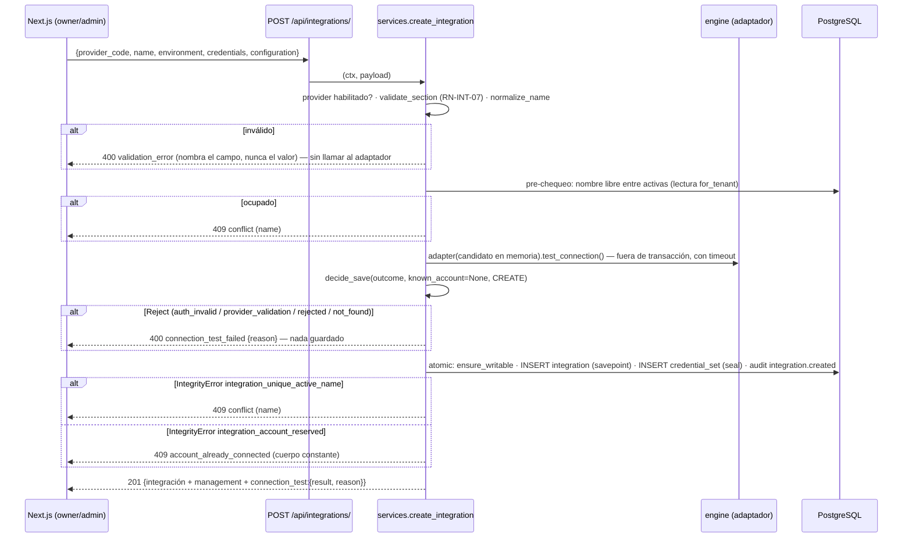

# Diseño — Módulo de Gestión de Integraciones (integraciones, credenciales, vínculos y Cajas)

> Parte de `spec.sdd.md` **1.0.0 (*Approved*)** y de `clarifications.md` (Q-401…Q-432). No cambia reglas de negocio:
> donde la spec delega un detalle técnico ("lo fija `design.md`") se decide acá. Decisión no obvia de cifrado:
> **ADR-0003** (*Aceptado* 2026-11-27). Se reutiliza sin cambios la base de SPEC-02 (ADR-0001, ADR-0002): `TenantModel` que
> falla cerrado, `TenantContext`, `ensure_writable`, `ActionSpec`/`TenantViewSet`, puerto de auditoría, suite
> cross-tenant y test de arquitectura.
>
> **Supuestos de otras specs.** SPEC-00/01/02: el código de `main` (Django 5.2, DRF 3.18, PostgreSQL 17,
> structlog, `application/problem+json`, flags en `apps/common/feature_flags.py`, contrato en
> `specs/_contracts/openapi.yaml`, `API_VERSION` 0.19.0). **SPEC-03 sigue en *Draft* 0.3.0**: §3.6 fija la interfaz
> del motor que este módulo consume; el diseño de SPEC-03 la tiene que respetar o cambiar este documento con
> historial. Las tareas de 04 que llaman al motor van después de las de 03.
>
> **Supuestos por preguntas abiertas** (sin bloqueo; §11.2 dice qué cambia si se decide otra opción): Q-413 a),
> Q-414 a), Q-416 a), Q-417 a), Q-419 a), Q-422 a). **Decididas por el dueño el 2026-11-27 durante la revisión del
> PR #158** y aplicadas acá: Q-430 a) (cuenta sin confirmar, §4.2), Q-431 b) (solo sobre integración y `Branch` activas, §4.6), Q-432 a).

## 1. Resumen de la solución
1. **Una app `apps/integrations`** (label `integrations`) con cuatro tablas tenant (`Integration`, `CredentialSet`,
   `BranchLink`, `CashRegister`), en las capas de siempre (`api → services → selectors → models`, reglas puras en
   `domain/`). Comparte paquete con el motor de SPEC-03 (`engine/`, `providers/`), que no tiene tablas.
2. **Credenciales cifradas con AES-256-GCM** (ADR-0003): solo los campos que el esquema del adaptador marca
   secretos, atados por AAD a su organización e integración, con `key_id` por fila para rotar sin downtime. Se
   descifran solo dentro de una sesión de proveedor de **una** operación; ninguna API las devuelve.
3. **Las reglas que cruzan filas las garantiza la base**: nombre único entre activas (Q-426), cuenta única en toda
   la plataforma mientras haya credenciales (Q-403/Q-423, índice único parcial **sin** consultas globales), un
   vínculo por `Branch` + integración (Q-429), FK compuestas `(organization_id, …)` en todos los vínculos (ADR-0002
   §1). El servicio traduce el `IntegrityError` (patrón de `Branch`, sin `full_clean`: Q-229 no aplica).
4. **La prueba de conexión nunca corre dentro de una transacción**: se llama al adaptador primero (con timeout), una
   función pura decide qué se guarda (Q-406/407/423/425/427) y recién ahí una transacción corta escribe, con lock de
   la fila y control de versión del juego probado.
5. **Frontera con 06/07 por contratos chicos**: selectors "utilizable", lock `FOR KEY SHARE` de la integración para
   el cobro nuevo, `provider_session(...)` que resuelve credenciales y marca `credenciales inválidas` ante un
   `ProviderAuthError` real (Q-409), y un puerto `PendingChargesPort` que implementa SPEC-06.

## 2. Cobertura de la spec
| RN / RF / RNF | Dónde vive en el diseño |
|---|---|
| RN-INT-01 | `models/integration.py` · constraint `integration_unique_active_name` (`organization`, `Lower(name)`, `WHERE status='active'`) · `domain/names.py::normalize_name` · `services/create_integration.py`, `update_integration.py`, `integration_lifecycle.py` (reactivar: `taken`) |
| RN-INT-02 | `selectors/catalog.py::enabled_provider(code)` (registry + flag) · `services/create_integration.py` (`provider_code` → `validation_error`/`not_available`) |
| RN-INT-03 | `Integration.environment` + `integration_environment_valid` · inmutable (PATCH lo rechaza, Q-414 a)) · `services/resolve_context.py` lo pasa al `IntegrationContext` |
| RN-INT-04 | `domain/credential_cipher.py` · `CredentialSet` (sin serializer propio) · `api/serializers/integrations.py` (solo `configured` + `updated_at`) · `__repr__`/`__str__` = PK · tests §9 (RNF-INT-01) |
| RN-INT-05 | `services/resolve_context.py::resolve_integration_context(ctx, id)` (`for_tenant(ctx)` + AAD con la organización) · `services/provider_gateway.py::provider_session` · sin endpoint ni comando que exporte |
| RN-INT-06 | `CredentialSet` = **una fila** por integración, reemplazo con una sola `UPDATE` bajo lock (§4.3) · re-cifrado igual (ADR-0003 §5) |
| RN-INT-07 | `domain/field_validation.py::validate_section(specs, values)` contra `FieldSpec` del motor (§3.6) · límites genéricos §7 |
| RN-INT-08 | `domain/permissions.py::INTEGRATIONS_ACTIONS` (§3.5) · `ActionPermission` de SPEC-02 |
| RN-INT-09 | `TenantViewSet` (header) · selectors `for_tenant(ctx)` → `404` · serializers estrictos (`organization_id` → `unknown_field`) · `backend/tests/cross_tenant/cases/integrations.py` |
| RN-INT-10 | `services/test_connection.py` · `domain/connection.py::decide_manual_test` (Q-406, Q-425) · Q-421: el motor lo garantiza (SPEC-03 AC-ENG-11) |
| RN-INT-11 | `selectors/catalog.py::capabilities_of(integration)` (del adaptador, nunca de la BD) · `GET …/capabilities/` |
| RN-INT-12 | `services/cash_registers.py::create_cash_register` (modos `create`/`import`/`manual`, §4.6) · `domain/external_keys.py::pos_key` (crear si no existe) · FK compuesta a `BranchLink` |
| RN-INT-13 | FK compuestas por `RunSQL` (§5.1) · selectors `get_branch(ctx, id)` (SPEC-02) y `get_integration(ctx, id)` |
| RN-INT-14 | `selectors/usability.py` (RN-INT-26) · desactivar no toca credenciales, vínculos ni Cajas (`integration_lifecycle.py`) |
| RN-INT-15 | `ActionPermission` (`WRITE` → `409` suspendida) + `ensure_writable` en cada servicio de escritura de usuario · `resolve_integration_context` no mira suspensión ni actividad |
| RN-INT-16 | Sin rutas OAuth (`api/urls.py`); test de rutas (AC-INT-22) |
| RN-INT-17 | `domain/audit_events.py::IntegrationsAuditAction` · `services/audit.py::record_event` + `AUDIT_TRIGGERS` (patrón SPEC-02) |
| RN-INT-18 | `domain/lifecycle.py::decide_integration_event`, `decide_link_event`, `decide_cash_register_event` · `transition.rejected` fuera del `atomic` |
| RN-INT-19 | índice único parcial `integration_account_reserved` (`provider_code`, `environment`, `account_id`) `WHERE account_id IS NOT NULL AND status <> 'disconnected'` · `domain/connection.py::decide_save` (otra cuenta) · traducción a `account_already_connected` sin datos ajenos (§4.2) · `Integration.account_unconfirmed` + `integration_unconfirmed_coherent` (Q-430 a)) |
| RN-INT-20 | `api/serializers/integrations.py`: bloque `management` solo con `integration.read_detail` (§6.5) |
| RN-INT-21 | `Integration.connection_status/connection_reason/connection_checked_at` + checks · `services/auth_failure.py::report_provider_auth_error` · desconectar → `unverified` |
| RN-INT-22 | `domain/connection.py::decide_save` (tabla §4.2) · `services/create_integration.py`, `replace_credentials.py`, `integration_lifecycle.py::reactivate` |
| RN-INT-23 | `BranchLink` + `services/branch_links.py` (modos `create`/`import`/`manual`/`none`) · `domain/external_keys.py::store_key` · `list_stores` (Q-428) · `branch_link_one_per_pair` (Q-429) |
| RN-INT-24 | `services/integration_lifecycle.py::disconnect` (§4.5): lock `FOR UPDATE` de la integración + `PendingChargesPort` + `DELETE` del juego · `integration_disconnected_coherent` |
| RN-INT-25 | `INTEGRATIONS_ACTIONS` (`branch_link.*`, `cash_register.*`) |
| RN-INT-26 | `selectors/usability.py::get_usable_integration`, `get_usable_cash_register` · `selectors/locks.py::lock_integration_for_new_charge` (las dos excluyen `account_unconfirmed`, Q-430 a)) · `provider_session(..., new_charge=NewChargeLock)` re-chequea versión y "utilizable" antes de crear el cobro en el proveedor (§4.5) |
| RN-INT-27 | `Integration.webhook_route_key` (único) · `services/webhook_key.py::regenerate_webhook_key` · `selectors/webhook_routing.py::find_by_webhook_route_key` (scope de modelo restringido) |
| RF-INT-01 | `GET /api/integration-providers/` · `selectors/catalog.py::list_enabled_providers` |
| RF-INT-02 | `POST /api/integrations/` · `services/create_integration.py` |
| RF-INT-03 | `GET /api/integrations/`, `GET /api/integrations/{id}/` · `selectors/integrations.py` |
| RF-INT-04 | `PATCH /api/integrations/{id}/` (`update_integration.py`) · `PUT /api/integrations/{id}/credentials/` (`replace_credentials.py`) |
| RF-INT-05 | `POST /api/integrations/{id}/test-connection/` · `services/test_connection.py` · throttle (Q-419 a)) |
| RF-INT-06 | `POST …/deactivate/`, `…/reactivate/`, `…/disconnect/` · `services/integration_lifecycle.py` · router sin `destroy` (`405`) |
| RF-INT-07 | `GET /api/integrations/{id}/capabilities/` |
| RF-INT-08 | `services/resolve_context.py` · `services/provider_gateway.py` |
| RF-INT-09 | `/api/cash-registers/…` · `services/cash_registers.py` · `selectors/cash_registers.py` |
| RF-INT-10 | `/api/branch-links/…` · `services/branch_links.py` · `GET /api/integrations/{id}/provider-stores/`, `GET /api/branch-links/{id}/provider-pos/` (`services/provider_lookup.py`) |
| RF-INT-11 | `selectors/usability.py` + `selectors/locks.py` (§3.7) |
| RF-INT-12 | `IntegrationsAuditAction` (§6.4) + test de completitud |
| RF-INT-13 | `services/auth_failure.py` · `provider_session` lo llama solo (§4.7) |
| RF-INT-14 | `management.webhook_route_key` en el detalle · `POST /api/integrations/{id}/webhook-key/regenerate/` · `selectors/webhook_routing.py` para SPEC-07 |
| RF-INT-15 | `management/commands/integrations_reencrypt_credentials.py` → `services/reencrypt.py` (ADR-0003 §5) |
| RNF-INT-01 | Suite `tests/security/test_no_secret_leaks.py` (§9) · `CredentialSet` sin `__repr__` con datos · mensajes de validación fijos (nunca el valor) |
| RNF-INT-02 | ADR-0003 · `keyring.py` · `domain/credential_cipher.py` · `checks.py` |
| RNF-INT-03 | §6.4 |
| RNF-INT-04 | §3.10 (eventos de log con nombres que no choca la redacción) |
| RNF-INT-05 | casos en `backend/tests/cross_tenant/cases/integrations.py` · entradas en `tests/architecture/allowlists.py` (§10) |
| RNF-INT-06 | migraciones 0001–0004 reversibles (§5.3) · §5.2 (RLS) |
| RNF-INT-07 | flag `INTEGRATIONS_PROVIDER_<CODE>` por provider (§3.6) · `checks.py` |
| RNF-INT-08 | timeouts del adaptador + presupuesto §6.3 · ninguna llamada al proveedor dentro de una transacción |
| RNF-INT-09 | `specs/_contracts/openapi.yaml` regenerado por tarea · `API_VERSION` menor +1 por tarea que agrega rutas · códigos §6.2 en `apps/common/api/problems.py::TITLES` |
| RNF-INT-10 | solo `account_id` y lo que declara el esquema; ninguna PII de pagadores |

> Sin filas sin destino. Las piezas que dependen de SPEC-03 (registry, `FieldSpec`, `ConnectionStatus`, errores,
> `FakeAdapter`) están en §3.6 como interfaz consumida.

## 3. Componentes y capas

### 3.1 Ubicación: una app `apps/integrations`
- `AGENTS.md` y `C-09` ya fijan `backend/apps/integrations/providers/<x>/` para los adaptadores, y el test de
  arquitectura (`ADAPTER_IMPORT_ALLOWLIST`) habla de `apps.integrations.providers`. El motor de SPEC-03 no tiene
  tablas (SPEC-03 §9); sus clases viven en `apps/integrations/engine/` (lo confirma el diseño de 03). Este módulo
  agrega los modelos, servicios, selectors y la API **en la misma app**, por dominio: una integración no existe sin
  su adaptador, y 06/07 importan de un solo lugar (`apps.integrations.selectors`, `apps.integrations.services`).
- Descartado: una app aparte `apps/integration_management`. Separa en dos apps lo que cambia junto (esquema de
  campos ↔ validación ↔ formulario), duplica el label en migraciones y en el test de arquitectura, y no hay una
  segunda implementación que lo justifique (ADR-0011). La frontera dura sigue siendo `providers/` (`C-09`): nada de
  este módulo importa de `providers/*`, solo de `engine/`.

### 3.2 Archivos (backend)
```
apps/integrations/
├── engine/                 (SPEC-03: contrato, registry, capacidades, FieldSpec, DTOs, errores, http, fake)
├── providers/<x>/          (SPEC-05, 13, 14)
├── models/                 integration.py · credential_set.py · branch_link.py · cash_register.py · __init__.py
├── domain/                 permissions.py · audit_events.py · lifecycle.py · connection.py · field_validation.py
│                           credential_cipher.py · names.py · external_keys.py · errors.py (reasons cerrados)
├── keyring.py              llavero desde settings (ADR-0003 §4)
├── selectors/              integrations.py · catalog.py · credentials.py · branch_links.py · cash_registers.py
│                           usability.py · locks.py · webhook_routing.py
├── services/               create_integration.py · update_integration.py · replace_credentials.py
│                           test_connection.py · integration_lifecycle.py · webhook_key.py · resolve_context.py
│                           provider_gateway.py · auth_failure.py · branch_links.py · cash_registers.py
│                           provider_lookup.py · reencrypt.py · ports.py · audit.py · writes.py
├── api/                    urls.py · integrations.py · integration_actions.py · providers.py · branch_links.py
│                           cash_registers.py · throttling.py · representation.py
│                           serializers/ (integrations.py · catalog.py · branch_links.py · cash_registers.py)
├── management/commands/    integrations_reencrypt_credentials.py · integrations_generate_key.py
├── checks.py               system checks (llavero, flags, fake fuera de prod, puerto de cobros)
├── errors.py               excepciones API (§6.2)
├── migrations/             0001_integration · 0002_credential_set · 0003_branch_link · 0004_cash_register
└── tests/                  domain/ · services/ · api/ · commands/ · security/
```
Estimaciones (`C-14`, ~400): los más grandes son `domain/connection.py` (~180), `services/replace_credentials.py`
(~200), `services/integration_lifecycle.py` (~240), `services/cash_registers.py` (~230), `services/branch_links.py`
(~220), `api/integrations.py` (~220) y `domain/field_validation.py` (~170). `writes.py` (~90) concentra lo que
comparten alta, reemplazo y reactivación (cifrar y escribir el juego, aplicar el resultado de la prueba, traducir
`IntegrityError`) para que ninguno crezca. Si uno pasa de ~300 en la implementación, se parte por caso de uso.

### 3.3 Capas
- **`api/`**: `TenantViewSet` de SPEC-02 con `action_specs` por acción; serializers de entrada estrictos (campo
  desconocido o de solo lectura → `400 unknown_field`/`read_only`), sin `ModelSerializer` sobre `CredentialSet`;
  llama **un** servicio o selector. `representation.py` arma el resumen o el detalle según `allowed_actions` (§6.5).
- **`services/`**: un caso de uso por archivo; llaman al motor **fuera** de toda transacción (`provider_gateway`
  lo verifica: `connection.in_atomic_block` → `TransactionManagementError`); después abren `transaction.atomic()`,
  `ensure_writable(ctx)`, lock de fila, deciden con `domain/`, escriben vía `for_tenant(ctx)` y emiten auditoría
  dentro de la transacción. Los rechazos auditables (`transition.rejected`) se emiten después del bloque (SPEC-02
  §3.3).
- **`selectors/`**: lecturas `for_tenant(ctx)`; las únicas excepciones son `webhook_routing.py` (scope de modelo
  restringido) y `locks.py` (SQL `FOR KEY SHARE`), ambas en la lista blanca del test de arquitectura (§10).
- **`domain/`**: sin Django ni red: enums, matriz, máquinas de estado, decisión de la prueba, validación contra el
  esquema, cifrado (recibe el llavero como argumento), claves externas. 100 % testeable sin BD.

### 3.4 Cifrado y llavero (ADR-0003)
- `keyring.py::Keyring(active_id, keys: Mapping[str, bytes])`, inmutable, construido una vez desde
  `settings.INTEGRATIONS_CREDENTIAL_KEYS` / `INTEGRATIONS_CREDENTIAL_ACTIVE_KEY` (`SecretStr` en
  `config/settings/env.py`). `__repr__` = `Keyring(active='k2', ids=['k1','k2'])`, nunca bytes.
- `domain/credential_cipher.py`:
  - `seal(keyring, organization_id, integration_id, secrets: Mapping[str, str]) -> Sealed(key_id, format_version=1,
    blob)`; `blob = nonce(12) ‖ AESGCM(key).encrypt(nonce, canonical_json, aad)`.
  - `open_sealed(keyring, organization_id, integration_id, sealed) -> dict[str, str]`; `key_id` ausente →
    `CredentialKeyUnavailable`; tag inválido → `CredentialDecryptError` (sin detalle).
  - `aad(org, integration, key_id) = b"cpu:integration-credentials:v1|" + str(org) + "|" + str(integration) + "|" +
    key_id`.
  - Límite: 16 KiB de JSON canónico.
- La fila guarda `secret_field_names` (en claro) para mostrar "configurado" sin descifrar.

### 3.5 Matriz de permisos como código
`apps/integrations/domain/permissions.py`: `IntegrationsAction` (`StrEnum`) e `INTEGRATIONS_ACTIONS` con
`ActionSpec` (deny-by-default). `api_key_scope=None` en todas hasta SPEC-11 (Q-420).

| Acción | Roles | `ActionKind` | Ruta |
|---|---|---|---|
| `integration_provider.list` | owner, admin | READ | `GET /api/integration-providers/` |
| `integration.read` | owner, admin, operator, viewer | READ | `GET /api/integrations/`, `GET …/{id}/` |
| `integration.read_detail` | owner, admin | READ | (decide el bloque `management`, §6.5) |
| `integration.capabilities` | owner, admin, operator, viewer | READ | `GET …/{id}/capabilities/` |
| `integration.create` / `update` / `replace_credentials` | owner, admin | WRITE | `POST`, `PATCH`, `PUT …/credentials/` |
| `integration.test_connection` | owner, admin | WRITE (Q-417 a)) | `POST …/test-connection/` |
| `integration.deactivate` / `reactivate` / `disconnect` | owner, admin | WRITE | `POST …/{acción}/` |
| `integration.regenerate_webhook_key` | owner, admin | WRITE | `POST …/webhook-key/regenerate/` |
| `integration.provider_lookup` | owner, admin | READ | `GET …/provider-stores/`, `GET /api/branch-links/{id}/provider-pos/` |
| `branch_link.read` | owner, admin, operator, viewer | READ | `GET /api/branch-links/…` |
| `branch_link.create` / `deactivate` / `reactivate` | owner, admin | WRITE | `POST /api/branch-links/…` |
| `cash_register.read` | owner, admin, operator, viewer | READ | `GET /api/cash-registers/…` |
| `cash_register.create` / `update` / `deactivate` / `reactivate` | owner, admin | WRITE | `POST`, `PATCH`, `POST …/{acción}/` |

`tests/domain/test_permission_matrix.py` transcribe la tabla de `spec.sdd.md §4` (versión citada) celda por celda,
en `active` y `suspended`, y exige `set(IntegrationsAction) == set(INTEGRATIONS_ACTIONS)`. Desconectar es `WRITE`
(no `REDUCE_ACCESS`): la spec lo rechaza con la organización suspendida (AC-INT-17).

### 3.6 Interfaz consumida del motor (SPEC-03, a confirmar en su diseño)
Importada solo de `apps.integrations.engine` (nunca de `providers/`):
- `ProviderRegistry.get(code) -> type[BaseAdapter]`, `.codes() -> frozenset[str]` (RF-ENG-01).
- `BaseAdapter.capabilities: frozenset[Capability]` y `.field_schema: FieldSchema` (RF-ENG-02, RF-ENG-06), con
  `FieldSchema(credentials: tuple[FieldSpec, ...], configuration: tuple[FieldSpec, ...], branch_link:
  tuple[FieldSpec, ...])` y `FieldSpec(name, type ∈ {string, integer, boolean, choice}, required, secret,
  pattern: str | None, max_length: int | None, choices: tuple[str, ...], help_text, label)`. Atributos de clase:
  el catálogo y la validación no instancian el adaptador ni descifran nada.
- `BaseAdapter(context: IntegrationContext)`; `IntegrationContext(integration_id, organization_id, environment,
  credentials: Credentials, configuration: Mapping)`, con `Credentials` de `repr` redactado (AC-ENG-05).
- `test_connection() -> ConnectionStatus(result ∈ {CONNECTED, AUTH_INVALID, UNREACHABLE}, account_id, reason)`
  (RF-ENG-07); `list_stores() -> list[ProviderStore(ref, name)]`, `list_pos() -> list[ProviderPos(ref, name,
  store_ref)]`, `ensure_store(EnsureStore(external_key, name, data)) -> ProviderRef`, `ensure_pos(EnsurePos(
  external_key, store_ref, name)) -> ProviderRef` (RF-ENG-03, solo con `POS_MANAGEMENT`; si no,
  `CapabilityNotSupported` sin red).
- Errores (RN-ENG-05) con `reason` estable (`provider_auth_error`, `provider_validation`, `provider_rejected`,
  `provider_not_found`, `provider_unavailable`, `provider_rate_limited`, `provider_unknown`, `timeout`).
- **Habilitación (RNF-INT-07):** flag `INTEGRATIONS_PROVIDER_<CODE>` (mayúsculas) en el `REGISTRY` de
  `apps/common/feature_flags.py`, que agrega la spec de cada provider (SPEC-05 agrega `..._MERCADOPAGO`). `checks.py`
  falla al arrancar si un provider registrado no tiene su flag en el `REGISTRY`, y en `prod` si `fake` está
  registrado. En `test` el `FakeAdapter` se registra con un fixture que también registra su flag; en `dev`, detrás
  de `INTEGRATIONS_PROVIDER_FAKE` (para la validación manual de la UI antes de SPEC-05).

### 3.7 Interfaz ofrecida a otros módulos (Python)
| Para | Función | Contrato |
|---|---|---|
| 06 | `selectors.usability.get_usable_integration(ctx, integration_id, capability)` | `UsableIntegration` o `IntegrationNotUsable(reason ∈ {inactive, unknown_account, account_unconfirmed, capability_not_supported, provider_unavailable})`; otra organización → `NotFound` (RN-INT-26, Q-422 a)) |
| 06 | `selectors.usability.get_usable_cash_register(ctx, cash_register_id, integration_id)` | Caja activa, de esa integración, `Branch` activa y vínculo activo; si no, `CashRegisterNotUsable(reason)` |
| 06 | `selectors.locks.lock_integration_for_new_charge(ctx, integration_id) -> NewChargeLock(integration_id, credential_version)` | dentro de la transacción del cobro nuevo: `SELECT … FOR KEY SHARE` de la fila, re-chequeo de "utilizable" y lectura de la `version` del juego vigente (§4.5); SPEC-06 guarda el `NewChargeLock` y lo pasa a `provider_session` |
| 06 | `services.ports.PendingChargesPort.has_pending_charges(ctx, integration_id) -> bool` | lo **implementa** SPEC-06 y se registra en `settings.INTEGRATIONS_PENDING_CHARGES_PORT`; hasta entonces, `NoChargesModule` (no hay cobros) y `checks.py` falla si `apps.charges` está instalada sin puerto propio |
| 05/06/07 | `services.provider_gateway.provider_session(ctx, integration_id, *, operation, new_charge: NewChargeLock \| None = None)` | context manager que entrega el adaptador ya construido; ante `ProviderAuthError` llama `report_provider_auth_error` y re-lanza; nunca dentro de una transacción. Para una operación que **crea un cobro nuevo** (`operation ∈ NEW_CHARGE_OPERATIONS`, hoy `create_charge`) `new_charge` es obligatorio (sin él, `TypeError`) y la sesión, al resolver, exige que el juego vigente siga siendo `new_charge.credential_version` y que la integración siga utilizable (incluido `account_unconfirmed=false`); si no, `IntegrationNotUsable(reason ∈ {credentials_changed, account_unconfirmed, inactive, …})` **antes** de llamar al proveedor (§4.7). Las operaciones sobre cobros existentes no lo pasan y no miran "utilizable" (RN-INT-15) |
| 07 | `services.resolve_context.resolve_integration_context(ctx, integration_id)` | `IntegrationContext` (para `verify_webhook`); no lo bloquea la suspensión ni la inactividad (RN-INT-15) |
| 07 | `selectors.webhook_routing.find_by_webhook_route_key(key) -> RoutedIntegration(organization_id, integration_id) \| None` | lectura global de una fila por igualdad, antes de conocer el tenant |

Se justifica un puerto (ADR-0011) solo para `PendingChargesPort`: la dependencia va de 06 a 04, y 04 necesita una
respuesta de 06; la segunda implementación es real (SPEC-06). No se crea ninguna otra abstracción: el adaptador se
obtiene del registry de SPEC-03 y el cifrado es un módulo de funciones.

### 3.8 Asíncrono
**Sin tareas Celery.** Las llamadas al proveedor de este módulo son a pedido de una persona y acotadas por el
timeout del adaptador; el re-cifrado es un comando del operador (ADR-0003 §5), no una tarea periódica. La métrica
por estado de conexión sale de los logs (§3.10).

### 3.9 Interfaz de usuario (frontend)
| Ruta | Quién | Contenido |
|---|---|---|
| `/configuracion/integraciones` | owner/admin (entrada de menú oculta para el resto; acceso directo → "sin permiso") | `IntegrationsScreen`: tarjetas `IntegrationCard` (proveedor, nombre, ambiente, `StatusChip` de actividad, `ConnectionStatusChip`, fecha de verificación); filtro activas/inactivas/desconectadas; vacío "Todavía no conectaste ningún proveedor" con "Conectar"; `CreateIntegrationDialog` (paso 1 proveedor del catálogo, paso 2 nombre + ambiente, paso 3 `SchemaFields` de credenciales y configuración) |
| `/configuracion/integraciones/[id]` | owner/admin | `IntegrationDetailScreen`: datos no secretos e `account_id` completos; secretos como "Configurado · actualizado el …"; `ConnectionTestButton` (`LoadingButton`, resultado en `Alert` con texto de `lib/connection-messages.ts`); `CredentialsDialog` (reemplazar o reactivar una desconectada); `IntegrationLifecycleDialogs` (desactivar/reactivar/desconectar; "Desconectar" deshabilitado con el motivo si `management.disconnect_blocked_reason`); `WebhookKeyPanel` (Copiar, Regenerar con confirmación) |
| `/configuracion/sucursales/[id]` | todos (gestión owner/admin) | `BranchDetailScreen`: datos de la `Branch` (de SPEC-02) + `BranchLinksPanel` (vínculos con integraciones; `BranchLinkDialog` con modo según capacidades y `SchemaFields` de `branch_link`) + `CashRegistersTable` por vínculo (`CashRegisterDialog`: "crear en el proveedor" / "importar existente" con la lista de `provider-pos` / "ligar a mano") |
| `/inicio` | todos | `IntegrationStatusCards` con el resumen (RN-INT-20): estado de conexión + capacidades; "último evento" lo agrega SPEC-07 |

- Módulo `frontend/src/modules/integrations/`: `components/` (los de la tabla), `hooks/` (`useProviderCatalog`,
  `useIntegrations`, `useIntegration`, `useIntegrationMutations`, `useBranchLinks`, `useCashRegisters`,
  `useProviderLookups`), `lib/schema-to-zod.ts` (un `FieldSpec[]` → esquema zod: requerido, `pattern`,
  `max_length`, `choices`; el backend revalida igual) y `lib/connection-messages.ts` (`reason` → texto accionable,
  sin detalles técnicos). Query keys `['org', orgId, 'integrations', …]` (se limpian al cambiar de empresa, SPEC-02).
- **Secretos en el navegador:** los campos `secret` se renderizan `type="password"`, `autoComplete="new-password"`,
  sin valor inicial ni precarga; el formulario hace `reset()` al cerrar o terminar; la mutación de alta/reemplazo
  usa `gcTime: 0` y `mutation.reset()` en `onSettled` para que el valor no quede en el `MutationCache`; nunca van en
  query keys, URL, `sessionStorage` ni logs.
- `BranchesTable` (módulo `tenancy`, SPEC-02) suma un enlace por fila a `/configuracion/sucursales/[id]`, en el
  lugar reservado para las cajas (SPEC-02 `design.md §3.9`). No cambia la spec 02.
- Esquemas de carga y errores (`context/07 §2`): `PageSkeleton`, filas `Skeleton`, `EmptyState`, `Alert` con
  "Reintentar"; `409 organization_suspended` → solo lectura; `403` → "sin permiso"; `account_already_connected` →
  "Esa cuenta ya está conectada en el Hub" (sin decir dónde). La UI nunca decide permisos: usa `allowed_actions`.

### 3.10 Observabilidad (`C-16`, RNF-INT-04)
Logger `apps.integrations` (structlog JSON, `request_id`/`task_id` y `organization_id` ya ligados). Eventos:
| Evento | Campos |
|---|---|
| `integrations.connection_test` | `integration_id` (si existe), `provider_code`, `operation` (`manual`/`create`/`replace`/`reactivate`), `result`, `reason`, `duration_ms` |
| `integrations.connection_status_changed` | `integration_id`, `provider_code`, `from_status`, `to_status`, `reason`, `origin` (`test`/`real_operation`) — contable como métrica por estado |
| `integrations.context_resolved` | `integration_id`, `provider_code`, `operation`, `result`, `duration_ms` |
| `integrations.provider_auth_failure` | `integration_id`, `provider_code`, `operation`, `applied` (si el juego seguía vigente) |
| `integrations.cipher_key_missing` | `integration_id`, `cipher_key_id` (no secreto) |
| `integrations.reencrypt_batch` | `rows`, `skipped`, `failed`, `from_key_ids`, `to_key_id`, `duration_ms` (sin `organization_id` por fila) |
| `integrations.reencrypt_failed` | `integration_id`, `cipher_key_id` (juego que no descifra; no se escribe y el comando sale con código ≠ 0, ADR-0003 §5) |
Reglas de nombres (`context/08 §6`): nunca `state`, `code`, ni claves con `token`, `secret`, `credential`,
`session`, `signature`, `auth` (la redacción los tapa y se pierde el dato): se usa `*_status`, `reason`,
`cipher_key_id`. Nunca se loguea el `webhook_route_key` (las rutas van por plantilla, Q-041), ni `configuration`,
ni campos del esquema. Si SPEC-00 suma un backend de métricas, `connection_status_changed` es el punto del contador.

## 4. Flujos principales

### 4.1 Alta de integración (RF-INT-02)

El `webhook_route_key` se genera en el `INSERT` (`secrets.token_urlsafe(32)`, 43 caracteres). El `created_by` es el
usuario del `ctx`. `integration.created` lleva `provider_code`, `environment`, `connection_status` inicial y los
**nombres** de los campos cargados.

### 4.2 Qué se guarda según la prueba (`domain/connection.py`, puro)
`Outcome` = `Connected(account_id)` | `AuthInvalid(reason)` | `Unreachable(reason)` | `Raised(kind, reason)` con
`kind ∈ {validation, rejected, not_found, unknown}` (las excepciones de RF-ENG-07).

| Outcome | `decide_save` (alta / reemplazo / reactivación de una desconectada) | `decide_manual_test` |
|---|---|---|
| `Connected(A)`, sin cuenta conocida | `Save(connected, account=A, unconfirmed=false)` | `Apply(connected, account=A, unconfirmed=false)` |
| `Connected(A)`, cuenta conocida `X = A` | `Save(connected, unconfirmed=false)` | `Apply(connected, unconfirmed=false)` (confirma la cuenta, Q-430 a)) |
| `Connected(A)`, cuenta conocida `X ≠ A` | `Reject(account_mismatch)` (RN-INT-19, Q-427) | `Apply(connection_error, reason=account_mismatch)`, cuenta y `account_unconfirmed` sin cambio → respuesta `409 account_mismatch` (Q-430 a)) |
| `AuthInvalid` | `Reject(connection_test_failed, auth_invalid)` | `Apply(credentials_invalid, reason)`, `account_unconfirmed` sin cambio |
| `Raised(validation \| rejected \| not_found)` | `Reject(connection_test_failed, <kind>)` (Q-425) | `Apply(connection_error, reason)` (Q-425), `account_unconfirmed` sin cambio |
| `Unreachable` / `Raised(unknown)`, sin cuenta conocida (alta, o reemplazo/reactivación de una que nunca tuvo cuenta) | `Save(connection_error, reason, unconfirmed=false)`: ya no es utilizable por cuenta desconocida (Q-423) | `Apply(connection_error, reason)` |
| `Unreachable` / `Raised(unknown)`, cuenta conocida `X` (reemplazo o reactivación) | `Save(connection_error, reason, unconfirmed=true)`, cuenta sin cambio (Q-407, Q-425, **Q-430 a)**) | `Apply(connection_error, reason)`, `account_unconfirmed` sin cambio |

"Cuenta ya tomada" no la decide el dominio: la detecta el índice único al escribir `account_id` (o al volver a
`status='active'` una desconectada con cuenta conocida). En `decide_save` eso es `Reject(account_already_connected)`
y no se guarda nada; en `decide_manual_test` se aplica `connection_error` + `account_already_connected` **sin** la
cuenta, y la respuesta es `409 account_already_connected` (AC-INT-36). El cuerpo de ese `409` es constante: ni
organización, ni integración, ni la cuenta. Un test recorre la tabla completa.

**Cuenta sin confirmar (Q-430 a)).** `account_unconfirmed = true` significa "el juego vigente se guardó sin una
prueba que confirmara la cuenta conocida". Solo lo pone `decide_save` en la última fila; solo lo limpia una prueba
(a pedido o al guardar) que devuelve `Connected` con la cuenta conocida, y desconectar (que borra el juego). Una
operación real exitosa no lo limpia (RN-INT-21: no cambia el estado). Mientras sea `true`, la integración no es
utilizable para cobros nuevos (`get_usable_integration` y `lock_integration_for_new_charge`, reason
`account_unconfirmed`); los procesos de sistema sobre cobros existentes siguen (RN-INT-15).

**`409` con estado escrito.** En la prueba a pedido, `account_mismatch` y `account_already_connected` aplican el
estado dentro del `atomic` y el error se lanza **después** de cerrarlo (como `transition.rejected`, SPEC-02 §3.3),
así el rollback no se lleva el estado; un test verifica que tras el `409` el estado persistido es `connection_error`
con ese `reason` (AC-INT-36, AC-INT-45).

### 4.3 Reemplazo de credenciales y reactivación de una desconectada (RN-INT-06, RN-INT-22, Q-427)
1. Validar el juego contra el esquema (sin lock). Leer la integración `for_tenant(ctx)` (`404` si es de otra org).
   Reemplazo sobre una desconectada, o reactivación de una que no lo está → `409 invalid_transition` +
   `transition.rejected`. Reactivación: pre-chequeo de nombre libre (`400 validation_error`/`taken`).
2. Recordar `known_account` y `version` del juego vigente (o `None`).
3. `test_connection()` con el juego candidato en memoria, fuera de transacción → `decide_save(...)`.
4. `atomic`: `ensure_writable` → `select_for_update(no_key=True)` de la integración → si cambió el estado o la
   `version` desde el paso 2, `409 conflict` (otra escritura ganó; se reintenta) → escribir:
   - reemplazo: una sola `UPDATE` de `credential_set` (`ciphertext`, `key_id`, `public_fields`,
     `secret_field_names`, `version+1`, `credentials_updated_at`, `updated_by`) + campos de conexión y
     `account_unconfirmed` según `decide_save` (§4.2);
   - reactivación: `INSERT` del juego + `status='active'`, `deactivated_at=NULL`, `disconnected_at=NULL`,
     `account_unconfirmed` según `decide_save`.
   La escritura va en un savepoint: `IntegrityError` de `integration_account_reserved` → `409
   account_already_connected`, de `integration_unique_active_name` → `400 validation_error` (`taken`); nada
   guardado.
5. Eventos: `integration.credentials_replaced` (o `integration.reactivated` con `with_new_credentials=true`) y, si
   cambió, `integration.connection_status_changed` (`origin=test`).
Una resolución concurrente lee la fila vieja o la nueva (MVCC + una sola `UPDATE`): nunca una mezcla (AC-INT-09).
Dos `admin` a la vez: el segundo espera el lock, ve la `version` nueva y recibe `409 conflict`; si los dos pasaron el
paso 4 en orden, queda el último juego y hay un evento por cada uno (spec §12).

### 4.4 Prueba de conexión a pedido (RF-INT-05)
Throttle por integración (§6.3) → leer integración (desconectada → `409 invalid_transition`) → resolver el juego
vigente (`version` v) → `test_connection()` fuera de transacción → `decide_manual_test` → `atomic`: lock de la fila;
si la `version` ya no es v, el resultado se descarta (log `integrations.connection_test`, `result=stale`) y la
respuesta es `409 conflict` ("las credenciales cambiaron, probá de nuevo") → si no, aplica estado, `reason`,
`connection_checked_at`, `account_unconfirmed` y, si corresponde, `account_id` (savepoint; colisión → §4.2) →
evento de cambio de estado solo si cambió (Q-419 a)) → se cierra el `atomic` → recién ahí, si el resultado fue
`account_mismatch` o `account_already_connected`, se lanza el `409` (el estado ya quedó confirmado, §4.2).
Respuesta `200 {connection_status, connection_reason, connection_checked_at, account_id, account_unconfirmed}`.

### 4.5 Desconectar frente a un cobro nuevo (RN-INT-24)
- **Desconectar**: `atomic` → `ensure_writable` → `select_for_update()` (**`FOR UPDATE`**) de la integración →
  `decide_integration_event(status, DISCONNECT)` → `PendingChargesPort.has_pending_charges(ctx, id)` → si hay, `409
  pending_charges` sin cambios → si no, `DELETE` del `credential_set`, `status='disconnected'`,
  `disconnected_at=now()`, `deactivated_at=now()` si venía de `active` (si venía de `inactive` conserva el suyo;
  así se cumple `integration_active_coherent`), `connection_status='unverified'`, `connection_reason=NULL`,
  `connection_checked_at=NULL`, `account_unconfirmed=false`, `account_id` se conserva → `integration.disconnected`.
- **Cobro nuevo (SPEC-06)**: dentro de su transacción, antes de insertar el cobro, `lock_integration_for_new_charge`
  = `SELECT … FROM integrations_integration WHERE organization_id=%s AND id=%s FOR KEY SHARE` y re-chequeo de
  "utilizable" con las mismas condiciones que `get_usable_integration` (activa, cuenta conocida, **no**
  `account_unconfirmed`, capacidad, provider disponible). `FOR KEY SHARE` choca con el `FOR UPDATE` de desconectar y no con las `UPDATE` de estado de conexión
  (`NO KEY UPDATE`), así que los cobros no se serializan entre sí:
  - si el cobro toma el lock primero, inserta su `pending` y confirma; desconectar espera, ve el `pending` y rechaza;
  - si desconectar va primero, el cobro espera, relee `disconnected` y no se crea.
  La llamada al proveedor del cobro va **después** de confirmar el `pending` (es de SPEC-06), nunca con el lock.
  **Reemplazo entre el lock y la llamada (Q-430 a)).** `FOR KEY SHARE` no choca con el `FOR NO KEY UPDATE` del
  reemplazo de credenciales, así que entre que el cobro confirma su `pending` (con el juego J1, versión v) y que
  llama al proveedor puede guardarse J2 con `UNREACHABLE` y `account_unconfirmed=true`. Por eso
  `lock_integration_for_new_charge` devuelve `NewChargeLock(credential_version=v)` y SPEC-06 abre
  `provider_session(..., operation="create_charge", new_charge=lock)`: la sesión resuelve en **una** lectura la
  integración y su juego y, si la versión ya no es v o la integración dejó de ser utilizable (inactiva, desconectada,
  `account_unconfirmed`), lanza `IntegrationNotUsable` sin descifrar nada ni llamar al proveedor. Si la versión
  coincide, la sesión usa J1, cuya cuenta estaba confirmada: un reemplazo que llegue después de esa lectura no
  cambia el juego que se usa. Qué hace SPEC-06 con su `pending` cuando la sesión falla es de SPEC-06 (§11.3).
- `bounded_lock_wait()` de `common/tenancy/locks.py` acota la espera (5 s → `503 organization_busy`).

### 4.6 Vínculo y Caja con efecto en el proveedor (RN-INT-12, RN-INT-23, Q-424, Q-428)
- **Claves estables** (`domain/external_keys.py`): `store_key(integration_id, branch_id)` y `pos_key(integration_id,
  branch_id, normalize_name(name))` = `"hub" + sha256(...)[:32]` (hex, sin datos legibles). El adaptador las usa como
  identificador externo de "crear si no existe" (RN-MP-13): un doble clic o un reintento tras timeout pide el mismo
  recurso y no lo duplica.
- **Crear vínculo** (`store_mode`): `create` → `ensure_store(EnsureStore(store_key, branch.name, data))`; `import`
  → `list_stores()` y la `store_ref` tiene que estar en la lista (si no, `400 validation_error` en `store_ref`);
  `manual` → `store_ref` obligatoria, sin llamar al adaptador; `none` → sin referencia. `create`/`import` sin
  `POS_MANAGEMENT` → `409 capability_not_supported`.
- **Integración y `Branch` activas (Q-431 b)).** Crear un vínculo o una Caja exige `integration.status='active'` y
  `branch.is_active`; si no, `409 resource_inactive` con `reason ∈ {integration_inactive, branch_inactive}` (se
  chequea primero la integración), sin crear nada y **sin llamar al proveedor**. Una integración inactiva con
  credenciales y una desconectada dan lo mismo. Como una integración `active` siempre tiene su `credential_set`
  (§10 de la spec; lo mantienen alta, reactivación y desconexión, y un test lo verifica), los modos `create`/`import`
  nunca encuentran una integración sin credenciales en estas altas; `integration_without_credentials` queda solo
  para las listas de `provider-stores`/`provider-pos` sobre una desconectada. Q-431 b) cubre **solo la creación**:
  reactivar un vínculo o una Caja se permite aunque la integración o la `Branch` estén inactivas, y quedan no
  utilizables para cobros nuevos por RN-INT-26 hasta que todo vuelva a estar activo.
- **Crear Caja** (`mode`): además exige el vínculo `Branch` + integración y que esté activo (si no, `409
  branch_link_required` con `reason ∈ {missing, inactive}`; orden: `resource_inactive` antes que
  `branch_link_required`). `create` → `ensure_pos(EnsurePos(pos_key, link.store_ref, name))`; `import` → `list_pos()`
  filtrado por la `store_ref` del vínculo y la `provider_ref` tiene que estar; `manual` → `provider_ref`
  obligatoria, sin adaptador. Misma regla de capacidad.
- Orden: validar → chequeo de actividad (lectura; integración, `Branch`, vínculo) → pre-chequeo de unicidad
  (lectura) → llamada al proveedor dentro de `provider_session` (fuera de transacción) → `atomic`: `ensure_writable`
  → `select_for_update(no_key=True)` de la integración → `lock_branch(ctx, id)` de SPEC-02 → (Caja)
  `select_for_update(no_key=True)` del vínculo → **re-chequeo de actividad de los tres bajo lock** (así no se cruza
  con desactivar la integración, la `Branch` o el vínculo; si alguno cambió, `409 resource_inactive` o
  `branch_link_required` y nada local) → `INSERT` en savepoint (`IntegrityError` → `409 conflict` con el campo) →
  evento. Orden fijo de locks: organización → integración → `Branch` → vínculo. Si el re-chequeo falla después de
  haber creado el recurso en el proveedor, queda como en el punto siguiente (se reusa por la clave estable).
- Si el `INSERT` falla después de crear el recurso en el proveedor, el recurso queda creado y un reintento con los
  mismos datos lo reusa por la clave estable. Una Caja renombrada no cambia su POS (no hay `update_pos` en el
  contrato): crear otra Caja con el nombre viejo reusa ese POS y choca con `cash_register_unique_provider_ref` →
  `409 conflict` (`provider_ref`) que el texto de la UI explica.
- Errores del proveedor: `ProviderUnavailable`/`RateLimited`/`Unknown` → `503 provider_unavailable` (nada local);
  `ProviderAuthError` → `provider_session` marca `credenciales inválidas` (§4.7) y la respuesta es `409
  provider_rejected` con `reason=auth_invalid`; validación/rechazo/no encontrado → `409 provider_rejected` con su
  `reason`.
- **Reactivar un vínculo** (Q-429): `select_for_update` del vínculo → `decide_link_event` → `is_active=true`, sin
  llamar al proveedor → `branch_link.reactivated`. No exige integración ni `Branch` activas (Q-431 b) es solo para
  crear); lo mismo reactivar una Caja. Lo que quede reactivado sobre algo inactivo no es utilizable (RN-INT-26,
  AC-INT-46).

### 4.7 `ProviderAuthError` en una operación real (RF-INT-13, Q-409)
`provider_session(ctx, integration_id, operation=…, new_charge=None)`, en este orden literal: (1) verifica que no hay
transacción abierta; (2) **una sola lectura** de la integración y su juego de credenciales (`version` v, todavía
cifrado); (3) si `operation` crea un cobro nuevo, exige `new_charge` y comprueba sobre esa misma fila
`v == new_charge.credential_version` y las condiciones de "utilizable" de RN-INT-26 (activa, cuenta conocida,
`account_unconfirmed=false`, capacidad, provider disponible); si falla, `IntegrationNotUsable` sin descifrar ni llamar
al proveedor (§4.5); (4) recién entonces descifra (§4.8); (5) instancia el adaptador; (6) `yield`. Si el bloque lanza `ProviderAuthError`:
`report_provider_auth_error(ctx, integration_id, version=v, reason, operation)` abre su propia transacción, toma el
lock de la fila y, **solo si el juego vigente sigue siendo v** (un reemplazo posterior no se pisa), pasa a
`credentials_invalid` (si no lo estaba) y emite `integration.connection_status_changed` (`origin=real_operation`,
`operation`), con actor `SYSTEM` (`name="provider_auth_error"`); no llama a `ensure_writable` (es un cambio de
estado del sistema, como los de `SystemActor`, RN-INT-15). Después re-lanza el mismo error: no hay reintento ni
renovación. Una operación exitosa no toca el estado.

### 4.8 Resolución de credenciales (RF-INT-08)
`resolve_integration_context(ctx, id)`: `Integration.objects.for_tenant(ctx)` + su `credential_set` (una consulta
con `select_related`) → desconectada → `IntegrationWithoutCredentials` → `open_sealed(keyring, ctx.organization_id,
id, sealed)` → `IntegrationContext` → log `integrations.context_resolved`. Con el `ctx` de otra organización la
fila no existe (`NotFound`) y nada se descifra (AC-INT-16); aunque alguien copiara el texto cifrado a otra fila, el
AAD no coincide (`CredentialDecryptError`).

## 5. Datos
Todas las PK `UUID` v4, fechas `timestamptz` UTC, enums `varchar` + `CheckConstraint`, `NoHardDeleteMixin` salvo
`CredentialSet` (que se borra al desconectar). Todas heredan `TenantModel`. JSON con `JSONField` (`jsonb`).

| Tabla | Columnas | Constraints / índices | Notas |
|---|---|---|---|
| `integrations_integration` | `id`, `organization_id`, `provider_code varchar(32)`, `name varchar(120)`, `environment varchar(16)`, `status varchar(16) default 'active'`, `connection_status varchar(24) default 'unverified'`, `connection_reason varchar(48) null`, `connection_checked_at null`, `account_id varchar(128) null`, `account_unconfirmed bool default false` (Q-430 a)), `configuration jsonb default {}`, `webhook_route_key varchar(64)`, `created_by_id` FK user PROTECT, `created_at`, `updated_at`, `deactivated_at null`, `disconnected_at null` | `integration_status_valid` (`active, inactive, disconnected`) · `integration_environment_valid` (`test, production`) · `integration_connection_status_valid` (`unverified, connected, connection_error, credentials_invalid`) · `integration_name_not_blank` · `integration_unique_active_name` único `(organization_id, lower(name)) WHERE status='active'` (Q-426) · **`integration_account_reserved`** único `(provider_code, environment, account_id) WHERE account_id IS NOT NULL AND status <> 'disconnected'` (Q-403, Q-423, Q-427) · `integration_account_not_blank` (`account_id IS NULL OR account_id <> ''`) · `integration_connected_has_account` (`connection_status <> 'connected' OR account_id IS NOT NULL`) · `integration_reason_coherent` (`(connection_status IN ('unverified','connected')) = (connection_reason IS NULL)`) · `integration_active_coherent` (`(status='active') = (deactivated_at IS NULL)`) · `integration_disconnected_coherent` (`(status='disconnected') = (disconnected_at IS NOT NULL)` y `status <> 'disconnected' OR connection_status='unverified'`) · `integration_unconfirmed_coherent` (`NOT account_unconfirmed OR (account_id IS NOT NULL AND connection_status <> 'connected' AND status <> 'disconnected')`, Q-430 a)) · único `webhook_route_key` · `integration_org_id_uniq (organization_id, id)` · índice `(organization_id, status, name)` | `account_id` nunca cambia una vez conocido (servicio + test; un trigger se descarta, §11). `account_unconfirmed` va en `0001_integration` (todavía no hay datos: reversible bajando la migración). Sin tabla `providers` (Q-416 a)) |
| `integrations_credentialset` | `id`, `organization_id`, `integration_id` **único**, `version int`, `key_id varchar(32)`, `format_version smallint`, `ciphertext bytea`, `public_fields jsonb default {}`, `secret_field_names jsonb default []`, `credentials_updated_at`, `updated_by_id` FK user PROTECT, `created_at`, `reencrypted_at null` | `credentialset_one_per_integration` · `credentialset_version_positive` · `credentialset_format_v1` (`format_version = 1`) · `credentialset_key_id_valid` (`key_id ~ '^[a-z0-9-]{1,32}$'`) · `credentialset_ciphertext_min` (`octet_length(ciphertext) >= 28`) · índice `(key_id)` (progreso de la rotación) · FK compuesta → integración | La AAD usa el `organization_id` y el `integration_id` de la fila (ADR-0003 §3). `__repr__` = PK |
| `integrations_branchlink` | `id`, `organization_id`, `branch_id` FK `tenancy.Branch` PROTECT, `integration_id` FK PROTECT, `store_ref varchar(128) ''`, `store_origin varchar(16)`, `data jsonb default {}`, `is_active bool default true`, `deactivated_at null`, `created_by_id`, `created_at`, `updated_at` | **`branch_link_one_per_pair`** único `(organization_id, branch_id, integration_id)` (Q-429; destino de la FK de la Caja) · `branch_link_store_origin_valid` (`created, imported, manual, none`) · `branch_link_store_ref_coherent` (`(store_origin='none') = (store_ref='')`) · `branch_link_unique_store_ref` único `(integration_id, store_ref) WHERE store_ref <> ''` (Q-432 a)) · `branch_link_active_coherent` · FK compuestas → `Branch` y → integración · índices `(organization_id, branch_id, is_active)`, `(organization_id, integration_id, is_active)` | `data` validado contra `field_schema.branch_link` |
| `integrations_cashregister` | `id`, `organization_id`, `branch_id` FK PROTECT, `integration_id` FK PROTECT, `name varchar(120)`, `provider_ref varchar(128)`, `origin varchar(16)`, `is_active bool default true`, `deactivated_at null`, `created_by_id`, `created_at`, `updated_at` | `cash_register_unique_active_name` único `(organization_id, branch_id, integration_id, lower(name)) WHERE is_active` (Q-413 a)) · `cash_register_unique_provider_ref` único `(integration_id, provider_ref)` (Q-413 a)) · `cash_register_name_not_blank` · `cash_register_provider_ref_not_blank` · `cash_register_origin_valid` (`created, imported, manual`) · `cash_register_active_coherent` · `cash_register_org_id_uniq (organization_id, id)` (destino de la FK compuesta de SPEC-06) · **FK compuesta `(organization_id, branch_id, integration_id)` → `branchlink`** · índice `(organization_id, branch_id, integration_id, is_active, name)` | Una Caja no existe sin su vínculo (lo garantiza la base) |

- Normalización en servicios: `strip()` de `name`; textos del esquema según su `FieldSpec`. Comparación de nombres
  por `lower()` (como `Branch`).
- Unicidades sin `full_clean`/`UniqueValidator` (Q-229): la constraint decide y el servicio traduce el
  `IntegrityError` por `constraint_name` (como `services/branches.py::_taken_field`).

### 5.1 FK compuestas (ADR-0002 §1, RN-INT-13)
Django 5.2 no declara FK compuestas: se crean con `migrations.RunSQL(sql=…, reverse_sql=…)` en la misma migración
que la tabla, además de la FK simple que usa el ORM:
- `credentialset (organization_id, integration_id) → integrations_integration (organization_id, id)`;
- `branchlink (organization_id, branch_id) → tenancy_branch (organization_id, id)` (`branch_org_id_uniq` ya existe)
  y `branchlink (organization_id, integration_id) → integrations_integration (organization_id, id)`;
- `cashregister (organization_id, branch_id, integration_id) → integrations_branchlink (organization_id, branch_id,
  integration_id)`.
Todas `ON DELETE RESTRICT`. Un test inserta por SQL una fila que mezcla organizaciones y espera `IntegrityError`
(AC-INT-19, AC-INT-34).

### 5.2 Unicidad entre organizaciones y RLS (RNF-INT-06)
- `integration_account_reserved` es el único invariante que cruza organizaciones y lo hace **un índice único**, no
  una consulta: ningún servicio lee integraciones de otra organización, no hace falta `unscoped`. Con RLS (Q-215),
  PostgreSQL sigue verificando la unicidad sobre todas las filas aunque la política oculte las ajenas, así que la
  regla no depende de un bypass. El rechazo no revela más que lo que Q-403 acepta ("esa cuenta ya está conectada").
- `webhook_route_key` se busca antes de conocer el tenant (SPEC-07): scope de modelo `Integration.by_webhook_route_key`
  (de solo lectura, una fila por igualdad) permitido solo en `selectors/webhook_routing.py`
  (`RESTRICTED_SCOPE_ALLOWLIST`). Con RLS necesita la misma política de bypass que la resolución del tenant
  (ADR-0001 §8 c)).
- El re-cifrado enumera organizaciones con `unscoped(PLATFORM_COMMAND)` (solo `organization_id`) y procesa cada una
  con `tenant_scope(system_context(org, PLATFORM_COMMAND))`, como los comandos de SPEC-02.

### 5.3 Migraciones (`C-17`)
`0001_integration` (depende de `tenancy.0004_branch` y `identity`), `0002_credential_set`, `0003_branch_link`,
`0004_cash_register`. Solo esquema, sin datos; `RunSQL` siempre con `reverse_sql`; nombres descriptivos
(`lint_migrations`); ida y vuelta en el job `migrations` de CI. Bajar a `zero` no pierde datos ajenos (tablas nuevas,
sin columnas en tablas de otras apps).

## 6. Contratos de API
Todas tenant-scoped (`X-Organization-Id`), `application/problem+json`, paginación por defecto de SPEC-00. Entradas
estrictas. Sin `DELETE` (`405`).

### 6.1 Endpoints
| Método | Ruta | Acción | Request | Response | Errores |
|---|---|---|---|---|---|
| GET | `/api/integration-providers/` | `integration_provider.list` | — | `200 [{provider_code, display_name, environments[], capabilities[], fields:{credentials[], configuration[], branch_link[]}}]` (`FieldSpec` tal cual, sin valores) | 403 |
| GET | `/api/integrations/` | `integration.read` | `?status=active\|inactive\|disconnected` | `200 [Integration]` (§6.5) | 400/404 org |
| POST | `/api/integrations/` | `integration.create` | `{provider_code, name, environment, credentials{}, configuration{}}` | `201 Integration + connection_test{result, reason}` | 400 `validation_error` (`provider_code`: `not_available`), 400 `connection_test_failed`, 409 `conflict` (name), 409 `account_already_connected`, 409 `organization_suspended`, 403 |
| GET | `/api/integrations/{id}/` | `integration.read` | — | `200 Integration` | 404 |
| PATCH | `/api/integrations/{id}/` | `integration.update` | `{name?, configuration?}` (configuración completa; `environment` → `read_only`) | `200 Integration` | 400, 403, 404, 409 `conflict` |
| PUT | `/api/integrations/{id}/credentials/` | `integration.replace_credentials` | `{credentials{}}` | `200 Integration + connection_test` | 400 `validation_error` (esquema, `too_large`), 400 `connection_test_failed`, 409 `account_mismatch` / `account_already_connected` / `invalid_transition` / `conflict` |
| POST | `/api/integrations/{id}/test-connection/` | `integration.test_connection` | — | `200 {connection_status, connection_reason, connection_checked_at, account_id}` | 409 `account_already_connected` / `account_mismatch` / `invalid_transition` / `conflict`, 429 `throttled` |
| POST | `/api/integrations/{id}/deactivate/` | `integration.deactivate` | — | `200 Integration` | 409 `invalid_transition` |
| POST | `/api/integrations/{id}/reactivate/` | `integration.reactivate` | `{credentials?}` (obligatorio si está desconectada) | `200 Integration` (+ `connection_test` si hubo prueba) | 400 `validation_error` (`credentials`: `required`; `name`: `taken`), 400 `connection_test_failed`, 409 `account_mismatch` / `account_already_connected` / `invalid_transition` |
| POST | `/api/integrations/{id}/disconnect/` | `integration.disconnect` | — | `200 Integration` | 409 `pending_charges` / `invalid_transition` |
| POST | `/api/integrations/{id}/webhook-key/regenerate/` | `integration.regenerate_webhook_key` | — | `200 {webhook_route_key}` | 403, 404, 409 suspendida |
| GET | `/api/integrations/{id}/capabilities/` | `integration.capabilities` | — | `200 {capabilities[]}` | 404 |
| GET | `/api/integrations/{id}/provider-stores/` | `integration.provider_lookup` | — | `200 [{ref, name}]` | 409 `capability_not_supported` / `integration_without_credentials` / `provider_rejected`, 503 `provider_unavailable` |
| GET | `/api/branch-links/` | `branch_link.read` | `?branch_id&integration_id&is_active` | `200 [BranchLink]` | 404 (filtro de otra org) |
| POST | `/api/branch-links/` | `branch_link.create` | `{branch_id, integration_id, store_mode, store_ref?, data{}}` | `201 BranchLink` | 400, 404, 409 `resource_inactive` / `conflict` / `capability_not_supported` / `provider_rejected`, 503 `provider_unavailable` |
| GET | `/api/branch-links/{id}/` | `branch_link.read` | — | `200 BranchLink` | 404 |
| POST | `/api/branch-links/{id}/deactivate/` · `/reactivate/` | `branch_link.deactivate` · `.reactivate` | — | `200 BranchLink` | 409 `invalid_transition` |
| GET | `/api/branch-links/{id}/provider-pos/` | `integration.provider_lookup` | — | `200 [{ref, name}]` (del Store del vínculo) | igual que `provider-stores` |
| GET | `/api/cash-registers/` | `cash_register.read` | `?branch_id&integration_id&is_active` | `200 [CashRegister]` | 404 (filtro de otra org) |
| POST | `/api/cash-registers/` | `cash_register.create` | `{branch_id, integration_id, name, mode, provider_ref?}` | `201 CashRegister` | 400, 404, 409 `resource_inactive` / `branch_link_required` / `conflict` / `capability_not_supported` / `provider_rejected`, 503 |
| GET · PATCH | `/api/cash-registers/{id}/` | `cash_register.read` · `.update` | `{name}` | `200 CashRegister` | 404, 409 `conflict` |
| POST | `/api/cash-registers/{id}/deactivate/` · `/reactivate/` | `cash_register.deactivate` · `.reactivate` | — | `200 CashRegister` | 409 `invalid_transition`, 400 `taken` (reactivar con nombre ocupado) |

Todas las `WRITE` documentan además `409 organization_suspended` y `503 organization_busy`; todas, `400
organization_required` y `404 organization_not_found` (SPEC-02).

### 6.2 Códigos nuevos (se agregan a `apps/common/api/problems.py::TITLES`)
| `code` | HTTP | `reason` (cerrado) | Cuándo |
|---|---|---|---|
| `connection_test_failed` | 400 | `auth_invalid`, `provider_validation`, `provider_rejected`, `provider_not_found` | alta, reemplazo o reactivación rechazados por la prueba (RN-INT-22) |
| `account_already_connected` | 409 | — | la cuenta está reservada por otra integración (RN-INT-19); cuerpo constante |
| `account_mismatch` | 409 | — | la prueba devolvió otra cuenta (RN-INT-19, Q-427, Q-430 a)) |
| `pending_charges` | 409 | — | desconectar con cobros `pending` (RN-INT-24) |
| `integration_without_credentials` | 409 | — | lista de Stores o POS del proveedor (`provider-stores`, `provider-pos`) sobre una integración desconectada |
| `resource_inactive` | 409 | `integration_inactive`, `branch_inactive` | crear un vínculo o una Caja sobre una integración no activa (inactiva o desconectada) o una `Branch` inactiva (Q-431 b)); nada creado, sin llamar al proveedor. Código nuevo porque ninguno existente encaja: `invalid_transition` es para el estado de la propia entidad y `branch_link_required` para el vínculo; sigue el patrón `code` + `reason` cerrado de `branch_link_required` |
| `branch_link_required` | 409 | `missing`, `inactive` | Caja sin vínculo activo (RN-INT-12) |
| `capability_not_supported` | 409 | — | modo `create`/`import` o lista sin `POS_MANAGEMENT` (si SPEC-03 lo agrega antes, se reutiliza) |
| `provider_rejected` | 409 | `auth_invalid`, `provider_validation`, `provider_rejected`, `provider_not_found` | el proveedor rechazó una operación de vínculo, Caja o lista |
| `provider_unavailable` | 503 | — | proveedor caído, 429 o resultado ambiguo; nada local; con `Retry-After` |
Reutilizados: `validation_error` (códigos por campo `unknown_field`, `read_only`, `required`, `taken`,
`not_available`, `invalid`, `too_large`),
`conflict`, `invalid_transition`, `forbidden`, `not_found`, `throttled`, los de organización. Reemplazar
credenciales, reactivar sin juego o con nombre ocupado son `validation_error` con el campo, no códigos nuevos.

### 6.3 Tiempos y límite de la prueba (RNF-INT-08, Q-419 a))
- Presupuesto de toda request que llama al proveedor: timeout total del adaptador (MP: 5 s conexión + 15 s lectura,
  RNF-MP-01) + ≤ 1 s propio; p95 objetivo ≤ 2 s con el proveedor sano. El timeout del worker de gunicorn (SPEC-00)
  tiene que ser mayor que ese presupuesto: lo verifica la tarea de la prueba de conexión.
- Throttle `api/throttling.py::ConnectionTestThrottle` (`SimpleRateThrottle`, clave `organization_id:integration_id`,
  `settings.INTEGRATIONS_CONNECTION_TEST_RATE`, por defecto `6/min`, fail-open ante Redis caído como el de SPEC-00);
  `429 throttled` con `Retry-After`. Solo para la prueba a pedido.

### 6.4 Catálogo de auditoría (`IntegrationsAuditAction`, RNF-INT-03)
`integration.created`, `integration.updated` (`changed_fields`: nombres, nunca valores),
`integration.credentials_replaced` (`version`), `integration.deactivated`, `integration.reactivated`
(`with_new_credentials`), `integration.disconnected`, `integration.connection_status_changed` (`from_status`,
`to_status`, `reason`, `origin`, `operation`), `integration.webhook_key_regenerated` (sin valores),
`integration.credentials_reencrypted` (`count`, `from_key_ids`, `to_key_id`; actor operador),
`cash_register.created` (`origin`), `cash_register.updated`, `cash_register.deactivated`,
`cash_register.reactivated`, `branch_link.created` (`store_origin`), `branch_link.deactivated`,
`branch_link.reactivated`, `transition.rejected` (`entity`, `entity_id`, `status`, `event`). Todos con
`integration_id` / `cash_register_id` / `branch_link_id` en `metadata`. `AUDIT_TRIGGERS` + test de completitud
(AC-INT-23).

### 6.5 Representaciones
- **`Integration`** (todos los roles): `{id, name, provider_code, provider_display_name, environment, status,
  connection_status, capabilities[], provider_available, allowed_actions[]}` y, **solo** con
  `integration.read_detail` (owner/admin), `management: {connection_reason, connection_checked_at, account_id, account_unconfirmed,
  configuration{}, credentials: {public_fields{}, secret_fields: [{name, configured: true}], updated_at} | null,
  webhook_route_key, disconnect_blocked_reason: "pending_charges" | null, created_at, created_by_id,
  deactivated_at, disconnected_at}`. Para `operator`/`viewer` la clave `management` no existe (AC-INT-30). Un solo
  esquema OpenAPI con `management` opcional: los tipos del frontend lo reflejan.
- **`BranchLink`**: `{id, branch_id, integration_id, store_ref, store_origin, data{}, is_active, deactivated_at,
  created_at, allowed_actions[]}` (todos los roles: no son credenciales).
- **`CashRegister`**: `{id, branch_id, integration_id, name, provider_ref, origin, is_active, is_usable,
  deactivated_at, created_at, allowed_actions[]}`; `is_usable` lo calcula el backend con RN-INT-26 (la UI no decide).
- Versión del contrato: cada tarea que agrega o cambia rutas regenera `openapi.yaml` y sube `API_VERSION` menor
  (ADR-0005); la primera parte de 0.19.0.

## 7. Seguridad y privacidad
- **Autorización**: `ActionSpec` por acción (deny-by-default), bloque `management` por acción y no por rol suelto;
  operador de plataforma sin membership → `404 organization_not_found` (RN-TEN-20).
- **Aislamiento**: `TenantModel` + `for_tenant(ctx)`; FK compuestas; AAD por organización; suite cross-tenant para
  cada ruta (AC-INT-10/12/20/24); única lectura global por igualdad de una fila (`webhook_routing.py`).
- **Secretos** (`C-06`): cifrado ADR-0003; la API nunca devuelve un valor secreto ni parte de él; los mensajes de
  validación son fijos y nombran el campo, nunca el valor (también para campos no secretos, para no tener dos
  reglas); `CredentialSet`, `Keyring`, `Sealed` e `IntegrationContext` sin `repr` con datos; excepciones del módulo
  sin el valor; los serializers declaran `credentials` `write_only`; el `FakeAdapter` y los fixtures usan valores
  sintéticos (`fake-secret-…`), nunca los de `context/09` ni `context/10`. Al cerrar una sesión de proveedor no
  queda ninguna referencia al contexto.
- **Validación de entrada** (spec §12): por sección, a lo sumo 32 campos; cada texto ≤ `max_length` del esquema y
  nunca más de 2048 caracteres; el `pattern` del adaptador se aplica con `fullmatch` después del corte de largo;
  cuerpo total de credenciales + configuración + datos ≤ 16 KiB (`400 validation_error`, `too_large`); UUID en rutas con convertidor `uuid`; `name` ≤ 120.
- **Identificador de webhooks**: 256 bits aleatorios (`secrets`), único, solo en el detalle de owner/admin, nunca en
  logs ni en eventos; regenerarlo invalida el anterior en la misma transacción (ADR-0003 §8).
- **Privacidad** (`C-10`): sin PII de pagadores; `account_id` no secreto, solo owner/admin; la ubicación del vínculo
  es del comercio, no de personas.
- **Proveedor**: ninguna llamada dentro de una transacción ni con un lock tomado; timeouts del motor; el cuerpo
  crudo del proveedor nunca llega a la respuesta (solo `reason`).

## 8. Tecnologías y dependencias
- **Sin dependencias nuevas.** `cryptography==50.0.2` (ya fijada, ADR-0003), Django 5.2 (constraints condicionales y
  por expresión, `select_for_update(no_key=True)`), DRF 3.18 (`SimpleRateThrottle`), structlog, `secrets`/`hashlib`
  de la stdlib. Frontend: lo de SPEC-00 (Next.js, MUI, Tailwind, TanStack Query, react-hook-form + zod,
  `openapi-fetch`).
- Descartados: librerías de campos cifrados, `pgcrypto`, KMS/Vault por ahora, PyNaCl (ADR-0003); `django-polymorphic`
  o tablas por provider (el esquema del adaptador alcanza, `C-09`).

## 9. Estrategia de pruebas
| Nivel | Qué cubre | AC |
|---|---|---|
| Unitarias (dominio) | Matriz literal; `decide_save`/`decide_manual_test` (tabla §4.2 completa); máquinas de estado (integración, vínculo, Caja) con cada inválida; `validate_section` (requerido, tipo, `pattern`, largo, desconocido, mensajes sin valores); `normalize_name`; claves externas estables; cifrado: ida y vuelta, AAD de otra organización/integración/`key_id` falla, nonce distinto por cifrado, `key_id` desconocido, límite de tamaño; llavero: parseo y errores | AC-INT-05, 13, 25, 28, 31, 36, 37, 42 (decisión), 44 (cifrado) |
| Servicio/integración (BD real) | Alta/reemplazo/reactivación con `FakeAdapter`; constraints (nombre, cuenta, vínculo, Caja, FK compuestas por SQL directo); concurrencia con hilos + `transaction=True`: reemplazo vs resolución (J1 o J2 completo), dos reemplazos, desconectar vs `lock_integration_for_new_charge`, dos altas con la misma cuenta; `provider_session` con `ProviderAuthError` (una sola llamada, estado, evento, versión vieja no pisa); resolución con `ctx` de otra org; tarea de sistema con org suspendida; selectors de "utilizable"; re-cifrado K1→K2 y retiro de K1; búsqueda por `webhook_route_key` | AC-INT-45 (cuenta sin confirmar: selector y lock de cobro nuevo; **concurrencia**: hilo 1 toma `lock_integration_for_new_charge` con J1 y confirma, hilo 2 reemplaza por J2 con `UNREACHABLE`, hilo 1 abre `provider_session(..., new_charge=lock)` → `IntegrationNotUsable` y el `FakeAdapter` no registra ninguna llamada; y `create_charge` sin `new_charge` → `TypeError`), AC-INT-46 (actividad re-chequeada bajo lock frente a una desactivación concurrente), 04, 08, 09, 16, 17, 18, 19, 29, 32, 33, 36–38, 40, 42, 43, 44 |
| API | Cada AC con `test_AC_INT_NN_*`; representación por rol (sin `management` para operator/viewer); códigos §6.2; throttle; `405` en `DELETE`; prueba dentro del presupuesto con un fake que no responde | AC-INT-45 (`409` de la prueba con estado persistido), AC-INT-46 (`409 resource_inactive`, sin llamadas al `FakeAdapter`), 01–03, 05–07, 10, 11, 13–15, 17, 21, 25–31, 33–35, 39, 41 |
| Seguridad (`tests/security/`) | Valor secreto sintético conocido: crear, reemplazar, probar con `AUTH_INVALID`, resolver, desconectar → no aparece en logs capturados (structlog), cuerpos de respuesta y de error, eventos del `RecordingSink`, `repr`/`str` de modelos, DTOs y excepciones; fila de la BD sin el valor en claro | AC-INT-07, 08 |
| Contrato (adaptadores) | Es de SPEC-03/05 (AC-ENG-09…12); acá solo se usa el `FakeAdapter` | (AC-INT-14 se apoya en AC-ENG-11) |
| Aislamiento entre organizaciones | `backend/tests/cross_tenant/cases/integrations.py`: un caso por (ruta, método) de §6.1; objetos de B por ID → `404` y snapshot sin cambios; listados sin B; suspendida → `409` en toda `WRITE`; superusuario sin membership → `404` idéntico | AC-INT-02, 10, 12, 20, 24 |
| Arquitectura | Test existente (C-09, `TenantModel`, `unscoped`, SQL crudo) con las entradas nuevas de §10; test de rutas sin OAuth | AC-INT-22, 24 |
| Auditoría | `AUDIT_TRIGGERS` parametrizado sobre `IntegrationsAuditAction` | AC-INT-23 |
| Frontend (vitest + Testing Library) | `schema-to-zod`; `SchemaFields` (secreto `password`, sin valor inicial); alta con cada resultado; detalle sin secretos; operador sin sección; `WebhookKeyPanel`; diálogos de vínculo y Caja según capacidades; la mutación no deja el secreto en el `MutationCache` | soporte de §14 de la spec |
| E2E / manual | Humo HTTP con `FakeAdapter` en dev: alta → prueba → vínculo → Caja → desconectar. Manual (paso 6 de SDD): pantallas de §14 y, cuando exista SPEC-05, contra el sandbox de MP | AC-INT-01, 33, 35 (UI) |

Cobertura de los 46 AC: todos tienen al menos un nivel arriba; `verification.md` los lista uno por uno.

## 10. Migración y despliegue
- **Orden**: diseño y tareas del motor (SPEC-03: registry, `FieldSpec`, `FakeAdapter`) → `integrations` 0001–0004 →
  servicios y API → frontend. 06 usa los selectors y el puerto después.
- **Configuración nueva**: `INTEGRATIONS_CREDENTIAL_KEYS`, `INTEGRATIONS_CREDENTIAL_ACTIVE_KEY` (ADR-0003),
  `INTEGRATIONS_CONNECTION_TEST_RATE`, `INTEGRATIONS_PENDING_CHARGES_PORT`. `env.example` lleva los **nombres** con
  valor vacío y la instrucción `manage.py integrations_generate_key`; `config.settings.test` trae un llavero
  sintético fijo; `infra/docker-compose.ci.yml` (smoke del job `build`) le pasa uno sintético al backend. Ningún
  valor real en el repo.
- **Flags**: `INTEGRATIONS_PROVIDER_<CODE>` apagado por defecto (RNF-INT-07); `INTEGRATIONS_PROVIDER_FAKE` solo
  dev/test. El cifrado y el aislamiento no van detrás de un flag.
- **Entradas nuevas del test de arquitectura** (`tests/architecture/allowlists.py`, cada una con motivo y `count`):
  `TENANT_QUERY_ALLOWLIST` para `apps/integrations/selectors/locks.py` (`connection.cursor`, `FOR KEY SHARE`);
  `MODEL_SCOPES["integrations.Integration"] = {"by_webhook_route_key"}` + `RESTRICTED_SCOPES` y su entrada para
  `selectors/webhook_routing.py`; `UNSCOPED_ALLOWLIST` y `system_context` para `services/reencrypt.py`
  (`PLATFORM_COMMAND`).
- **Gate de producción**: llavero de producción cargado y guardado aparte del backup de la base (ADR-0003); sink de
  auditoría transaccional (SPEC-10), mismo gate que SPEC-02 §10.
- **Rollback**: redeploy del tag anterior; las migraciones bajan a `zero` (tablas nuevas). Rotación de clave: ver
  ADR-0003 §5 (mientras la clave vieja siga en el llavero, nada queda ilegible).

## 11. Riesgos técnicos y decisiones

### 11.1 Decisiones y riesgos
| Riesgo / decisión | Mitigación / ADR |
|---|---|
| Cifrado, clave maestra, rotación sin downtime | ADR-0003 (*Aceptado*) |
| SPEC-03 en *Draft*: su diseño puede no calzar con §3.6 | §3.6 es explícito; el diseño de 03 lo respeta o cambia este documento con historial; tareas de 04 después de las de 03 |
| Unicidad de cuenta entre organizaciones bajo RLS | Índice único (§5.2): no depende de políticas ni de consultas globales |
| Prueba con el proveedor lento mientras hay lock | Nunca hay lock ni transacción durante la llamada; control de `version` al aplicar (§4.3, §4.4) |
| Desconectar frente a un cobro nuevo | `FOR UPDATE` vs `FOR KEY SHARE` sobre la fila de la integración (§4.5); test de concurrencia |
| SQL crudo para `FOR KEY SHARE` (Django no lo expone) | Un único helper en `selectors/locks.py`, en la lista blanca con `count=1` |
| POS/Store duplicado por doble clic o timeout | Claves estables + "crear si no existe" del adaptador (§4.6) |
| Recurso creado en el proveedor y alta local fallida | Se reusa al reintentar (clave estable); queda log del fallo; sin borrado en el proveedor (no está en el contrato) |
| `account_id` inmutable sin trigger | Servicio + test; un trigger `BEFORE UPDATE` en `RunSQL` se descarta por costo de revisión frente a un solo camino de escritura (`services/writes.py`) |
| Secreto en el `MutationCache` del navegador | `gcTime: 0` + `reset()` (§3.9); test de frontend |
| El identificador de webhooks en claro | No autentica (la firma sí, `C-07`); 256 bits; sin logs; regenerable (ADR-0003 §8) |
| Fuga por logs con nombres de campo del esquema | Nunca se loguean valores ni nombres de campos; reglas de §3.10 |
| `context/07 §3` muestra la ruta `(dashboard)/integraciones/` | El código de SPEC-02 usa `/configuracion/*` y `context/07 §5.3` ubica "Integraciones" en Configuración: se usa `/configuracion/integraciones` (cambio pendiente en `context/07`, §11.3) |

### 11.2 Supuestos por preguntas abiertas
| Q | Supuesto | Si se decide otra cosa |
|---|---|---|
| Q-413 | a): nombre de Caja único sin mayúsculas entre activas por `Branch` + integración; `provider_ref` única por integración; sin borrado; desactivar `Branch` o integración no cambia la Caja | b): un paso más en `deactivate_branch` (SPEC-02) o un listener; cambia la constraint si cambia la unicidad |
| Q-414 | a): `environment` inmutable (PATCH → `read_only`) | b): permitir PATCH con `PendingChargesPort` = sin cobros; sin migración |
| Q-416 | a): sin tabla `providers` | b)/c): una migración nueva y un comando de sincronización |
| Q-417 | a): la prueba es `WRITE` (rechazada con la org suspendida) | b): `ActionKind.READ` y la prueba no escribe estado con la org suspendida |
| Q-419 | a): solo se auditan los cambios de estado; todas las pruebas, a log; `6/min` por integración | b): emitir un evento por prueba y quitar el throttle |
| Q-422 | a): un provider fuera del registry o con flag apagado no es utilizable para cobros nuevos (`provider_unavailable`), sigue visible, sus `pending` se procesan; sin adaptador registrado, toda operación falla con error tipado y log de error | b)/c): un cambio en `selectors/usability.py` |

Decididas por el dueño el 2026-11-27 (revisión del PR #158), ya no son supuestos:
| Q | Decisión | Dónde |
|---|---|---|
| Q-430 | a): tras un reemplazo o una reactivación guardados con `UNREACHABLE`/`ProviderUnknown` sobre una cuenta conocida, la integración no admite cobros nuevos hasta que una prueba exitosa confirme la misma cuenta | columna `account_unconfirmed` + `integration_unconfirmed_coherent` (§5, migración 0001), filas de §4.2, `get_usable_integration` y `lock_integration_for_new_charge` (§3.7, §4.5) |
| Q-431 | **b)** (reconfirmada por el dueño tras corregir la descripción de las opciones): vínculos y Cajas solo se crean sobre una integración activa y una `Branch` activa; si no, se rechazan sin crear nada | §4.6 (chequeo y re-chequeo bajo lock), §6.2 `resource_inactive`, AC-INT-46 |
| Q-432 | a): la referencia de Store informada es única por integración | `branch_link_unique_store_ref` (§5) |

### 11.3 Cambios pendientes fuera de esta spec (no editados acá)
- **`context/07`**: §3 (ruta `/configuracion/integraciones` en vez de `(dashboard)/integraciones/`); §5.2 (catálogo de
  estados de Q-406: `conectada` / `error de conexión` / `credenciales inválidas` / `sin verificar`); §5.3 fila
  "Sucursales y cajas" (las cajas son de `04`, Q-220 decidida).
- **SPEC-06**: la Caja del cobro pasa de `pos_ref?` a FK compuesta a `integrations_cashregister (organization_id, id)`;
  implementa `PendingChargesPort`; usa `get_usable_*`, `lock_integration_for_new_charge` y `provider_session`.
  Para **crear** la orden en el proveedor tiene que pasar el `NewChargeLock` que le devolvió el lock
  (`provider_session(..., operation="create_charge", new_charge=lock)`, §4.5); si la sesión lanza
  `IntegrationNotUsable` (el juego cambió o la cuenta quedó sin confirmar entre el `pending` y la llamada), no hubo
  llamada al proveedor y SPEC-06 decide qué hace con ese `pending`. La igualdad de versión falla cerrado: también rechaza si en el medio
  hubo un reemplazo confirmado con la misma cuenta, así que SPEC-06 debería tratar
  `IntegrationNotUsable(reason="credentials_changed")` como reintentable (volver a tomar el lock y releer "utilizable")
  y no como un fallo definitivo del cobro; los demás `reason` (`account_unconfirmed`, `inactive`, …) no se reintentan. Las operaciones
  sobre cobros existentes (consultar, cancelar, devolver, webhooks, poller) no pasan `new_charge` (RN-INT-15).
- **SPEC-07**: ruta de webhooks con `webhook_route_key` y su `Q-xxx` de ruta (tablero §1); usa
  `find_by_webhook_route_key` y `resolve_integration_context`.
- **SPEC-03**: confirmar §3.6 en su diseño (`FieldSpec`, firmas de `ensure_*`/`list_*`, `reason` estables).
- Ninguna spec *Approved* (00/01/02) necesita cambios: `Branch` no cambia y la pantalla de sucursales solo gana un
  enlace (tarea de frontend).

### 11.4 Orden preliminar de tareas (para `task-planner`; cada una ≤ ~300 líneas de diff)
1. Modelos `Integration` + `CredentialSet`, migraciones 0001–0002 (FK compuesta), constraints (AC-INT-08 base).
2. `keyring.py` + `domain/credential_cipher.py` + checks + `integrations_generate_key` (AC-INT-44 parte cifrado).
3. `domain/permissions.py`, `audit_events.py`, `lifecycle.py`, `connection.py`, `field_validation.py` + tests.
4. Catálogo `GET /api/integration-providers/` + flags (AC-INT-26, 27).
5. Alta (AC-INT-01–05, 28, 29, 31 alta).
6. Listado/detalle por rol + capacidades (AC-INT-06, 15, 30).
7. Reemplazo + PATCH (AC-INT-09, 31, 37, 45 parte reemplazo).
8. Prueba a pedido + throttle (AC-INT-13, 14, 36, 45 parte prueba).
9. Ciclo de vida: desactivar/reactivar/desconectar + `PendingChargesPort` (AC-INT-25, 33, 38, 42).
10. Resolución + `provider_session` + `auth_failure` (AC-INT-16, 32).
11. Selectors de "utilizable" + `lock_integration_for_new_charge` (AC-INT-18).
12. Identificador de webhooks (AC-INT-41).
13. `BranchLink` + migración 0003 + servicios/API + `list_stores` (AC-INT-34, 39, 43, 46 parte vínculo).
14. `CashRegister` + migración 0004 + servicios/API + `list_pos` (AC-INT-19, 20, 21, 35, 40, 46 parte Caja).
15. Re-cifrado (AC-INT-44).
16. Suite de secretos + suspendida + cross-tenant + auditoría + rutas OAuth (AC-INT-07, 10, 12, 17, 22–24).
17. Frontend: Integraciones (lista, alta, detalle, credenciales, ciclo de vida, webhooks).
18. Frontend: detalle de sucursal con vínculos y Cajas; tarjetas de Inicio.

---
**Hecho:** diseño completo: cada RN/RF/RNF con destino (§2), datos con constraints e índices (§5), contratos (§6),
seguridad (§7), UI (§3.9), pruebas por AC (§9); ADR-0003 *Aceptado* (2026-11-27).
**Pendiente / dudas:** OK del dueño (spec → *Approved*, ADR-0003 → *Aceptado*); supuestos de §11.2 (Q-430, Q-431 y
Q-432 ya decididas); diseño de SPEC-03 que confirme §3.6.
**Siguiente rol sugerido:** el dueño (aprobación) → task-planner (`/tasks 04-integration-management`, después de las
tareas de SPEC-03).
